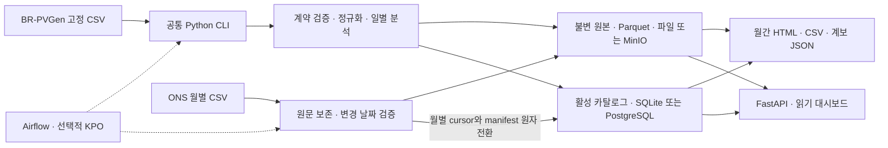

# SolarOps Audit

**공개 태양광 데이터를 검증하고, 실패·정정·재처리 이후에도 보고서 숫자를 원본까지 추적하는 배치 데이터 파이프라인.**

관측 슬롯이 모두 있어도 값이 모두 유효한 것은 아닙니다. SolarOps는 무효·누락·원본 보간을 구분하고, 검증한 결과만 게시하며, 실패하면 이전 결과를 유지합니다. Python 공통 CLI를 로컬, Docker, Airflow의 Kubernetes 작업 Pod에서 사용합니다.

**무엇을 하나요**

- **검증·계산:** 브라질 공개 BR-PVGen 51개 발전소 자료를 계약 검증·정규화하고, 일별 추정 발전량과 품질(관측·유효·누락·무효·원본 보간)을 함께 계산합니다.
- **안전한 게시:** 검증을 통과한 일별 결과만 원자적으로 게시합니다. 게시가 실패하면 이전 결과를 유지하고, 재처리하면 같은 논리 해시로 확인합니다.
- **추적 가능한 보고서:** 월간 보고서(HTML·CSV·계보 JSON)가 발행 당시의 원본 manifest 해시·입력·계산 버전을 보존합니다.
- **같은 코드, 여러 실행 환경:** 로컬, Docker Compose, Airflow + KubernetesPodOperator가 같은 CLI를 호출하고 FastAPI 대시보드로 결과를 조회합니다.

[한 쪽 요약](docs/portfolio/SUBMISSION.md) · [5분 재현](#빠른-실행) · [아키텍처](docs/architecture/system.md) · [설계 사례](docs/portfolio/CASE_STUDY.md) · [검사 CI](https://github.com/TaeyanG4/solarops-audit/actions/workflows/ci.yaml) · [전체 문서](docs/README.md)


*PS_001의 2024년 4월은 관측 슬롯 100%, 유효값 74.9%입니다. 원본 보간 17%는 별도 속성입니다. 화면의 에너지는 계량기 실측 전력량이 아닌 추정값입니다. [원본 확대](docs/portfolio/images/workspace-20261023/overview.png?raw=1) · [1440px 전체 화면](docs/portfolio/images/workspace-20261023/overview-1440.png?raw=1). 이미지는 DPR 2로 촬영했으며 축소 편집하지 않았습니다.*

## 빠른 실행

실행 경로는 세 가지입니다. 아래로 갈수록 미리 설치할 것이 많으며, 보고 싶은 단계까지만 진행하면 됩니다. **1번의 4줄만으로는 Compose·Kubernetes가 뜨지 않습니다.**

| 경로 | 보여주는 것 | 미리 설치할 것 |
|---|---|---|
| 1. Python 데모 | 검증 · 실패 시 이전 결과 보존 · 재처리 해시 일치 · 보고서 | Git, [uv](https://docs.astral.sh/uv/getting-started/installation/) (Python 3.12는 uv가 받을 수 있음) |
| 2. Docker Compose + Airflow | 실제 PostgreSQL · MinIO · 대시보드 · Airflow UI | 1번 + Docker(Windows는 Docker Desktop + WSL2 Ubuntu), WSL/Linux 안의 `make` · `python3` · `uv` |
| 3. Kubernetes (kind) | Airflow가 작업마다 Pod를 만드는 KubernetesPodOperator 실행 | 2번 + [kubectl](https://kubernetes.io/docs/tasks/tools/). kind 0.33.0 · Helm 3.19.0은 스크립트가 체크섬을 확인해 내려받음. 여유 메모리(작으면 Compose를 끄고 진행) |

### 1. Python 데모 (Docker 없음)

```text
git clone https://github.com/TaeyanG4/solarops-audit.git
cd solarops-audit
uv sync --frozen
uv run python scripts/demo/portfolio_demo.py --serve
```

출력되는 `http://127.0.0.1:8503/`을 **명령을 실행한 PC**에서 엽니다. 공개 원본 다운로드 없이 합성 7일 자료로 다음 흐름을 재현합니다. 최초 의존성 설치에는 네트워크가 필요합니다.

1. 정상 처리와 7개 일별 결과 게시.
2. 커밋 도중 실패 주입, 이전 결과 보존 확인.
3. 재처리 후 논리 해시 일치 확인.
4. 월간 보고서와 `evidence.json` 생성.

Docker를 쓰지 않으므로 컨테이너·볼륨이 없는 PC에서도 재현됩니다. 2026-10-23 새 clone에서 확인: `uv sync --frozen` 후 데모 3.2초, 이전 결과 보존·재처리 해시 일치 모두 `true`. 서버는 **Ctrl+C**로 종료하고, 서버 없이 검증하려면 `--serve`를 생략합니다. [시연·결과 확인](docs/portfolio/DEMO_GUIDE.md).

### 2. Docker Compose + Airflow

WSL Ubuntu 또는 Linux 셸에서 저장소 루트로 이동해 실행합니다.

```bash
make install          # Linux용 가상환경(.venv-linux)
make up-local         # .env 비밀값 무작위 생성 → 이미지 빌드 → app-db · minio · dashboard 기동
make demo-services    # 실제 PostgreSQL · MinIO로 합성 데모
make test-services    # 실제 서비스 검사 13개
make airflow-up       # Compose Airflow
make dag-validate     # DAG 불러오기 검사
```

대시보드 `127.0.0.1:8502`, Airflow `127.0.0.1:8080`. 첫 실행은 이미지 빌드 때문에 오래 걸립니다. 특히 MinIO는 공식 이미지 대신 고정 버전 소스를 빌드합니다. `make down-local`은 컨테이너를 **중지**만 하고 볼륨을 지우지 않습니다.

### 3. Kubernetes (kind + Airflow + KPO)

```bash
bash scripts/ops/install-k8s-tools.sh   # kind · Helm 내려받기(체크섬 확인), kubectl 확인
make k8s-bootstrap    # kind 클러스터 생성(kubeconfig는 artifacts/에 보관)
make k8s-deploy       # 이미지를 kind에 로드하고 Airflow를 Helm으로 배포
make k8s-smoke        # DAG를 실행해 KPO 작업 Pod 동작 확인
```

공개 원본 전체(약 350MB 내려받기, 처리 8~16분)와 ONS 수집은 데모에 포함되지 않으며 [수집·처리 명령](docs/guides/data-ingestion.md)으로 별도 실행합니다.

2·3번 절차는 이 프로젝트의 작업 PC(Windows + WSL2 Ubuntu 22.04 + Docker Desktop)에서 실제로 실행·운영했습니다. 아무것도 없는 새 머신에서 처음부터 다시 설치하는 검증은 아직 하지 않았습니다. 자세한 사전 준비·환경 변수·문제 해결은 [설치 안내](docs/guides/setup.md), 켜기·끄기는 [운영 절차](docs/runbooks/operator.md)와 [DAG 운영](docs/runbooks/dags.md)에 있습니다. 외부 공개 데모 사이트는 운영하지 않습니다.

## 데이터와 숫자의 의미

| 자료 | 출처·실제 범위 | 사용 방식 |
|---|---|---|
| BR-PVGen V.1 | [Zenodo 원문·파일](https://zenodo.org/records/21511487), DOI [10.5281/zenodo.21511487](https://doi.org/10.5281/zenodo.21511487), CC BY 4.0. 브라질 51개 발전소의 2024-03-26~2025-06-09 자료; 발전소별 기간은 다름 | 고정 배포 CSV를 명시적으로 다운로드·재처리. 원본이 15분 집계·일부 보간된 자료 |
| ONS 발전 자료 | [브라질 전력계통 운영기관 ONS](https://dados.ons.org.br/dataset/geracao-usina-2), 월별 갱신 CSV, CC BY(버전 미명시) | 이전·현재 월을 조건부 HTTP GET. 변경 날짜와 성공 cursor를 원자 게시 |
| 합성 DEMO_01 | [저장소의 생성기](src/solarops/fixtures.py) | 작은 오프라인 데모·실패 주입·회귀 검사. 실제 발전 실적으로 해석하지 않음 |

BR-PVGen 제작자는 Caian Dutra de Jesus, Rhuan Nascimento Ferreira, Eduardo Pestana de Aguiar(UFJF)입니다. [출처·인용·파일별 다운로드](docs/data-sources.md)에서 메타데이터, 인버터, 기상 파일을 구별할 수 있습니다.

- **추정 kWh:** 유효한 15분 전력에 `W ÷ 1000 × 0.25 h`를 적용합니다. 원본 보간·표본 수·추가 필드를 보존합니다. 추정 에너지는 계량기 실측 전력량·매출·확정 손실이 아닙니다.
- **품질 분모:** 인버터별 원본 관측 범위와 요청 날짜의 교집합입니다. 관측·유효·누락·무효·보간을 각각 표시하며, 확인되지 않은 설비 가동기간을 추정해 채우지 않습니다.
- **ONS:** 단위 MWmed와 원문 시각, 검증/예측/미확정 유형을 보존합니다. 공식 사전의 시간대·구간 기준이 불명확해 `ts_utc=null`로 두고 기존 kWh에 합산하지 않습니다.
- **기간과 환경:** 전체 자료는 51개 발전소지만 2024년 4월 화면에는 해당 월 자료가 있는 5개가 나옵니다. Compose·kind·네이티브 저장소는 독립이며 자동 동기화하지 않습니다.

[계산·품질 계약](docs/data-contract.md) · [ONS 계약과 API](docs/ons-source-contract.md) · [주기·새 데이터 추가](docs/guides/data-ingestion.md). ONS 일정은 매일 05:00 UTC / 14:00 KST로 구성했습니다. 실제 활성 상태는 운영 기록을 확인하며, 화면 새로고침은 저장된 결과 조회입니다.

## 설계와 기술 선택



| 기술 | 선택 이유와 역할 |
|---|---|
| Python 3.12 · uv | 처리·CLI·검사를 통합하고 앱 의존성을 잠금 |
| DuckDB · Arrow/Parquet | 외부 정렬과 제한된 배치, 명시 스키마·열 형식 저장. 전체 CSV를 한 번에 Python 메모리에 적재하지 않음 |
| PostgreSQL · SQLAlchemy | 활성 결과·계보의 트랜잭션과 동시 게시 제어. SQLite는 서버 없는 재현 경로 |
| MinIO · S3 API | 원본·산출물의 바이트 저장. 파일 저장소와 같은 인터페이스, 실제 서비스 검사 별도 제공 |
| Airflow · Docker · KubernetesPodOperator | 일정·재시도·백필·실행 이력과 작업별 자원 격리. 핵심 계산은 공통 CLI에 유지 |
| FastAPI · HTML/CSS/JS · Jinja2 | 읽기 API·대시보드·독립 HTML 보고서를 같은 패키지로 전달 |
| pytest · Ruff · GitHub Actions | 계약·실패·동시성·조직 격리 검사, Windows/Ubuntu 재현·패키징 |

객체 업로드와 DB는 분산 트랜잭션으로 묶지 않습니다. 객체를 먼저 저장하고 검증한 뒤 활성 포인터를 바꿉니다. 실패한 객체는 게시되지 않은 증거로 남습니다. BR-PVGen은 일별 원자성, ONS는 월별 성공 cursor와 변경 날짜의 원자성을 보장합니다.

Airflow는 LocalExecutor로 동작하고 KPO가 작업 Pod를 만듭니다. KubernetesExecutor와 구분합니다. 배치 요구와 현재 처리 규모에서 Kafka/Spark 도입 비용을 정당화하지 못해 사용하지 않았습니다. 로컬 관리 서버는 분석 앱과 분리하고 대시보드 컨테이너에 Docker 소켓을 주지 않습니다.

[환경별 아키텍처·게시 경계](docs/architecture/system.md) · [버전·대안·비용·재검토 조건](docs/architecture/technology-stack.md) · [설계 결정 ADR](docs/README.md#설계-결정-기록).

## 실행 구성 요소와 컨테이너 역할

같은 Python CLI(`solarops`)와 같은 이미지를 세 환경에서 씁니다. Compose와 kind는 DB·MinIO·Airflow를 **각자 따로** 가지며 자료를 자동 동기화하지 않습니다. [환경별 아키텍처](docs/architecture/system.md) · [켜기·끄기](docs/runbooks/operator.md).

**Docker Compose** (Docker Desktop에 `solarops-audit-*`로 보임)

| 컨테이너 | 이미지 | 역할 |
|---|---|---|
| `solarops-audit-app-db-1` | `postgres:16.10` | 활성 카탈로그 DB: 게시된 일별 결과의 포인터·계보·실행 이력·보고서 목록 |
| `solarops-audit-minio-1` | `solarops-minio` | S3 API 객체 저장소: 원본 CSV·Parquet·시계열·보고서 파일과 SHA-256 |
| `solarops-audit-dashboard-1` | `solarops-worker` | FastAPI 대시보드·읽기 API `127.0.0.1:8502` (읽기 전용) |
| `solarops-audit-worker-run-*` | `solarops-worker` | `docker compose run worker …`로 CLI 작업을 한 번 실행할 때 생기는 일회성 컨테이너 |
| `solarops-audit-airflow-db/init/api/scheduler/dag-processor` | `postgres` · `solarops-airflow` | Compose 쪽 Airflow(선택, `make airflow-up`). Airflow 상태 DB, 초기화, UI(8080), 일정 실행, DAG 읽기 |

**Kubernetes (kind)** — Docker Desktop에는 노드 컨테이너 `solarops-control-plane` **하나**만 보이고, 그 안에서 `solarops` 네임스페이스의 Pod 6개가 돕니다.

| Pod | 정의 위치 | 역할 |
|---|---|---|
| `airflow-api-server` | [Helm 값](infra/helm/airflow-values.yaml) (Airflow 차트 1.22.0) | Airflow 웹 UI와 REST API |
| `airflow-scheduler` | Helm | 일정에 맞춰 DAG 실행을 결정하고 LocalExecutor로 태스크를 시작. 태스크가 KPO로 작업 Pod를 만듦. 로그 정리 보조 컨테이너 포함 2개 컨테이너 |
| `airflow-dag-processor` | Helm | `dags/` 파일을 읽어 DAG 목록과 구조를 갱신. 보조 컨테이너 포함 |
| `airflow-db` | [`infra/k8s/services.yaml`](infra/k8s/services.yaml) | Airflow 메타데이터 PostgreSQL(실행 이력·상태·재시도 기록) |
| `app-db` | `infra/k8s/services.yaml` | kind 쪽 SolarOps 카탈로그 PostgreSQL (Compose의 app-db와 별개) |
| `minio` | `infra/k8s/services.yaml` | kind 쪽 S3 객체 저장소 (Compose의 MinIO와 별개) |
| 작업 Pod (일시적) | [`dags/solarops_factory.py`](dags/solarops_factory.py)의 KubernetesPodOperator | 태스크 1개 = Pod 1개. `solarops-worker` 이미지로 CLI를 실행하고 종료. 조사용으로 완료 Pod를 남김 |

Redis·Celery·StatsD·Triggerer·Flower는 쓰지 않습니다(LocalExecutor). kind의 DB·MinIO·ONS 수집 자료는 노드 컨테이너의 볼륨에 있으므로 **`solarops-control-plane`을 지우면 kind 자료가 사라집니다.** 관리 서버 `127.0.0.1:8504`(`scripts/ops/admin.ps1`)와 랜딩 `127.0.0.1:8507`은 컨테이너가 아닌 PC의 Python 프로세스입니다.

**검증용 임시 컨테이너** — 실제 PostgreSQL/MinIO로 검사할 때마다 새 이름으로 만들고 중지만 해 두는 컨테이너입니다. 시스템 동작에는 필요 없으며, 2026-10-23에 그때까지 쌓인 74개와 옛 버전 이미지 41개·빌드 캐시를 정리했습니다. 검사를 다시 실행하면 같은 이름 패턴으로 다시 생깁니다.

| 이름 패턴 | 만든 곳 | 용도 |
|---|---|---|
| `solarops-ci-pg-*`, `solarops-ci-s3-*` | [`.github/workflows/services.yaml`](.github/workflows/services.yaml) | 실제 서비스 CI 검사 |
| `solarops-restore-pg-*`, `solarops-restore-s3-*` | [`scripts/validation/service_restore_drill.py`](scripts/validation/service_restore_drill.py) | 별도 DB·버킷 백업/복원 시험 |
| `solarops-quality-pg-*`, `solarops-quality-s3-*` | 독립 평가·릴리스 때 실행한 서비스 검사 도우미(Git 제외 `artifacts/`) | 격리된 PostgreSQL/MinIO 13개 검사, 실행마다 한 쌍 |
| `solarops-integrity-*`, `-incremental-*`, `-load-*`, `-release*`, `-dagcheck*`, `-dags*`, `-dag-*`, `-ons-050*`, `-portfolio-*`, `-migrate-050`, `-airflow-lock*`, `-*pinned*` | 과거 버전 검증 명령(일부 도우미는 Git 제외 `artifacts/`) | 게시 무결성·ONS 증분·동시 조회 부하·릴리스 비교·DAG 점검·미리보기·이미지 고정 확인 |

정리할 때는 위 Compose·kind 구성(특히 `solarops-control-plane`과 `solarops-audit_*` 볼륨)을 제외하고 검증용 컨테이너만 지웁니다. 필요한 이미지는 `solarops-worker`·`solarops-airflow`(현재 버전), `solarops-minio:2025-10-15-pinned`, `postgres:16.10-bookworm`, `kindest/node:v1.35.0` 5개입니다. 지워도 빠른 실행의 데모와 테스트는 그대로 재현됩니다.

## 실행 근거와 한계

최신 릴리스는 **v0.5.7 · energy-interval-v2**이며 Compose 대시보드와 kind Airflow/KPO에 배포했습니다. 보고서와 overview가 같은 지표 필수 필드 계약을 쓰고, 보간이 전부 불명인 날은 0%가 아닌 null로 표시합니다. [최신 검증·배포](docs/benchmarks/quality-v0.5.7.md) · [재계산 가능한 성능 표본](docs/benchmarks/evidence/technical-20261023/README.md)과 [v0.5.3의 정상 입력 동등성·비용](docs/benchmarks/quality-v0.5.3.md)을 구분해 기록했습니다. 실제 배포·독립 재평가 상태는 [handoff](handoff.md)를 확인하세요.

| 확인한 항목 | 결과 | 범위와 근거 |
|---|---|---|
| v0.5.7 릴리스 검사·배포 | 오프라인 142통과·14제외, 실제 PostgreSQL/MinIO 13통과, Compose 배포 전후 응답 비교, kind 3개 rollout·6개 Pod Ready | 단일 로컬 호스트. 새 scheduled KPO·성능 재측정은 미실행. [검사·배포](docs/benchmarks/quality-v0.5.7.md) |
| 공개 역사 자료 처리 | 51개 발전소, 인버터 14,400,480행, 일별 파티션 12,572개 | 과거 전체 처리 근거이며 매 커밋마다 전체를 재실행한 수치가 아님. [스택·자료 실사](docs/benchmarks/stack-authenticity-20261023.md) |
| 실제 ONS 정기 수집 | kind 9~10월 태양광 167,424행·51일, 실제 scheduled KPO 성공. Compose 재확인 변경 0일 | 두 환경 저장소는 독립. [명령·원본 SHA·수집 결과](docs/benchmarks/incremental-v0.5.0.md) |
| 공개 일별 KPO 병렬 비교 | 동일 4일, 직렬 36.675초 → 동시 2개 19.339초. 결과 hash 4개 동일, CPU 합 24.3% 증가 | 단일 kind 호스트, 직렬 후 병렬 각 1회, 기동·캐시 영향 포함. 하나의 4일 CLI 배치와 비교하지 않음. [조건·기계 판독 결과](docs/benchmarks/incremental-v0.5.0.json) |
| 실패·재현·최종 화면 | v0.5.1 기준 양 OS 각각 137통과·13제외, 격리 합성 7일 복구·보고서·종료, 1440/768/390px 확인 | 해당 버전의 과거 근거. [검증 기록](docs/benchmarks/portfolio-finish-20261023.md) · [CI](https://github.com/TaeyanG4/solarops-audit/actions/runs/39915517455) |

고정 20항목 [루브릭](docs/reviews/portfolio-rubric.md)으로 코드·실행 근거·문서를 독립 평가했습니다(면접·개인 역량 제외). 최근 결과는 [R5](docs/reviews/2026-10-23-artifact-r5.md) Astra 96 / Fable 94, [R6](docs/reviews/2026-10-23-artifact-r6.md) Fable 91이며, R6 지적 5건은 v0.5.7에서 보완했습니다. 반복 평가는 2026-10-23 사용자 요청으로 종료했습니다. 점수는 품질 보증이 아니며 원문·실행 검사·한계를 함께 보존합니다. [최신 검사 CI](https://github.com/TaeyanG4/solarops-audit/actions/workflows/ci.yaml).

실제 PostgreSQL/MinIO, 복구·동시 조회, 모바일 접근성, 버전별 무결성 등 상세 증거는 [문서 목차](docs/README.md)에 모았습니다. 단일 호스트 kind는 고가용성 근거가 아니며 일회 비교는 일반적인 처리량·확장성을 입증하지 않습니다. 자동 접근성 검사 통과도 실제 보조공학 검사나 인증을 대체하지 않습니다.

## 화면과 개발 도구

전체 현황·발전소·데이터 품질·월간 보고서·실행 이력·데이터 출처를 기능별 사이드바로 묶었습니다. 보고서는 생성 당시 자료의 스냅샷이며 현재 게시 결과와 비교할 수 있습니다. 이전 보고서를 새 값으로 덮어쓰지 않습니다.

제품 소개용 정적 [랜딩페이지](landing/README.md)는 저장된 공개 집계로 만든 데모 화면을 담으며 대시보드와 별도로 실행합니다. 백엔드에 연결하지 않습니다. [화면 검수](landing/QA.md).

<details>
<summary>월간 보고서 화면과 사용한 개발 스킬</summary>


[보고서 확대](docs/portfolio/images/workspace-20261023/report.png?raw=1) · [ONS 수집 상태 화면](docs/portfolio/images/portfolio-finish-20261023/ons-readme.png?raw=1) · [1440/768/390px 검증](docs/benchmarks/workspace-20261023.md) · [화면 사용법](docs/runbooks/operator.md).

| 사용한 스킬 | 실제 목적 |
|---|---|
| [UI UX Pro Max](https://github.com/nextlevelbuilder/ui-ux-pro-max-skill) | 정보 위계·색·타이포그래피·차트·반응형 디자인 시스템 |
| [Impeccable](https://github.com/pbakaus/impeccable) | 가독성·상태 표현·접근성 검수와 수정 |
| [Agent Browser](https://github.com/vercel-labs/agent-browser) | 실제 화면·키보드·선택창·오류 경로·세 너비 검증 |
| [Web Design Guidelines](https://github.com/vercel-labs/agent-skills) | 링크·폼·주소 상태·포커스·웹 사용성 검사 |

AI 도구의 사용 범위·버전·채택하지 않은 제안은 [스킬 기록](docs/development/skills.md)에 공개했습니다. 스킬은 개발 도구이며 제품 실행 의존성이 아닙니다.

</details>

## 범위와 기록

**프로젝트 상태:** 2026-10-23에 v0.5.7로 마무리했습니다. 실행 가능한 미완료 작업은 없고, 고객 검증(BIZ-01)은 보류입니다. 작업 PC의 로컬 서비스(대시보드·kind·랜딩)는 데이터를 보존한 채 중지되어 있으며, 다시 켜는 방법은 [handoff](handoff.md)와 [운영 절차](docs/runbooks/operator.md)에 있습니다.

검증 대상은 로컬 엔지니어링 포트폴리오입니다. 고객 계약·매출·현장 고장 정답·고객 인증·외부 SLO·다른 물리 호스트의 재해복구는 미검증입니다. 저출력은 검토 후보이며 확정 고장이나 손실이 아닙니다. [현재 구현 상태](docs/IMPLEMENTATION_STATUS.md).

라이선스: 저장소는 공개되어 있지만 코드에는 아직 라이선스 파일이 없어, 열람은 가능해도 재사용·수정·배포 권한은 부여되지 않습니다. 데이터는 BR-PVGen CC BY 4.0·ONS CC BY 조건을 따르고, 글꼴 Pretendard는 [SIL OFL 1.1](src/solarops/api/static/fonts/OFL.txt)입니다.

```text
src/solarops/       CLI · 수집 · 분석 · 저장 · 보고서 · API
tests/             데이터 계약 · 재처리 · 게시 · 보안 · 패키징
dags/ / infra/     Airflow · Docker/Compose · kind/Helm
scripts/           데모 · 운영 · 검증 · 데이터 · 릴리스
landing/           제품 소개 정적 페이지(저장된 공개 집계 데모)
docs/              출처 · 설계 · 운영 · 증거 · 날짜별 작업 기록
plan.md            미완료 항목의 점수·의존성
handoff.md         현재 상태와 다음 행동, 100줄 이하
data/, artifacts/  로컬 데이터·검사 산출물, Git 제외
```

[개발 안내](CONTRIBUTING.md) · [스크립트 목록](scripts/README.md) · [변경 이력](CHANGELOG.md) · [날짜별 작업 기록](docs/worklog/README.md).
