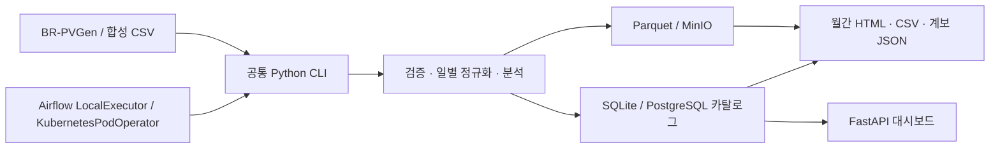

# SolarOps Audit

[](https://github.com/TaeyanG4/solarops-audit/actions/workflows/ci.yaml)

태양광 운영 자료의 **누락·무효값·원본의 보간 여부를 구분**하고, 입력 파일까지 추적할 수 있는 월간 HTML/CSV 보고서를 만드는 Python 프로젝트입니다. 공개 BR-PVGen 역사 데이터와 합성 데모를 지원합니다.

## 주요 기능

- 공개 자료의 checksum 확인, 안전한 압축 해제, 원본·추가 컬럼·표본 수 보존
- 발전소/날짜별 Parquet 정규화, 중복 충돌 차단, 입력 버전 및 처리 계보 관리
- 15분 전력으로 추정한 에너지, 품질 지표, 저출력 검토 후보와 월간 보고서
- 동일 입력 재처리 시 논리 해시 일치, 실패 시 이전 활성 파티션 유지
- 읽기 전용 한국어 대시보드/API, PostgreSQL·MinIO, Airflow·Kubernetes 실행



실제 발전량 계량·고장 확정·금전 손실 산정 제품이 아닙니다. 실제 고객 인터뷰·데이터 사용 계약·결제는 수행되지 않았습니다.

## 빠른 실행

[Python 3.12](https://www.python.org/downloads/)와 [uv](https://docs.astral.sh/uv/getting-started/installation/), Git이 필요합니다. Windows PowerShell, macOS/Linux 셸에서:

```text
git clone https://github.com/TaeyanG4/solarops-audit.git
cd solarops-audit
uv sync --frozen
uv run solarops doctor
uv run solarops demo
uv run solarops serve
```

[대시보드](http://127.0.0.1:8501) · [API 문서](http://127.0.0.1:8501/docs)

기본 데모는 네트워크나 Docker 없이 합성 데이터 1주를 처리합니다. `data/`에 SQLite 카탈로그, 원본, Parquet, 보고서를 보존합니다. 실행 후 출력되는 `report.html`, `metrics.csv`, `manifest.json`은 브라우저·Excel·JSON 도구에서 볼 수 있습니다.

## WSL2 / Ubuntu

```bash
make install
make doctor
make lint
make test
make demo-sample
make serve
```

Make는 Windows용 `.venv`와 다른 `.venv-linux`를 사용하고, 로컬 DB도 `data/linux-native`로 분리합니다. Windows와 WSL에서 같은 SQLite WAL 파일을 동시에 열지 마세요. Make 명령에는 `make`와 uv가 필요합니다. 인프라 실행에는 Docker Compose가 추가로 필요하며, WSL에서는 Linux 파일시스템의 별도 checkout을 권장합니다.

## PostgreSQL · MinIO · Airflow

Docker Desktop의 Linux 엔진을 실행하고 WSL에서:

```bash
make up-local
make demo-services
make test-services
make airflow-up
make dag-validate
```

- 제품 대시보드: [127.0.0.1:8502](http://127.0.0.1:8502)
- Airflow: [127.0.0.1:8080](http://127.0.0.1:8080)
- 앱 PostgreSQL: localhost:55432. Airflow DB는 별도 컨테이너/계정/볼륨.
- MinIO API: localhost:59000. 암호는 `scripts/bootstrap.py`가 `.env`에 무작위 생성합니다.
- 로컬 UI는 인증 없는 개발용입니다. 모든 호스트 포트는 127.0.0.1에만 바인딩합니다.
- `make down-local`은 컨테이너를 **중지**하며 볼륨을 삭제하지 않습니다.

MinIO 공식 공개 이미지/바이너리 배포가 이 환경에서 접근 불가하여, 공식 저장소의 `RELEASE.2025-10-15T17-29-55Z` 소스를 빌드합니다. 첫 빌드는 Go 의존성 다운로드 때문에 시간이 걸립니다. MinIO는 AGPLv3입니다.

## 공개 자료 처리

설치/테스트에서는 공개 자료를 다운로드하지 않습니다. 아래 명령으로만 내려받습니다.

```bash
make download-metadata
make download-full
uv run solarops ingest \
  --metadata data/source/BR-PVGen_metadata.csv \
  --inverter data/source/inverter/BR-PVGen_inverter/PS_001.csv \
  --station data/source/station/BR-PVGen_meteorological/PS_001.csv \
  --plant PS_001 --from 2024-04-01 --to 2024-04-08 \
  --source-version brpvgen-v1 --source-kind public
uv run solarops report --period 2024-04 --plant PS_001 --source-kind public
```

`--from` 포함, `--to` 미포함입니다. 기간은 보고서 시간대의 날짜이며 기본 UTC입니다. `SOLAROPS_REPORT_TIMEZONE=Asia/Seoul`처럼 명시적으로 변경할 수 있습니다. 브라질 자료를 임의로 한국 시각으로 해석하지 않습니다.

51개 전체 처리: `uv run python scripts/full_dataset.py`. PostgreSQL/MinIO 전체 처리: `uv run python scripts/full_dataset.py --services`. 이미 다운로드한 파일의 checksum이 다르면 덮어쓰지 않습니다. 수정한 입력은 새 `--source-version`을 지정해야 합니다.

## Kubernetes

Compose와 별도 DB/MinIO를 갖는 로컬 kind 클러스터입니다. 작은 메모리 환경에서는 Compose를 중지하고 진행하세요.

```bash
bash scripts/install-k8s-tools.sh
make k8s-bootstrap
make k8s-deploy
make k8s-smoke
export KUBECONFIG="$PWD/artifacts/kubeconfig"
kubectl get pods -n solarops
```

kind 0.33.0, Kubernetes 1.35.0, Helm 3.19.0, Airflow chart 1.22.0, Airflow 3.3.2, KPO provider 10.24.0을 사용합니다. CLI 실행 Pod는 root 권한 없이 실행되며 CPU/RAM 한도가 있습니다. 스케줄러 LocalExecutor와 KubernetesPodOperator의 역할이 분리되어 있습니다.

도구 경로는 `.tools/kind`, `.tools/linux-amd64/helm` 또는 PATH를 사용합니다. Kubeconfig는 이 프로젝트의 `artifacts/kubeconfig`에 보관합니다. 클러스터·볼륨 삭제 명령은 자동 실행하지 않습니다.

## 테스트와 검증

```text
uv run ruff check src tests scripts dags
uv run ruff format --check src tests scripts dags
uv run pytest -q
```

[GitHub Actions](https://github.com/TaeyanG4/solarops-audit/actions/workflows/ci.yaml)는 push/PR마다 잠긴 의존성 설치, lint, 오프라인 테스트, 합성 데모, lockfile 일치를 검사합니다. 공개 데이터 다운로드와 Docker/kind 검증은 별도 실행합니다.

2026-10-22 실행 결과와 범위는 [검증 보고서](docs/benchmarks/2026-10-22.md)에 기록합니다.

- 오프라인 계약/단위/통합 검사 41개 통과, PostgreSQL·MinIO 통합 검사 별도 통과.
- 공개 51개 발전소 14,400,480행, 12,572개 일별 파티션 처리.
- 동일 입력 3회 재실행 해시 일치, 버전 충돌 차단, 트랜잭션 실패 시 기존 결과 유지.
- Compose와 kind에서 4개 DAG 실제 실행 및 재시도/백필 검증.
- Kubernetes 작업 프로세스 강제 종료 후 Airflow 재시도 성공.
- 동일한 합성 4일 자료를 1/2/4 Pod로 실행, 결과 해시 일치.

위 수치는 같은 구현 세션의 자체 검증입니다. 실행 환경, 측정 한계, 명령과 증거 위치는 검증 보고서를 참고하세요.

## 문서와 구조

- [데이터 계약](docs/data-contract.md), [운영 안내](docs/runbooks/operator.md), [DAG/백필](docs/runbooks/dags.md), [복구](docs/runbooks/recovery.md)
- [설계 결정](docs/adr/0001-data-processing.md), [파일럿 준비](docs/market/pilot.md)
- [구현 상태와 남은 범위](docs/IMPLEMENTATION_STATUS.md)
- `src/solarops/`: 수집, 정규화, 분석, 저장, 보고서, API, 공통 CLI
- `dags/`, `infra/`, `scripts/`, `migrations/`, `tests/`
- 원본 기획 ZIP 내용은 `docs/plan/`에 보존했습니다. 그 안의 예시 프롬프트는 이번 사용자 요청과 구별합니다.

## 운영 범위

로컬 개발/검증용입니다. 고객 인증, 고객 CSV 업로드, 외부 알림, 결제, 원격 설비 제어는 구현하지 않았습니다. 보고서는 생성 시점의 스냅샷이므로 새 데이터를 처리한 뒤 다시 생성해야 합니다. `.env`, 원본 데이터, 실행 로그, 생성된 비밀 설정은 Git에서 제외합니다.

다음 개발 범위는 공개 자료의 Airflow 재처리, 실행 관측성 개선, 승인된 고객 스키마 어댑터입니다. 고객 자료 연결과 사업 검증은 별도 승인이 필요합니다.

## 출처

De Jesus, C. D., Ferreira, R. N., & de Aguiar, E. P. (2026). **BR-PVGen — The Brazilian Photovoltaic Generation Dataset**. [Zenodo / DOI 10.5281/zenodo.21511487](https://doi.org/10.5281/zenodo.21511487), CC BY 4.0. 연관 논문: 동일 저자·제목, *IEEE Access* (원본 README 기준 in press; 논문 DOI는 미기재).

이 프로젝트의 변경: UTC 정규화, 중복 검사, 품질 구분, 15분 전력의 에너지 근사, 검토 후보 규칙과 보고서. 공개 원본도 Git에 포함하지 않습니다. 고객 업로드/메일/결제/원격 설비 제어는 구현 범위 밖입니다.
