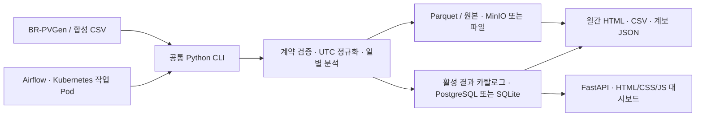

# SolarOps Audit

[CI 검사 — Windows · Ubuntu](https://github.com/TaeyanG4/solarops-audit/actions/workflows/ci.yaml)

**태양광 운영 데이터를 검증하고, 보고서 숫자를 원본까지 추적하는 데이터 엔지니어링 프로젝트.**

브라질 공개 발전소 자료와 합성 데모를 수집해 일별 Parquet·품질 지표·월간 보고서·읽기 전용 대시보드로 제공합니다. 데이터가 빠지거나 잘못됐을 때의 표시, 같은 자료를 다시 처리했을 때의 일관성, 작업 실패 후 이전 결과 보존까지 구현했습니다.

**현재 화면:** 분석·감사 자료·관리로 묶은 사이드바, 본문 16px·보조 14px, 공통 월/목록 선택창을 적용했습니다. 월간 보고서는 화면 안의 iframe 없이 본문에서 바로 읽습니다. [화면·전후 비교](docs/benchmarks/workspace-20261023.md).

**최근 수정:** 실행 이력에 발전소 ID 조회·필터 초기화를 추가하고, 상태·페이지·선택한 상세를 주소에 보존했습니다. 새로고침·뒤로 가기 후에도 조사 위치를 복원하고 상위 작업과 일별 파티션을 오갈 수 있습니다. [화면·검증 기록](docs/worklog/2026-10-23-run-navigation.md) · [다음 개선 우선순위](plan.md). 열린 목록의 스크롤 정렬은 [이전 수정](docs/benchmarks/select-anchor-20261023.md)에 있습니다.

**데이터 출처:** [BR-PVGen / Zenodo](https://zenodo.org/records/21511487) · 브라질 51개 발전소의 공개 역사 자료 · CC BY 4.0. 합성 데모는 별도로 표시하며 화면의 발전량은 추정치입니다.

**실제로 작동하는가?** 2026-10-23 실행 서비스·DB·객체를 직접 점검했습니다. 원본 4개는 Zenodo 게시 체크섬과 일치하고, 대표 하루의 독립 계산값이 DB·API·보고서·Kubernetes 결과와 일치합니다. Airflow/KPO 실행 이력도 확인했으며, 합성 장애 시험과 공개 데이터 처리를 구분합니다. [기술스택·데이터 실사와 한계](docs/benchmarks/stack-authenticity-20261023.md).

[빠른 실행](#빠른-실행) · [데이터 출처](#어떤-데이터를-사용하는가) · [기술 선택](#구조와-기술-선택) · [사용 스킬](#개발에-사용한-ai-스킬) · [검증 근거](#검증한-범위) · [전체 문서](docs/README.md)


*실제 화면을 820 CSS px·DPR 2로 렌더링해 크롭했습니다. 이미지를 축소 편집하거나 글자를 샤프닝하지 않았습니다. [원본 크게 보기](docs/portfolio/images/workspace-20261023/overview.png?raw=1) · [사이드바를 포함한 1440px 화면](docs/portfolio/images/workspace-20261023/overview-1440.png?raw=1) · [반응형 비교](docs/benchmarks/workspace-20261023.md).*

## 어떤 문제를 해결하는가

“관측률 100%”인 데이터에도 NULL·무효 전력·원본 보간이 섞일 수 있습니다. 결과가 그럴듯하게 보여도 어떤 값을 제외했는지, 어느 원본에서 계산했는지, 실패한 작업이 기존 보고서에 영향을 줬는지를 설명할 수 있어야 합니다.

| 운영 중 확인할 질문 | SolarOps의 처리 |
|---|---|
| 자료가 모두 정상인가? | 관측 슬롯·유효값·무효값·누락을 구분하고 원본 보간 여부를 별도로 표시 |
| 이 숫자는 어디에서 왔는가? | 원본 SHA-256, 입력 버전, 계산 버전, 일별 파티션과 보고서 계보 연결 |
| 같은 입력을 다시 처리해도 같은가? | 실행 시각·실행 ID를 제외한 논리 해시로 결과 비교, 같은 버전의 다른 입력은 거부 |
| 처리 도중 실패하면? | 검증된 일별 결과만 활성화. 실패한 날짜의 이전 결과 유지, 원인과 하위 파티션 조회 |
| 로컬과 서비스 환경이 다른가? | 공통 CLI와 저장소 인터페이스, SQLite/파일 및 PostgreSQL/MinIO 결과 비교 |

**실제 예:** 공개 자료 PS_001의 2024년 4월 관측 슬롯 완전성은 100%지만 유효값 비율은 74.9%입니다. 무효 슬롯 28,146개를 분리하고, 추정 발전량 585.98 MWh와 원본 보간 표시 17%를 함께 보여줍니다. 보간은 유효·무효 분류와 겹칠 수 있는 속성입니다.

## 어떤 데이터를 사용하는가

**실측 기반 공개 원천은 [BR-PVGen — 브라질 태양광 발전 데이터셋](https://zenodo.org/records/21511487)입니다.** SolarOps가 직접 수집한 고객 자료가 아닙니다. 원본 제작자가 15분 집계와 일부 보간을 수행한 역사 자료입니다.

| 구분 | 출처와 범위 | 프로젝트에서의 용도 |
|---|---|---|
| 공개 자료 (`public`) | 브라질 51개 발전소, 2024-03-26~2025-06-09, 15분 간격. 발전소별 수록 기간은 다름 | 실제 CSV 계약 검증, 전체 처리, 품질 분석과 공개 자료 시연 |
| 합성 데모 (`synthetic`) | [프로젝트 생성기](src/solarops/fixtures.py)의 DEMO_01, 기본 1주 | Docker 없는 시연, 누락·무효·실패 주입·재처리 검사 |
| 화면의 “전체” | 공개와 합성 자료를 함께 조회 | 편의 필터. 실제 발전소 수나 공개 데이터 실적으로 합산해 해석하지 않음 |

- **제작자:** Caian Dutra de Jesus, Rhuan Nascimento Ferreira, Eduardo Pestana de Aguiar — 브라질 UFJF.
- **배포:** Zenodo V.1 · DOI [10.5281/zenodo.21511487](https://doi.org/10.5281/zenodo.21511487) · [CC BY 4.0](https://creativecommons.org/licenses/by/4.0/).
- **원본 구성:** [발전소 메타데이터](https://zenodo.org/records/21511487/files/BR-PVGen_metadata.csv?download=1) / [인버터 ZIP 약 294 MB](https://zenodo.org/records/21511487/files/BR-PVGen_inverter.zip?download=1) / [기상 ZIP 약 57 MB](https://zenodo.org/records/21511487/files/BR-PVGen_meteorological.zip?download=1) / [원문 설명](https://zenodo.org/records/21511487/files/Readme.txt?download=1).

전체 인버터 14,400,480행과 발전소 51개는 **전체 기간** 기준입니다. 위 2024년 4월 화면은 해당 월에 자료가 있는 **5개**만 표시합니다. 원본의 NULL·보간 표시·집계 표본 수를 보존하며, 유효한 전력에 `W ÷ 1000 × 0.25 h`를 적용한 값을 **추정 에너지**로 표시합니다. 계량기 실측 전력량·매출·확정 손실을 뜻하지 않습니다.

[출처·파일별 역할·인용·다운로드](docs/data-sources.md) · [실제 스키마·품질·계산 계약](docs/data-contract.md)

## 화면에서 확인할 수 있는 것

| 화면 | 할 수 있는 일 |
|---|---|
| 전체 현황 | 추정 에너지·품질, 부분 기간/무효/누락 필터, 날짜 탐색과 수치표 |
| 발전소 | 월별 비교와 개별 15분 전력·일사량 관측. 빈값·판단 불가·검토 후보 구분 |
| 데이터 품질 | 유효·무효·누락 분류와 별도 원본 보간, 발전소별 비교 |
| 월간 보고서 | 본문에서 요약·품질·일별 내역·계보 조회, CSV/JSON 및 별도 인쇄용 HTML |
| 실행 이력 | 발전소·상태별 조회, 주소로 조사 위치 복원, 작업↔일별 파티션·실패 원인·입력 버전 추적 |
| 데이터 출처 | BR-PVGen 원문·라이선스·파일별 역할, 공개/합성 자료의 차이 |
| 시스템 관리 | 사이드바에서 독립 관리 서버로 바로 이동. 서비스 제어 / 컨테이너 상태 / 운영 안내 탭 |


*PS_001 공개 2024년 4월 보고서. 관측 슬롯 100%와 유효값 74.9%는 다른 지표입니다. 일별 내역은 필요할 때 펼쳐 보고 페이지 전체를 한 번에 스크롤합니다. 기존 보고서 UUID는 보존합니다. [보고서 원본 확대](docs/portfolio/images/workspace-20261023/report.png?raw=1).*

[390px 스크롤 중 열린 목록](docs/portfolio/images/select-anchor-20261023/reports-scrolled-390.png) · [월 선택창](docs/portfolio/images/workspace-20261023/month-picker-mobile.png) · [시스템 관리 탭](docs/portfolio/images/interactions-20261023/admin-services-1440.png) · [관측 차트의 빈 구간](docs/portfolio/images/interactions-20261023/series-768.png) · [5분 시연 순서](docs/portfolio/DEMO_GUIDE.md)

[일별 차트 확대](docs/portfolio/images/workspace-20261023/chart.png?raw=1) · [품질 분류 확대](docs/portfolio/images/workspace-20261023/quality.png?raw=1) · [합성 실패 근거](docs/portfolio/images/readme-hidpi-20261023/run-evidence.png). GitHub가 본문 너비에 맞춰 표시하므로 작은 수치는 원본 링크에서 확대할 수 있습니다.

## 빠른 실행

Python 3.12, [uv](https://docs.astral.sh/uv/getting-started/installation/), Git이 필요합니다. 저장소는 비공개이므로 접근 권한이 있는 계정으로 실행합니다.

```text
git clone https://github.com/TaeyanG4/solarops-audit.git
cd solarops-audit
uv sync --frozen
uv run python scripts/demo/portfolio_demo.py --serve
```

[합성 데모 열기 — localhost:8503](http://127.0.0.1:8503/?view=overview&period=2024-04&source=synthetic). Docker와 공개 데이터 다운로드 없이 **정상 처리 → 커밋 실패 → 이전 결과 보존 → 재처리 해시 일치 → 보고서**를 확인합니다. 실행할 때마다 새 결과 폴더와 `evidence.json`을 만들며, 서버는 해당 터미널에서 **Ctrl+C**로 종료합니다.

이미 구성된 이 작업 PC의 공개 자료 화면은 [localhost:8502](http://127.0.0.1:8502/?view=overview&period=2024-04&source=public)입니다. 외부 공개 사이트가 아니며, 다른 PC에서는 아래 설치 절차로 자료·저장소를 준비해야 합니다.

| 실행 방식 | 필요한 것 | 시작·종료 |
|---|---|---|
| 독립 합성 데모 8503 | Python·uv | 위 명령 / Ctrl+C |
| 기본 네이티브 8501 | Python·uv, `solarops demo`로 생성한 자료 | [설치 안내](docs/guides/setup.md#빠른-실행) / Ctrl+C |
| Compose 대시보드 8502 | Docker, 준비된 PostgreSQL·MinIO·catalog | 아래 3개 서비스 / `stop` |
| 로컬 관리 서버 8504 | Python·uv·Docker CLI, 이미 생성된 SolarOps 컨테이너 | 아래 PowerShell 실행기 또는 `solarops admin` |
| Airflow / Kubernetes | 배치 스케줄·작업 Pod 시연 시 선택 | [DAG 운영](docs/runbooks/dags.md), 대시보드 조회에는 불필요 |

구성이 끝난 환경에서 대시보드와 저장소 켜기/끄기:

```text
docker compose --env-file .env -f infra/compose/compose.yaml up -d app-db minio dashboard
docker compose --env-file .env -f infra/compose/compose.yaml stop dashboard app-db minio
```

`stop`은 데이터 볼륨을 삭제하지 않습니다. 별도로 실행한 네이티브 서버나 Airflow/kind는 각각 관리합니다. [최초 설치·환경 변수·공개 자료 처리](docs/guides/setup.md) · [화면 운영](docs/runbooks/operator.md)

Windows에서 [시스템 관리 화면](http://127.0.0.1:8504/) 켜기·상태 확인·끄기:

```powershell
.\scripts\ops\admin.ps1 start
.\scripts\ops\admin.ps1 status
.\scripts\ops\admin.ps1 stop
```

관리 화면의 **SolarOps 작업 환경 → 시작**은 기본 3개 서비스(DB·MinIO·대시보드)를 켭니다. **중지**는 SolarOps Compose 서비스와 kind를 모두 멈춥니다. 관리 서버(8504)는 다시 켜는 데 필요해 계속 실행되므로, 완전히 종료할 때 마지막 명령도 실행하세요. Docker Desktop 자체와 다른 프로젝트는 제어하지 않습니다. Kubernetes/Airflow는 필요할 때 개별 시작합니다. [정확한 제어 범위와 운영 순서](docs/runbooks/operator.md#시스템-관리-8504).

Docker는 켜져 있지만 8502가 열리지 않으면 컨테이너가 중지됐는지 확인하세요. 기존 컨테이너는 다음 명령으로 다시 켭니다. [접속 오류 확인 순서](docs/runbooks/operator.md#8502가-열리지-않을-때).

```text
docker compose --env-file .env -f infra/compose/compose.yaml start app-db minio dashboard
```

## 구조와 기술 선택



| 기술 | 역할과 선택 이유 |
|---|---|
| Python 3.12 · uv | CLI·처리·검사를 통합하고 잠긴 의존성으로 재현 |
| DuckDB · PyArrow/Parquet | CSV 외부 정렬과 일별 처리를 통해 메모리 경계를 제한, 명시 스키마·압축 저장 |
| SQLAlchemy · SQLite/PostgreSQL | 서버 없는 데모와 서비스 환경을 지원, 일별 활성 결과를 트랜잭션으로 전환 |
| MinIO · S3 API | 원본과 산출물을 작업 간 공유하고 파일 checksum·계보 보존 |
| FastAPI · HTML/CSS/JS | 읽기 중심 UI와 API를 한 패키지로 전달, 별도 프런트엔드 빌드 체인 없이 실행 |
| 별도 로컬 FastAPI 관리 서버 | 분석 앱을 꺼도 다시 시작할 수 있도록 호스트에서 실행. Docker 소켓을 대시보드 컨테이너에 넘기지 않고 고정된 기존 자원만 제어 |
| Airflow · Docker · Kubernetes KPO | 재시도·백필·이력과 작업 자원 격리. 핵심 로직은 같은 CLI 사용 |
| pytest · Ruff · GitHub Actions | 계약·실패·동시성 회귀, Windows/Ubuntu 검사와 패키징 |

[정확한 버전·대안·비용·재검토 조건](docs/architecture/technology-stack.md) · [일별 커밋 경계와 데이터 흐름](docs/architecture/system.md)

## 검증한 범위

| 항목 | 확인한 결과 | 근거 |
|---|---|---|
| 기술스택·자료 실사 | 원본 4개·CSV 102개·공개 계보 103개 해시 대조, 대표 계산 경로 일치, 실제 Airflow/KPO 이력 확인 | [2026-10-23 실사](docs/benchmarks/stack-authenticity-20261023.md) |
| 전체 공개 자료 | 51개 발전소·인버터 14,400,480행·일별 파티션 12,572개, v1/v2 일별 지표·원본 SHA 일치 | [v0.4 검증](docs/benchmarks/reliability-v0.4.0.md) |
| 실패·동시성·복구 | 입력 변경·동시 버전·보고서 역순 완료·파일 누락/변조·격리 복원 | [v0.4.1 검증](docs/benchmarks/integrity-v0.4.1.md) |
| 화면·보고서·관리 | 1440/768/390px, overview 107명령·workspace 195명령, axe 3+23회 위반 0, API 동일 | [최신 UI 검증](docs/benchmarks/workspace-20261023.md) |
| 실행 이력 탐색 | 기존 관련 테스트 5개 통과, 3너비·주소 복원·상하위 이동 확인, 모바일 axe 위반 0건; 영구 테스트 추가 없음 | [변경·검증·한계](docs/worklog/2026-10-23-run-navigation.md) |
| 선택창·관리 탭·관측 차트 | 후속 303명령·axe 18회 위반 0, Python 31통과, 원본 빈값 대조·API 동일 | [상호작용 회귀](docs/benchmarks/interactions-20261023.md) |
| 열린 목록 스크롤 유지 | 닫힘 동작을 교체, 269명령·3너비·열린 목록 axe6회 위반0, API 동일 | [목록 회귀](docs/benchmarks/select-anchor-20261023.md) |
| 서비스 제어 | 실제 전체 중지→기본 3서비스 시작→kind 시작, 독립 관리 서버 유지·다른 프로젝트 보존 | [관리 검증과 한계](docs/benchmarks/workspace-20261023.md) |
| 최신 로컬 회귀 | Python 126통과·6제외, Ruff·4개 JS 문법·wheel 정적 자산 확인 | [최신 수행 기록](docs/worklog/2026-10-23-workspace.md) |
| 회귀·전달 | 기능 커밋 `451a229`의 Windows/Ubuntu 각각 **127통과·5제외**, 합성 복원·wheel·소스 패키징 성공 | [검증 CI](https://github.com/TaeyanG4/solarops-audit/actions/runs/39886235410) |
| 월별 조회 | HTTP 53회 → 1회. 같은 로컬 조건 5회 중앙값 703.239ms → 12.576ms | [측정 조건](docs/benchmarks/workspace-v0.3.0.md) |

조회 측정은 응답 범위와 요청 방식이 달라 일반적인 성능 배수로 해석하지 않습니다. 자동 접근성 위반 0건은 WCAG 인증이 아니며 실제 모바일 기기·스크린리더·다른 브라우저는 미검증입니다. 과거 전체 처리를 매번 재실행한 것으로 표현하지 않습니다.

## 개발에 사용한 AI 스킬

| 스킬 | 실제 사용 목적 | 결과물 |
|---|---|---|
| [UI UX Pro Max](https://github.com/nextlevelbuilder/ui-ux-pro-max-skill) | 정보 위계·색·글자·차트·반응형 설계 가이드 검색 | [새 디자인 시스템](DESIGN.md) |
| [Impeccable](https://github.com/pbakaus/impeccable) | 가독성·상태·접근성·정적 검출, 별도 최종 검수와 시스템 문서화 | [검수·수정 근거](docs/benchmarks/workspace-20261023.md) |
| [Agent Browser](https://github.com/vercel-labs/agent-browser) | 실제 화면·선택창·키보드·오류 경로·세 너비·관리 수명주기 검증 | [최신 이미지](docs/portfolio/images/workspace-20261023/README.md)와 UI 검증 |
| [Web Design Guidelines](https://github.com/vercel-labs/agent-skills) | 실제 링크·폼·URL 상태·포커스·반응형 검사 | [설치와 적용 기록](docs/development/skills.md) |
| [skill-installer](https://github.com/openai/skills/tree/main/skills/.system/skill-installer) | 요청한 스킬을 공식 저장소에서 설치 | 로컬 개발 도구 준비 |

스킬은 개발·검수를 돕는 도구이며 앱 실행 의존성이 아닙니다. 자동 추천을 그대로 채택하지 않은 이유와 도구 버전·적용 범위는 [스킬 사용 기록](docs/development/skills.md)에 정리했습니다. 앞으로 작업 기록에 research-orchestrator 스킬은 사용하지 않습니다.

## 저장소와 작업 기록

```text
src/solarops/       CLI · 수집 · 검증 · 분석 · 저장 · 보고서 · API
tests/             계산/계약 · 재처리 · 실패 보존 · API · 패키징 회귀
dags/ / infra/     Airflow DAG · Docker/Compose · kind/Helm
scripts/           운영 · 검증 · 데모 · 데이터 · 배포 도구
docs/              출처 · 설계 · 운영 · 검증 · 포트폴리오
docs/worklog/      수행 일자별 상세 기록과 과거 기록 보관
plan.md            미완료 작업과 점수·의존성
handoff.md         현재 상태 · 최근 작업 요약 · 다음 재개 지점
data/, artifacts/  로컬 데이터와 실행 증거 — Git 제외
```

[handoff](handoff.md)는 100줄 이내로 유지하고 상세 내용은 [날짜별 작업 기록](docs/worklog/README.md)에 연결합니다. 계획은 [plan.md](plan.md), 버전 변경은 [CHANGELOG](CHANGELOG.md)에 기록합니다.

## 현재 한계

엔지니어링 MVP와 로컬 시연은 검증했습니다. 실제 고객 계약·매출·현장 고장 라벨 평가, 고객 인증·다중 사용자 권한, 다른 호스트의 재해복구·SLO는 아직 검증하지 않았습니다. 저출력은 검토 후보이며 고장이나 금전적 손실로 확정하지 않습니다. [현재 구현 상태](docs/IMPLEMENTATION_STATUS.md) · [수익화 판단](docs/market/revenue-assessment.md)

[포트폴리오 설계 사례](docs/portfolio/CASE_STUDY.md) · [개발·검사 방법](CONTRIBUTING.md) · [스크립트 안내](scripts/README.md)
