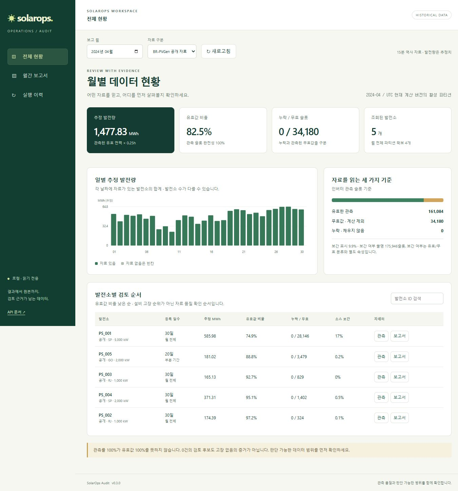
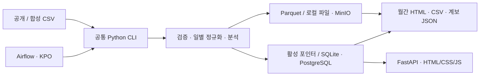

# SolarOps Audit

[](https://github.com/TaeyanG4/solarops-audit/actions/workflows/ci.yaml)

태양광 운영 자료의 **누락·무효값·원본 보간 여부를 구분**하고, 숫자의 출처를 원본 파일까지 추적하는 데이터 엔지니어링 프로젝트입니다. 공개 BR-PVGen 역사 데이터와 합성 자료에서 일별 Parquet, 월간 HTML/CSV 보고서, 읽기 전용 대시보드를 생성합니다.

**관측률 100%가 유효값 100%를 뜻하지 않습니다.** 품질 지표를 분리하고, 재처리 결과의 일관성과 실패 시 기존 결과 보존을 검증합니다. 에너지는 15분 전력의 추정치이며 저출력 표시는 검토 후보입니다.



[5분 시연](docs/portfolio/DEMO_GUIDE.md) · [포트폴리오 사례](docs/portfolio/CASE_STUDY.md) · [기술 선택 근거](docs/architecture/technology-stack.md) · [현재 진행도](docs/IMPLEMENTATION_STATUS.md) · [문서 전체](docs/README.md)

작업은 [점수 기반 계획](plan.md)의 높은 순위부터 진행합니다. 완료 근거는 [발견 기록](discoveries.md), 재개 지점과 이력은 [handoff.md](handoff.md)에 남깁니다. [수익화 판단](docs/market/revenue-assessment.md)은 기술 검증과 실제 고객·매출 검증을 구분합니다.

## 빠른 실행

Python 3.12, [uv](https://docs.astral.sh/uv/getting-started/installation/), Git이 필요합니다. 저장소 접근 권한이 있는 계정으로:

```text
git clone https://github.com/TaeyanG4/solarops-audit.git
cd solarops-audit
uv sync --frozen
uv run python scripts/demo/portfolio_demo.py --serve
```

[독립 데모 열기](http://127.0.0.1:8503/?view=overview&period=2024-04&source=synthetic). 합성 1주 자료로 **정상 처리 → 커밋 실패 → 이전 결과 보존 → 재처리 해시 일치 → 보고서**를 검증합니다. Docker나 공개 데이터 다운로드는 필요하지 않습니다. 매번 새 폴더에 증거를 남기며 출력 폴더와 `evidence.json` 경로를 표시합니다. 서버 종료는 Ctrl+C입니다.

일반 네이티브 실행, 환경 변수, WSL 분리, PostgreSQL·MinIO·Airflow·kind 및 공개 자료 처리 명령은 [설치와 실행](docs/guides/setup.md)에 모았습니다.

## 무엇을 구현했는가

- 원본 checksum·버전·추가 컬럼·보간 여부·표본 수를 보존하는 입력 계약
- 발전소/일자별 정규화와 중복 충돌 차단, 검증된 결과만 활성 포인터로 공개
- 슬롯 수를 분모로 한 품질 지표, 추정 에너지, 출처가 고정된 보고서
- 월별 현황 단일 조회, 발전소 시계열, 작업→일별 파티션 실행 이력
- 같은 CLI를 쓰는 로컬 실행, Airflow 재시도·백필, Kubernetes 작업 Pod
- 모두 무효인 전력과 실제 0의 구분, 시간대 경계 회귀, v1을 보존하는 별도 계산 v2
- 읽기 전용 미완료 작업 진단, 합성 SQLite·파일과 PostgreSQL·MinIO의 격리 복원 시험
- 보존 원본으로 처리하는 계보, 동시 버전 충돌 차단, 파일 SHA 검증과 부작용 없는 조회 API



Python·uv는 공통 실행과 의존성 재현, DuckDB·Arrow는 CSV 외부 정렬과 일별 Parquet, SQLAlchemy·PostgreSQL은 활성 결과 전환, MinIO는 원본·산출물 보관을 담당합니다. Airflow는 재시도를 관리하고 KPO는 작업 자원을 격리합니다. 각 기술의 **버전·대안·선택 이유·한계**는 [기술 스택](docs/architecture/technology-stack.md), 일별 커밋 경계는 [구조와 데이터 흐름](docs/architecture/system.md)에 설명합니다.

## 검증으로 확인한 범위

| 확인 항목 | 실제 증거와 해석 범위 |
|---|---|
| 공개 전체 처리 | 51개 발전소 · 인버터 14,400,480행 · 12,572개 일별 파티션. v1 native/서비스 일치, v2 서비스 재처리 후 v1/v2 일별 지표·원본 SHA 일치 ([v0.4 검증](docs/benchmarks/reliability-v0.4.0.md)) |
| 재처리·복구 | 동일 입력 반복, 중복 충돌, 트랜잭션 실패, Compose/kind DAG 및 Pod 중단 후 재시도 검증 |
| 장애·동시성 | 입력 변경·복사 경합·동시 버전·보고서 역순 완료·누락/변조 파일 회귀 ([v0.4.1 검증](docs/benchmarks/integrity-v0.4.1.md)) |
| 화면 조회 | 월별 HTTP 요청 53회→1회, 로컬 5회 중앙값 703.239ms→12.576ms. 응답 범위와 요청 방식이 달라 일반 성능 배수로 해석하지 않음 ([측정 조건](docs/benchmarks/workspace-v0.3.0.md)) |
| 품질 관리 | Windows·Ubuntu CI: 잠긴 의존성, lint, API/처리 회귀 검사, 합성 복구 데모, wheel 및 문서 링크 검사 ([최신 결과](docs/IMPLEMENTATION_STATUS.md)) |

전체 데이터 51개와 2024년 4월 화면의 공개 발전소 5개는 조회 기간이 다릅니다. 위 측정은 자체 검증이며 모든 버전에서 전체 데이터를 다시 처리한 결과는 아닙니다.

## 저장소 구조

```text
src/solarops/       공통 CLI와 수집·계약·정규화·분석·저장·보고서·API
tests/             계약, 재처리, 실패 보존, API, 패키징 회귀 검사
dags/              공통 CLI를 호출하는 Airflow DAG
infra/             Docker·Compose·kind·Helm 구성
scripts/           ops / validation / demo / data / release / archive
docs/              시작 안내·설계·운영·검증·포트폴리오·원본 기획
migrations/        카탈로그 구조 안내
plan.md            점수·선행조건·다음 검사가 있는 미완료 작업
handoff.md         현재 상태·완료 이력·다음 재개 지점
discoveries.md     실행 결과·판단 근거·독립 검토 상태
data/, artifacts/  로컬 데이터와 실행 증거 — Git 제외
```

[스크립트 사용 안내](scripts/README.md) · [개발·검사 방법](CONTRIBUTING.md) · [변경 이력](CHANGELOG.md)

## 현재 범위

엔지니어링 MVP와 로컬 시연은 구현됐습니다. 실제 고객 인터뷰·데이터 계약·현장 고장 라벨 평가, 고객 인증, 별도 호스트의 재해복구는 아직 수행하지 않았습니다. 합성 SQLite·파일 및 같은 서버의 별도 PostgreSQL DB·MinIO 버킷 복원과 중단 작업 진단은 검증했습니다. 일별 사건 경계를 넘는 병합과 실행 상태의 자동 조정은 후속 과제입니다. 자세한 범위는 [구현 상태](docs/IMPLEMENTATION_STATUS.md)에 기록합니다.

서비스는 127.0.0.1에서 사용하는 로컬 검증용입니다. `.env`, 원본 데이터, 로그, 생성된 비밀 설정은 Git에 포함하지 않습니다. 원본 ZIP과 `docs/plan/`은 보존된 기획 자료이며 현재 상태 문서는 별도로 관리합니다.

## 데이터 출처

De Jesus, C. D., Ferreira, R. N., & de Aguiar, E. P. (2026). **BR-PVGen — The Brazilian Photovoltaic Generation Dataset**. [Zenodo / DOI 10.5281/zenodo.21511487](https://doi.org/10.5281/zenodo.21511487), CC BY 4.0. 연관 논문: 동일 저자·제목, *IEEE Access* (원본 README 기준 in press; 논문 DOI 미기재).

프로젝트에서 UTC 정규화, 중복 검사, 품질 구분, 에너지 근사, 검토 후보 규칙과 보고서를 추가했습니다. 공개 원본도 Git에는 포함하지 않습니다. [실제 스키마·checksum·계산 계약](docs/data-contract.md).
