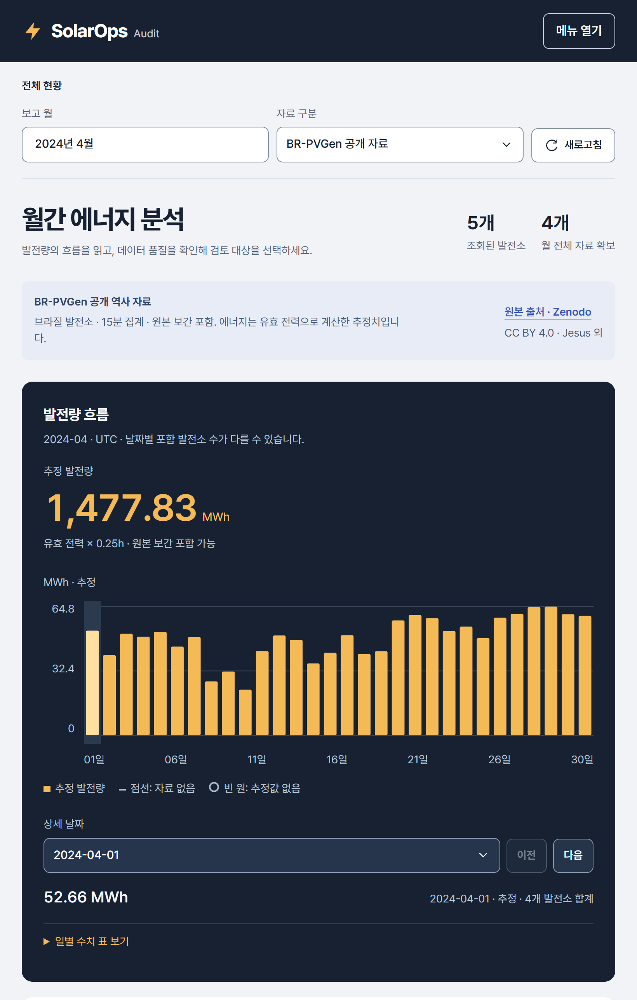
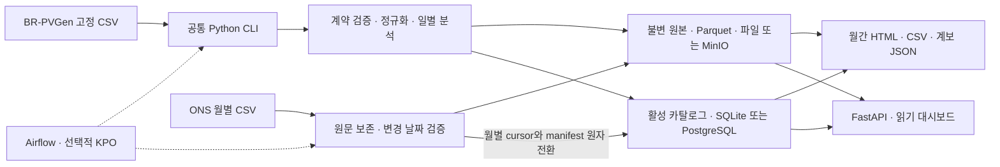
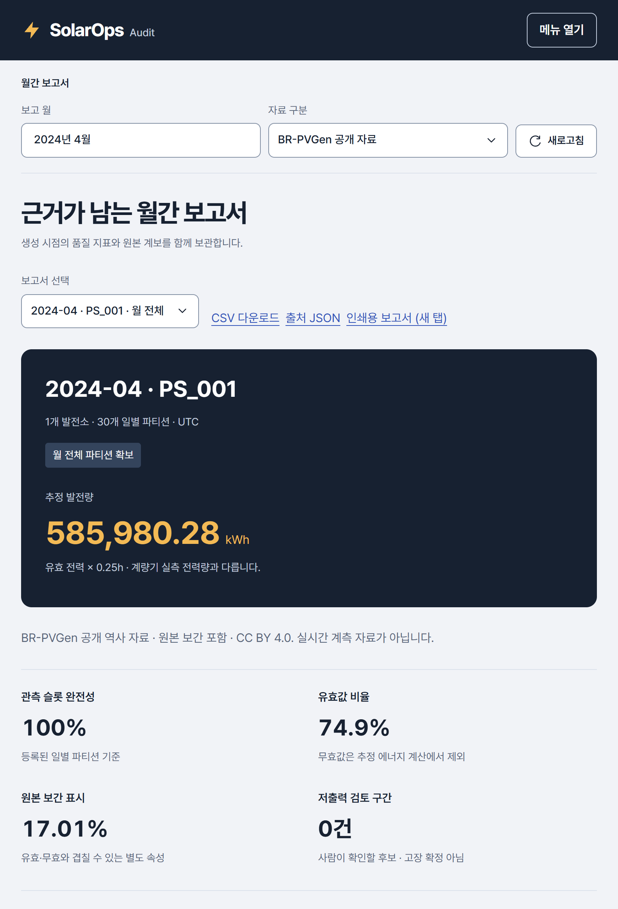

# SolarOps Audit

**공개 태양광 데이터를 검증하고, 실패·정정·재처리 이후에도 보고서 숫자를 원본까지 추적하는 배치 데이터 파이프라인.**

관측 슬롯이 모두 있어도 값이 모두 유효한 것은 아닙니다. SolarOps는 무효·누락·원본 보간을 구분하고, 검증한 결과만 게시하며, 실패하면 이전 결과를 유지합니다. Python 공통 CLI를 로컬, Docker, Airflow의 Kubernetes 작업 Pod에서 사용합니다.

[한 쪽 요약](docs/portfolio/SUBMISSION.md) · [5분 재현](#빠른-실행) · [아키텍처](docs/architecture/system.md) · [설계 사례](docs/portfolio/CASE_STUDY.md) · [검사 CI](https://github.com/TaeyanG4/solarops-audit/actions/workflows/ci.yaml) · [전체 문서](docs/README.md)



*PS_001의 2024년 4월은 관측 슬롯 100%, 유효값 74.9%입니다. 원본 보간 17%는 별도 속성입니다. 화면의 에너지는 계량기 실측 전력량이 아닌 추정값입니다. [원본 확대](docs/portfolio/images/workspace-20261023/overview.png?raw=1) · [1440px 전체 화면](docs/portfolio/images/workspace-20261023/overview-1440.png?raw=1). 이미지는 DPR 2로 촬영했으며 축소 편집하지 않았습니다.*

## 빠른 실행

Python 3.12, [uv](https://docs.astral.sh/uv/getting-started/installation/), Git을 준비합니다. 비공개 저장소 접근 권한이 필요합니다.

```text
git clone https://github.com/TaeyanG4/solarops-audit.git
cd solarops-audit
uv sync --frozen
uv run python scripts/demo/portfolio_demo.py --serve
```

출력되는 `http://127.0.0.1:8503/`을 **명령을 실행한 PC**에서 엽니다. Docker·공개 원본 다운로드 없이 합성 7일 자료의 다음 흐름을 재현합니다. 최초 의존성 설치에는 네트워크가 필요할 수 있습니다.

1. 정상 처리와 7개 일별 결과 게시.
2. 커밋 도중 실패 주입, 이전 결과 보존 확인.
3. 재처리 후 논리 해시 일치 확인.
4. 월간 보고서와 `evidence.json` 생성.

서버는 같은 터미널에서 **Ctrl+C**로 종료합니다. 각 실행은 새 폴더를 만들고 기존 자료를 보존합니다. 서버 없이 검증하려면 `--serve`를 생략합니다. [시연·결과 확인](docs/portfolio/DEMO_GUIDE.md) · [전체 설치 안내](docs/guides/setup.md).

실제 PostgreSQL·MinIO·Airflow/Kubernetes 시연은 선택 경로입니다. [설치](docs/guides/setup.md), [수집·처리 명령](docs/guides/data-ingestion.md), [서비스 시작·종료](docs/runbooks/operator.md), [DAG 운영](docs/runbooks/dags.md)에 절차를 분리했습니다. 이 작업 PC의 현재 포트와 프로세스는 [handoff](handoff.md)에 기록합니다. 외부 공개 데모 사이트는 운영하지 않습니다.

## 데이터와 숫자의 의미

| 자료 | 출처·실제 범위 | 사용 방식 |
|---|---|---|
| BR-PVGen V.1 | [Zenodo 원문·파일](https://zenodo.org/records/21511487), DOI [10.5281/zenodo.21511487](https://doi.org/10.5281/zenodo.21511487), CC BY 4.0. 브라질 51개 발전소의 2024-03-26~2025-06-09 자료; 발전소별 기간은 다름 | 고정 배포 CSV를 명시적으로 다운로드·재처리. 원본이 15분 집계·일부 보간된 자료 |
| ONS 발전 자료 | [브라질 전력계통 운영기관 ONS](https://dados.ons.org.br/dataset/geracao-usina-2), 월별 갱신 CSV, CC BY(버전 미명시) | 이전·현재 월을 조건부 HTTP GET. 변경 날짜와 성공 cursor를 원자 게시 |
| 합성 DEMO_01 | [저장소의 생성기](src/solarops/fixtures.py) | 작은 오프라인 데모·실패 주입·회귀 검사. 실제 발전 실적으로 해석하지 않음 |

BR-PVGen 제작자는 Caian Dutra de Jesus, Rhuan Nascimento Ferreira, Eduardo Pestana de Aguiar(UFJF)입니다. [출처·인용·파일별 다운로드](docs/data-sources.md)에서 메타데이터, 인버터, 기상 파일을 구별할 수 있습니다.

- **추정 kWh:** 유효한 15분 전력에 `W ÷ 1000 × 0.25 h`를 적용합니다. 원본 보간·표본 수·추가 필드를 보존합니다. 추정 에너지는 계량기 실측 전력량·매출·확정 손실이 아닙니다.
- **품질 분모:** 인버터별 원본 관측 범위와 요청 날짜의 교집합입니다. 관측·유효·누락·무효·보간을 각각 표시하며, 확인되지 않은 설비 가동기간을 추정해 채우지 않습니다.
- **ONS:** 단위 MWmed와 원문 시각, 검증/예측/미확정 유형을 보존합니다. 공식 사전의 시간대·구간 기준이 불명확해 `ts_utc=null`로 두고 기존 kWh에 합산하지 않습니다.
- **기간과 환경:** 전체 자료는 51개 발전소지만 2024년 4월 화면에는 해당 월 자료가 있는 5개가 나옵니다. Compose·kind·네이티브 저장소는 독립이며 자동 동기화하지 않습니다.

[계산·품질 계약](docs/data-contract.md) · [ONS 계약과 API](docs/ons-source-contract.md) · [주기·새 데이터 추가](docs/guides/data-ingestion.md). ONS 일정은 매일 05:00 UTC / 14:00 KST로 구성했습니다. 실제 활성 상태는 운영 기록을 확인하며, 화면 새로고침은 저장된 결과 조회입니다.

## 설계와 기술 선택



| 기술 | 선택 이유와 역할 |
|---|---|
| Python 3.12 · uv | 처리·CLI·검사를 통합하고 앱 의존성을 잠금 |
| DuckDB · Arrow/Parquet | 외부 정렬과 제한된 배치, 명시 스키마·열 형식 저장. 전체 CSV를 한 번에 Python 메모리에 적재하지 않음 |
| PostgreSQL · SQLAlchemy | 활성 결과·계보의 트랜잭션과 동시 게시 제어. SQLite는 서버 없는 재현 경로 |
| MinIO · S3 API | 원본·산출물의 바이트 저장. 파일 저장소와 같은 인터페이스, 실제 서비스 검사 별도 제공 |
| Airflow · Docker · KubernetesPodOperator | 일정·재시도·백필·실행 이력과 작업별 자원 격리. 핵심 계산은 공통 CLI에 유지 |
| FastAPI · HTML/CSS/JS · Jinja2 | 읽기 API·대시보드·독립 HTML 보고서를 같은 패키지로 전달 |
| pytest · Ruff · GitHub Actions | 계약·실패·동시성·조직 격리 검사, Windows/Ubuntu 재현·패키징 |

객체 업로드와 DB는 분산 트랜잭션으로 묶지 않습니다. 객체를 먼저 저장하고 검증한 뒤 활성 포인터를 바꿉니다. 실패한 객체는 게시되지 않은 증거로 남습니다. BR-PVGen은 일별 원자성, ONS는 월별 성공 cursor와 변경 날짜의 원자성을 보장합니다.

Airflow는 LocalExecutor로 동작하고 KPO가 작업 Pod를 만듭니다. KubernetesExecutor와 구분합니다. 배치 요구와 현재 처리 규모에서 Kafka/Spark 도입 비용을 정당화하지 못해 사용하지 않았습니다. 로컬 관리 서버는 분석 앱과 분리하고 대시보드 컨테이너에 Docker 소켓을 주지 않습니다.

[환경별 아키텍처·게시 경계](docs/architecture/system.md) · [버전·대안·비용·재검토 조건](docs/architecture/technology-stack.md) · [설계 결정 ADR](docs/README.md#설계-결정-기록).

## 실행 근거와 한계

최신 구현은 **v0.5.6 · energy-interval-v2**입니다. 발전소·전체·자료 필터별 보고서를 독립적으로 보존하고 총 품질 이슈와 분석 경고를 구별합니다. [최신 검증](docs/benchmarks/quality-v0.5.6.md) · [재계산 가능한 성능 표본](docs/benchmarks/evidence/technical-20261023/README.md)과 [v0.5.3의 정상 입력 동등성·비용](docs/benchmarks/quality-v0.5.3.md)을 구분해 기록했습니다. 실제 배포·독립 재평가 상태는 [handoff](handoff.md)를 확인하세요.

| 확인한 항목 | 결과 | 범위와 근거 |
|---|---|---|
| 공개 역사 자료 처리 | 51개 발전소, 인버터 14,400,480행, 일별 파티션 12,572개 | 과거 전체 처리 근거이며 매 커밋마다 전체를 재실행한 수치가 아님. [스택·자료 실사](docs/benchmarks/stack-authenticity-20261023.md) |
| 실제 ONS 정기 수집 | kind 9~10월 태양광 167,424행·51일, 실제 scheduled KPO 성공. Compose 재확인 변경 0일 | 두 환경 저장소는 독립. [명령·원본 SHA·수집 결과](docs/benchmarks/incremental-v0.5.0.md) |
| 공개 일별 KPO 병렬 비교 | 동일 4일, 직렬 36.675초 → 동시 2개 19.339초. 결과 hash 4개 동일, CPU 합 24.3% 증가 | 단일 kind 호스트, 직렬 후 병렬 각 1회, 기동·캐시 영향 포함. 하나의 4일 CLI 배치와 비교하지 않음. [조건·기계 판독 결과](docs/benchmarks/incremental-v0.5.0.json) |
| 실패·재현·최종 화면 | v0.5.1 기준 양 OS 각각 137통과·13제외, 격리 합성 7일 복구·보고서·종료, 1440/768/390px 확인 | 해당 버전의 과거 근거. [검증 기록](docs/benchmarks/portfolio-finish-20261023.md) · [CI](https://github.com/TaeyanG4/solarops-audit/actions/runs/39915517455) |

[최신 검사 CI](https://github.com/TaeyanG4/solarops-audit/actions/workflows/ci.yaml), [현재 계획](plan.md), [독립 평가 기준](docs/reviews/portfolio-rubric.md)을 함께 확인하세요. 기존 [Fable·Astra 모의 면접 평가](docs/reviews/2026-10-23-interview.md)의 후속 검토는 면접·개인 역량을 제외한 산출물 기준으로 진행합니다. 평가 점수는 품질 보증이 아니며 확인된 결함과 미실행 검사를 따로 기록합니다.

실제 PostgreSQL/MinIO, 복구·동시 조회, 모바일 접근성, 버전별 무결성 등 상세 증거는 [문서 목차](docs/README.md)에 모았습니다. 단일 호스트 kind는 고가용성 근거가 아니며 일회 비교는 일반적인 처리량·확장성을 입증하지 않습니다. 자동 접근성 검사 통과도 실제 보조공학 검사나 인증을 대체하지 않습니다.

## 화면과 개발 도구

전체 현황·발전소·데이터 품질·월간 보고서·실행 이력·데이터 출처를 기능별 사이드바로 묶었습니다. 보고서는 생성 당시 자료의 스냅샷이며 현재 게시 결과와 비교할 수 있습니다. 이전 보고서를 새 값으로 덮어쓰지 않습니다.

<details>
<summary>월간 보고서 화면과 사용한 개발 스킬</summary>



[보고서 확대](docs/portfolio/images/workspace-20261023/report.png?raw=1) · [ONS 수집 상태 화면](docs/portfolio/images/portfolio-finish-20261023/ons-readme.png?raw=1) · [1440/768/390px 검증](docs/benchmarks/workspace-20261023.md) · [화면 사용법](docs/runbooks/operator.md).

| 사용한 스킬 | 실제 목적 |
|---|---|
| [UI UX Pro Max](https://github.com/nextlevelbuilder/ui-ux-pro-max-skill) | 정보 위계·색·타이포그래피·차트·반응형 디자인 시스템 |
| [Impeccable](https://github.com/pbakaus/impeccable) | 가독성·상태 표현·접근성 검수와 수정 |
| [Agent Browser](https://github.com/vercel-labs/agent-browser) | 실제 화면·키보드·선택창·오류 경로·세 너비 검증 |
| [Web Design Guidelines](https://github.com/vercel-labs/agent-skills) | 링크·폼·주소 상태·포커스·웹 사용성 검사 |

AI 도구의 사용 범위·버전·채택하지 않은 제안은 [스킬 기록](docs/development/skills.md)에 공개했습니다. 스킬은 개발 도구이며 제품 실행 의존성이 아닙니다.

</details>

## 범위와 기록

검증 대상은 로컬 엔지니어링 포트폴리오입니다. 고객 계약·매출·현장 고장 정답·고객 인증·외부 SLO·다른 물리 호스트의 재해복구는 미검증입니다. 저출력은 검토 후보이며 확정 고장이나 손실이 아닙니다. [현재 구현 상태](docs/IMPLEMENTATION_STATUS.md).

```text
src/solarops/       CLI · 수집 · 분석 · 저장 · 보고서 · API
tests/             데이터 계약 · 재처리 · 게시 · 보안 · 패키징
dags/ / infra/     Airflow · Docker/Compose · kind/Helm
scripts/           데모 · 운영 · 검증 · 데이터 · 릴리스
docs/              출처 · 설계 · 운영 · 증거 · 날짜별 작업 기록
plan.md            미완료 항목의 점수·의존성
handoff.md         현재 상태와 다음 행동, 100줄 이하
data/, artifacts/  로컬 데이터·검사 산출물, Git 제외
```

[개발 안내](CONTRIBUTING.md) · [스크립트 목록](scripts/README.md) · [변경 이력](CHANGELOG.md) · [날짜별 작업 기록](docs/worklog/README.md).
