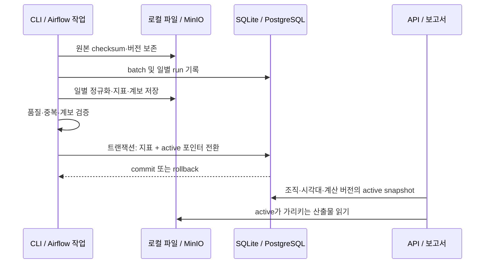

# 구조와 데이터 흐름

[문서 홈](../README.md) · [기술 선택](technology-stack.md)

## 폴더별 책임

| 경로 | 책임 / 변경할 때 확인할 곳 |
|---|---|
| `src/solarops/acquisition/` | 공개 파일 목록·다운로드·checksum·안전한 압축 해제 |
| `src/solarops/contracts/` | 입력 스키마, ID/시각/단위 계약 및 API/보고서가 공유하는 날짜 경계 |
| `src/solarops/normalize/` | DuckDB CSV 정렬·필터, Arrow Parquet. 추가 원본 필드 보존 |
| `src/solarops/analytics/` | 품질 지표·추정 에너지·검토 후보. 계산 변경 시 버전 필요 |
| `src/solarops/storage/` | `postgres.py`의 Catalog는 PostgreSQL/SQLite, `minio.py`의 ObjectStore는 MinIO/로컬 파일 지원 |
| `src/solarops/pipeline.py`, `replay.py` | 입력 버전·일별 처리·공개, 최대 31일의 제한된 재처리 계획과 실행 |
| `src/solarops/reports/` | 불변 보고서 HTML/CSV/계보와 최신 보고서 포인터 |
| `src/solarops/api/` | 조회 모델·검증·읽기 API와 정적 UI. 변환 작업을 요청에서 실행하지 않음 |
| `src/solarops/cli.py` | 네이티브·Compose·KPO가 공통 호출하는 진입점 |
| `dags/`, `infra/` | 스케줄/재시도 연결과 배포. 데이터 변환 규칙은 복제하지 않음 |
| `scripts/` | [목적별 실행 보조 도구](../../scripts/README.md); 도메인 로직은 `src`에 둠 |
| `tests/` | 계약·정규화·파이프라인·재처리·조회·서비스·패키징 회귀 |
| `docs/plan/` | 원본 ZIP 기획 아카이브. 새 설계와 운영 문서는 다른 디렉터리에 작성 |
| `data/`, `artifacts/` | 실행 데이터와 증거, Git 제외. 이전 실행 증거는 자동 정리하지 않음 |

프로젝트 패키지는 이미 책임별로 분리되어 있어 공개 Python import 경로는 유지했습니다. 혼합되어 있던 보조 스크립트를 목적별로 이동했고, README는 설치·운영 상세 대신 문서 탐색의 시작점으로 정리했습니다. 공통 날짜 계산은 보고서 렌더러에서 `contracts/dates.py`로 옮겨 API가 보고서 생성 모듈에 의존하지 않게 했습니다.

## 공개 결과가 바뀌는 경계

DB와 객체 저장소 전체를 하나의 분산 트랜잭션으로 묶지는 않습니다. 객체가 먼저 저장되어도 DB 커밋 전에는 active 조회에 나타나지 않습니다. 실패하면 이전 포인터가 유지되고 고아 staging은 증거로 남습니다. 공개 단위는 **조직/발전소/현지 일자/시각대/계산 버전**입니다. 여러 날짜 중 뒤의 날짜가 실패해도 이미 커밋한 날짜는 남습니다.

파일 SHA-256은 입력 바이트를, 논리 해시는 정렬된 자연키·정규화 값·원본 필드·지표·규칙을 확인합니다. 실행 UUID와 시각은 논리 해시에서 제외됩니다. 같은 입력 버전 이름에 다른 내용을 넣으면 중단합니다. 보고서는 생성 시점의 active snapshot을 UUID 경로에 고정하므로 새 적재 후 자동으로 바뀌지 않습니다.

## 조회 계약

- `/api/v1/overview`: `period=YYYY-MM`, 선택한 자료 종류. 월 범위 단일 SELECT와 슬롯 가중 집계. 파티션 없는 날짜는 `metrics: null`.
- `/api/v1/plants/{plant_id}/metrics`: `from=YYYY-MM-DD` 포함, `to=YYYY-MM-DD` 제외. 시작이 끝보다 빨라야 함.
- `/api/v1/plants/{plant_id}/series`: 엄격한 ISO 날짜. 다음 날짜를 표현할 수 없는 `9999-12-31`은 422.
- 발전소 ID: 영문·숫자로 시작, 영문·숫자·밑줄·하이픈, 최대 80자. 형식이 맞지만 미등록이면 빈 목록.
- `/api/v1/reports`: 선택적 `period`, `source_kind`. 발전소 이름 대신 생성 당시 계보로 필터. 혼합 보고서는 포함된 각 자료 종류에 매칭.
- 예전 보고서에 `source_kinds`가 없으면 불변 manifest에서 읽음. 읽기 실패 시 `source_kinds: null`, `source_metadata_status: unavailable`; 전체 목록에서 상태를 보이고 특정 자료 필터에서는 제외. 기존 파일/DB를 수정하지 않음.
- 모든 조회는 프로세스 설정의 조직 범위. 다른 조직을 선택하는 사용자 파라미터는 없음. 조직 필터는 사용자 인증을 대체하지 않음.

기존 보고서의 출처 조회에는 객체 I/O가 추가됩니다. UI는 월 범위를 보내며 새로 생성한 보고서는 DB에 출처 종류를 함께 저장합니다. 보고서 수가 커지면 승인된 메타데이터 보강·페이지 나눔을 검토해야 합니다. 실행 시간 필드는 원본 다운로드·등록 이후 처리 구간이며 과거 누락 필드는 추측해 채우지 않습니다.
