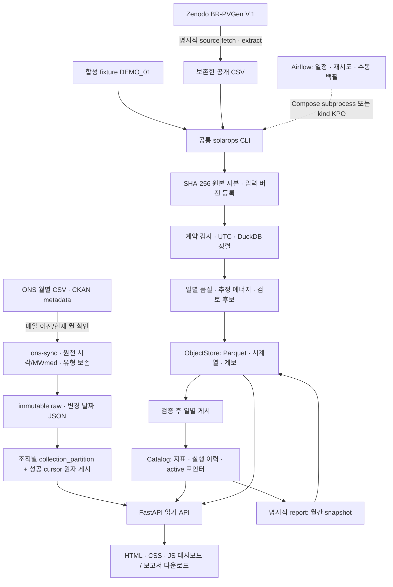
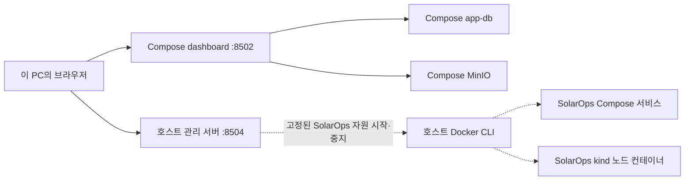
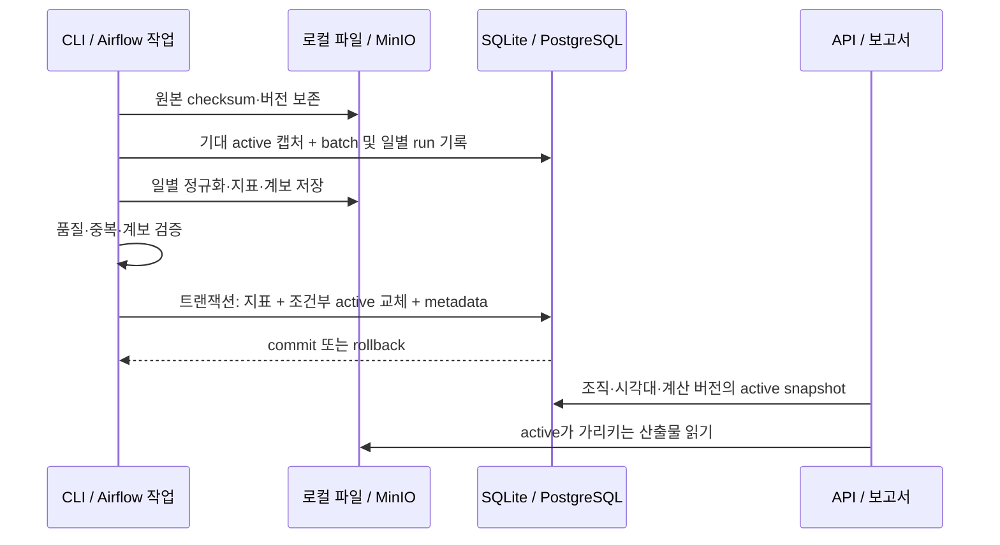

# SolarOps Audit 아키텍처

[문서 홈](../README.md) · [기술 선택](technology-stack.md) · [수집·일정·데이터 추가](../guides/data-ingestion.md)

SolarOps는 **역사 CSV 분석과 갱신 원천의 증분 수집을 수행하는 배치 시스템**입니다. Python CLI가 처리와 쓰기를 담당하고 FastAPI 대시보드는 저장된 결과를 읽습니다. 같은 CLI를 네이티브, Compose, Airflow, Kubernetes 작업 Pod에서 실행합니다. ONS의 원문 단위·시각은 BR-PVGen의 추정 에너지와 분리합니다.

설계 기준은 입력 보존, 계산·출처 추적, 실패 시 이전 게시 결과 유지, 실행 환경별 재현성입니다. 현재 코드 v0.5.4 / 계산 `energy-interval-v2` 기준이며 실제 배포 이미지와 확인 범위는 아래에 구분합니다.

**v0.4.2:** 독립 검토에서 재현한 입력 ID·추출·metadata·역순 게시 경계를 수정했습니다. 배치 시작 때 기대한 active와 비교해 교체하고 metadata도 같은 트랜잭션에 게시합니다. 충돌은 이전 결과를 유지한 채 명시적으로 실패하며 의도적 과거 복원은 `--restore`가 필요합니다. [실제 SQLite/PostgreSQL 검증](../benchmarks/integrity-v0.4.2.md).

## 전체 데이터 흐름

다운로드는 `acquisition/brpvgen.py`, 일별 처리는 `pipeline.py`, 보고서는 `reports/`에 있습니다. BR-PVGen DAG는 고정된 역사 구간을 재처리합니다. v0.5.0의 ONS DAG는 별도 수집기로 이전/현재 월을 조건부 GET하고, 날짜별 내용 hash와 월별 성공 cursor로 증분 게시합니다. 실시간 스트리밍은 아닙니다. [일정·실제 상태·확장 절차](../guides/data-ingestion.md).

## 배포 환경과 저장소 경계

| 환경 | 실행 주체 / 진입점 | 카탈로그 | 원본·산출물 | 범위 |
|---|---|---|---|---|
| 네이티브 | `uv run solarops`, 기본 UI 8501 | 설정한 data 폴더의 SQLite | 같은 환경의 로컬 파일 | 서버 없는 개발·합성 시연. 기본 native의 기존 v1 결과는 보존본 |
| 독립 포트폴리오 데모 | `portfolio_demo.py --serve`, 8503 | 실행마다 새 SQLite | 실행마다 별도 폴더 | 합성 실패·복구 시연, 서비스 DB와 분리 |
| Compose | worker 또는 Airflow subprocess, UI 8502 | `app-db` PostgreSQL | MinIO + 작업용 app-data 볼륨 | 공개 전체 51개 발전소의 계산 v2 결과 |
| kind Kubernetes | Airflow LocalExecutor → KPO CLI Pod | namespace 내부 별도 `app-db` | namespace 내부 별도 MinIO + PVC | 기존 공개 v2는 PS_001 하루. ONS 수집은 별도 collection 테이블, 성능시험은 별도 DB/버킷. Compose 복제본 아님 |

**Compose와 kind는 독립 저장소이며 자동 동기화하지 않습니다.** 네이티브에서 처리한 결과도 설정을 명시하지 않으면 8502에 나타나지 않습니다. 같은 코드가 실행돼도 데이터와 활성 결과의 범위는 환경마다 다릅니다. [환경 분리 결정](../adr/0002-two-environments.md).

Compose의 앱 DB와 **Airflow 메타 DB**도 별개입니다. 앱 DB는 발전소·소스·일별 지표·보고서·실행 계보를 보관하고, Airflow DB는 DAG/태스크 스케줄·상태를 보관합니다. MinIO는 원본·Parquet·JSON·HTML/CSV의 바이트를 저장합니다. Airflow 메타 DB를 앱 데이터 저장소로 사용하지 않습니다.

관리 서버는 별도 호스트 프로세스이므로 분석 대시보드를 꺼도 다시 켤 수 있습니다. dashboard 컨테이너에 Docker 소켓을 전달하지 않습니다. 관리 화면은 기존 SolarOps 자원만 제어하며 DB SQL 실행·원본 업로드·컨테이너/볼륨 삭제·Docker Desktop 종료 기능은 없습니다. 기본 시작은 Compose 3서비스, 전체 중지는 SolarOps Compose와 kind이며 관리 서버는 별도 종료합니다. [운영 절차](../runbooks/operator.md#시스템-관리-8504).

Airflow는 Compose에서는 LocalExecutor 태스크가 앱 CLI subprocess를 호출하고, kind에서는 LocalExecutor가 KubernetesPodOperator를 실행해 별도 작업 Pod를 만듭니다. KubernetesExecutor를 사용하는 구조가 아닙니다. 변환 로직을 DAG에 복제하지 않고 XCom에 DataFrame을 전달하지 않습니다. [실행기 선택](../adr/0003-kpo-not-executor.md).

## 폴더별 책임

| 경로 | 책임 / 변경할 때 확인할 곳 |
|---|---|
| `src/solarops/acquisition/` | 공개 파일 목록·다운로드·checksum·안전한 압축 해제 |
| `src/solarops/contracts/` | 입력 스키마, ID/시각/단위 계약 및 API/보고서가 공유하는 날짜 경계 |
| `src/solarops/normalize/` | DuckDB CSV 정렬·필터, Arrow Parquet. 추가 원본 필드 보존 |
| `src/solarops/analytics/` | 품질 지표·추정 에너지·검토 후보. 계산 변경 시 버전 필요 |
| `src/solarops/storage/` | `postgres.py`의 Catalog는 PostgreSQL/SQLite, `minio.py`의 ObjectStore는 MinIO/로컬 파일 지원 |
| `src/solarops/pipeline.py`, `replay.py` | 입력 버전·일별 처리·공개, 최대 31일의 제한된 재처리 계획과 실행 |
| `src/solarops/reports/` | 불변 보고서 HTML/CSV/계보, 최신 보고서 포인터, 현재 게시 근거 비교 |
| `src/solarops/api/` | 조회 모델·읽기 API·정적 UI. 분석 API 요청에서 변환 작업을 실행하지 않음 |
| `src/solarops/admin/` | 별도 호스트 관리 앱, 기존 SolarOps 서비스의 상태·시작·중지 |
| `src/solarops/cli.py` | 네이티브·Compose·KPO가 공통 호출하는 진입점 |
| `dags/`, `infra/` | 스케줄/재시도 연결과 배포. 데이터 변환 규칙은 복제하지 않음 |
| `scripts/` | [목적별 실행 보조 도구](../../scripts/README.md); 도메인 로직은 `src`에 둠 |
| `tests/` | 계약·정규화·파이프라인·재처리·조회·서비스·패키징 회귀 |
| `docs/plan/` | 원본 ZIP 기획 아카이브. 새 설계와 운영 문서는 다른 디렉터리에 작성 |
| `data/`, `artifacts/` | 실행 데이터와 증거, Git 제외. 이전 실행 증거는 자동 정리하지 않음 |

업무 계산은 `src`에, 실행 보조는 `scripts`에, 배포는 `infra`에 둡니다. 공통 날짜 경계는 `contracts/dates.py`를 통해 API와 보고서가 공유합니다. 공개 Python import 경로와 기존 API 계약을 유지합니다.

## 공개 결과가 바뀌는 경계

DB와 객체 저장소 전체를 하나의 분산 트랜잭션으로 묶지는 않습니다. 객체가 먼저 저장되어도 DB 커밋 전에는 active 조회에 나타나지 않습니다. 실패하면 이전 포인터가 유지되고 고아 staging은 증거로 남습니다. 공개 단위는 **조직/발전소/현지 일자/시각대/계산 버전**입니다. 여러 날짜 중 뒤의 날짜가 실패해도 이미 커밋한 날짜는 남습니다.

파일 SHA-256은 입력 바이트를, 논리 해시는 정렬된 자연키·정규화 값·원본 필드·지표·규칙을 확인합니다. 실행 UUID와 시각은 논리 해시에서 제외됩니다. 같은 입력 버전 이름에 다른 내용을 넣으면 중단합니다. 보고서는 생성 시점의 active snapshot을 UUID 경로에 고정하므로 새 적재 후 자동으로 바뀌지 않습니다.

보고서 발행도 객체 저장 후 DB의 보고서 정보·최신 포인터를 전환합니다. 업로드나 DB 커밋에 실패하면 이전 보고서를 유지하고, 늦게 끝난 오래된 생성 작업이 더 최신 snapshot을 대체하지 않도록 검사합니다. 보고서 HTML/CSV/manifest는 기존 UUID 경로에서 수정하지 않습니다. [무결성·동시성 계약](../adr/0008-storage-integrity.md).

## 데이터 해석과 확장 경계

- **공개와 합성:** 현재 `public`은 demo 조직의 BR-PVGen 고정 DOI·라이선스로 기록합니다. 임의 CSV를 같은 분류로 넣으면 출처가 왜곡되므로 다른 원천은 adapter와 계보 등록 경로를 함께 확장해야 합니다.
- **관측과 유효성:** 누락 슬롯, 관측됐으나 무효인 전력, 유효한 0을 구분합니다. 보간은 원본의 별도 속성이며 유효/무효와 겹칠 수 있습니다. 원본 표본 수와 추가 컬럼도 보존합니다.
- **에너지와 판단:** 유효 전력 W를 15분 슬롯 기준으로 적분한 추정 kWh입니다. 연결 구간을 새로 보간하지 않으며 저출력은 검토 후보입니다. 현장 고장·확정 손실·매출로 해석하지 않습니다.
- **조직 경계:** 저장·게시·쿼리의 조직 범위는 프로세스 설정에서 정합니다. URL로 다른 조직을 고르는 기능은 없으며, 이 필터는 사용자 로그인·권한 체계를 대체하지 않습니다.

[정확한 입력·계산 계약](../data-contract.md) · [지원되는 추가 처리와 미구현 연동](../guides/data-ingestion.md#데이터를-더-추가할-수-있는가).

## 조회 계약

- `/api/v1/overview`: `period=YYYY-MM`, 선택한 자료 종류. 월 범위 단일 SELECT와 슬롯 가중 집계. 파티션 없는 날짜는 `metrics: null`.
- `/api/v1/plants/{plant_id}/metrics`: `from=YYYY-MM-DD` 포함, `to=YYYY-MM-DD` 제외. 시작이 끝보다 빨라야 함.
- `/api/v1/plants/{plant_id}/series`: 엄격한 ISO 날짜. 다음 날짜를 표현할 수 없는 `9999-12-31`은 422.
- 발전소 ID: 영문·숫자로 시작, 영문·숫자·밑줄·하이픈, 최대 80자. 형식이 맞지만 미등록이면 빈 목록.
- `/api/v1/reports`: 선택적 `period`, `source_kind`. 발전소 이름 대신 생성 당시 계보로 필터. 혼합 보고서는 포함된 각 자료 종류에 매칭.
- `/api/v1/reports/{report_id}/freshness`: 발행 당시 선택 범위·시각대·계산 버전·게시 근거와 현재 active snapshot 비교. `unchanged` / `changed` / `unavailable`, 응답 캐시 없음. 변경은 수치 변화나 고장 확정을 뜻하지 않음.
- 예전 보고서에 `source_kinds`가 없으면 불변 manifest에서 읽음. 읽기 실패 시 `source_kinds: null`, `source_metadata_status: unavailable`; 전체 목록에서 상태를 보이고 특정 자료 필터에서는 제외. 기존 파일/DB를 수정하지 않음.
- 모든 조회는 프로세스 설정의 조직 범위. 다른 조직을 선택하는 사용자 파라미터는 없음. 조직 필터는 사용자 인증을 대체하지 않음.

기존 보고서의 출처 조회에는 객체 I/O가 추가됩니다. UI는 월 범위를 보내며 새로 생성한 보고서는 DB에 출처 종류를 함께 저장합니다. 보고서 수가 커지면 승인된 메타데이터 보강·페이지 나눔을 검토해야 합니다. 실행 시간 필드는 원본 다운로드·등록 이후 처리 구간이며 과거 누락 필드는 추측해 채우지 않습니다.

보고서 근거 비교는 요청 시점의 검사이며 지속 모니터링이나 자동 재발행이 아닙니다. 같은 입력을 재게시해 실행 근거가 달라져도 `changed`가 될 수 있습니다. 선택 범위를 기록하지 않은 이전 보고서는 추측하지 않고 `unavailable`로 표시합니다.

## 구현·배포·검증의 범위

최신 코드0.5.4는 실패 기록의 2차 오류에서 원래 원인을 유지하고 안전한 필드 진단·고정MinIO배포를 보완했습니다. [검사와 배포 상태](../benchmarks/quality-v0.5.4.md) · [현재 실행 환경](../../handoff.md). ONS 상태 UI의0.5.1 실행은 [이전 근거](../benchmarks/portfolio-finish-20261023.md)로 보존합니다.

v0.5.0에서 Compose dashboard/worker/Airflow와 kind Airflow/KPO를 갱신했습니다. [단일 명세](../../src/solarops/release.json)와 [v0.5.0 커밋·이미지 ID](../releases/0.5.0.json)를 연결하고 CI에서 선언 드리프트를 검사합니다. Compose Airflow는 중지 상태이며 과거 완료 Pod·보고서는 보존합니다. v0.4.2 당시의 환경별 동일 표본·재시도 검증은 [역사 근거](../benchmarks/integrity-v0.4.2.md)로 유지합니다.

| 주장 | 실행한 근거 / 한계 |
|---|---|
| 실제 스택과 원본 사용 | [원본 해시·독립 계산·DB/API/보고서/KPO 대조](../benchmarks/stack-authenticity-20261023.md). 현장 계측 정확도 인증은 아님 |
| 실패 보존·재처리 | [v0.4.2](../benchmarks/integrity-v0.4.2.md): 실제 서비스12검사, 동시 게시·복원·실제KPO 재시도. 과거 공개 전체 검증은 별도 역사 기록 |
| 보고서 비교·동시 읽기 | [최신 기술 측정](../benchmarks/technical-20261023.md). 합성10만 건·동시4의 깊은 페이지 p95 679ms, 동시8은 약2초; 동시 쓰기·장시간 부하 미검증 |
| 복원 | 별도 PostgreSQL/MinIO 인스턴스에 합성27객체·7파티션 복원. 같은 물리 호스트이며 다른 호스트 재해복구·운영 RTO/RPO 증거는 아님 |
| ONS 갱신 수집 | 실제 정기 KPO·9~10월 167,424 PV행·재실행 변경 0일. Compose/kind 저장소는 독립. [근거](../benchmarks/incremental-v0.5.0.md) |
| 외부 운영 | 현재 로컬 개발/시연 범위. 고객 업로드·다중 사용자 인증/권한·HTTPS 외부 서비스는 미구현 |

기술별 버전·대안·재검토 조건은 [기술 선택 문서](technology-stack.md), 실제 실행·종료는 [운영 안내](../runbooks/operator.md), 복구는 [백업·복원](../runbooks/backup-restore.md)을 따릅니다.

## ONS 증분 경계 (v0.5.0)

원천의 offset 없는 시각을 UTC라고 가정하지 않습니다. MWmed·verified/forecast/unspecified를 보존하고 기존 energy-v2 지표와 분리합니다. 원본과 metadata를 보존한 뒤 날짜별 내용 hash가 달라진 결과만 업로드하고, 기대 cursor가 일치할 때 월의 변경 manifest와 cursor를 함께 전환합니다. HTTP304는 날짜 재처리 없이 확인 이력만 남깁니다. [출처·실패/철회 계약과 조회 API](../ons-source-contract.md).

실제 KPO 병렬 측정은 별도 PostgreSQL DB·MinIO 버킷·PVC 하위 경로를 사용합니다. 동일 PS_001 공개4일을 max_active_tasks=1/2로 실행하며 신규 기술스택을 추가하지 않습니다. 단일 kind 노드의 공유 RWO PVC이므로 다중 물리 노드 확장 검증이 아닙니다. [실행 기록](../worklog/2026-10-23-incremental.md).
