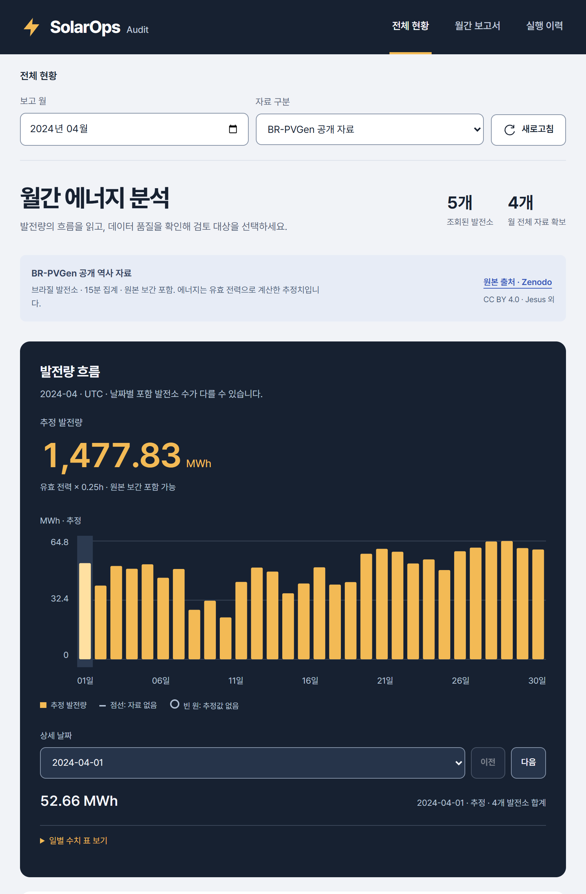

# Energy Desk — 전체 현황을 새로 설계

이 문서는 수평 탐색 중간안의 이력입니다. 이후 사용자 지시에 따른 최신 사이드바·보고서·관리 화면은 [워크스페이스 검증](workspace-20261023.md)을 참고하세요.

2026-10-23. 사용자가 “이전과 똑같다”, “지금 것을 참고하지 말고 새롭게”라고 지시해 기존 외형을 개선하던 중간안에서 **HTML/CSS를 새로 작성하는 디자인 교체**로 전환했습니다. 기존 계산과 데이터 계약은 그대로 유지했습니다.

## 바뀐 화면 구조

| 이전·중간안 | 새 Energy Desk |
|---|---|
| 왼쪽 고정 사이드바 | 화면 폭을 쓰는 상단 탐색과 밑줄 활성 상태 |
| 동일한 KPI 카드 4개 | 발전량 총합은 차트와 통합, 발전소 수는 페이지 제목 옆, 품질은 별도 영역 |
| 흰 패널·녹색 에너지 차트 | 남색 에너지 분석 공간·금색 에너지, 흰 데이터 품질 영역 |
| 시스템 글꼴 | 로컬 Pretendard Variable 1.3.9, 수치와 제목 위계 재설계 |
| 카드 내부 여백이 반복되는 표 | 전폭 검토 표, 탭형 범위 필터, 작은 화면의 발전소별 기록 배치 |



## 실제 전후 비교

같은 공개 BR-PVGen 2024년 4월, 1000 CSS px 높이·DPR2로 캡처한 전체 페이지입니다. ‘전’은 사용자가 거절한 중간안입니다. 과거 파일을 덮어쓰지 않고 보존했습니다.

| CSS 너비 | 이전 | 새 디자인 |
|---|---|---|
| 1440px | [원본 확대](../portfolio/images/energy-desk-20261023/before-1440.png?raw=1) | [원본 확대](../portfolio/images/energy-desk-20261023/after-1440.png?raw=1) |
| 768px | [원본 확대](../portfolio/images/energy-desk-20261023/before-768.png?raw=1) | [원본 확대](../portfolio/images/energy-desk-20261023/after-768.png?raw=1) |
| 390px | [원본 확대](../portfolio/images/energy-desk-20261023/before-390.png?raw=1) | [원본 확대](../portfolio/images/energy-desk-20261023/after-390.png?raw=1) |

README에는 820px 반응형 화면을 DPR2로 렌더링한 캡처를 사용합니다. 전체 페이지를 강제로 축소하거나 글자를 다시 그리지 않았습니다. [캡처 크기·발췌 범위](../portfolio/images/energy-desk-20261023/README.md).

## 스킬 적용과 검수

- **UI UX Pro Max:** 정확히 일치하는 `data-dense-dashboard` 스타일을 확인하고 읽기 순서·기능 필터·수치표를 채택했습니다. energy 색 검색의 fitness와 chart 검색의 radar 결과는 부적합해 사용하지 않았습니다. 일별 합계는 임의의 선 보간 없이 막대로 표시합니다.
- **Impeccable:** new-work의 기존 외형 교체, layout의 위계·그룹·반응형 구성, craft-floor·audit·polish를 적용했습니다. 정적 detector는 `[]` / exit0. 별도 검수자가 실제 세 크기 캡처와 소스를 확인했습니다.
- **Agent Browser:** Chrome156에서 실제 조회·필터·상태·키보드·합성 터치·캡처 검증을 수행했습니다.
- **Web Design Guidelines:** 최신 원문을 가져와 링크·폼 레이블·URL 상태·포커스·숫자 정렬·반응형·theme-color를 확인했습니다. [설치 버전과 적용 범위](../development/skills.md).

사용자가 자율 구현과 이후 수정을 맡겨 code-led로 진행했습니다. concept-seed 선택, 승인 이미지나 이미지 대조 점수를 수행했다고 주장하지 않습니다. 디자인 판단은 [DESIGN.md](../../DESIGN.md), 제품 계약은 [PRODUCT.md](../../PRODUCT.md)에 둡니다.

## 최종 실행 결과

| 검사 | 실제 결과 |
|---|---|
| 전체 브라우저 회귀 | 107명령 통과, 세션 종료 제외. [재현 스크립트](../../scripts/validation/overview_browser.py) |
| 접근성 | 1440/768/390px 각각 axe-core4.12.1 위반0 |
| 화면 폭 | 세 요구 너비와 320px에서 문서 가로 넘침0 |
| 필터·검색 | 부분 기간·무효·누락, 공백/대소문자, 결과 없음, 초기화와 포커스 |
| 탐색 | URL reload/back 복원, 관측/PS_001 보고서/실행 이력의 실제 링크 |
| 값의 의미 | 합계·발전소 null은 추정값 없음, 실제0 보존, 날짜별 미등록/추정값없음 분리 |
| 상태 | 공개·합성·혼합·빈 월, 브라우저 요청 실패와 다시 시도, reduced-motion |
| 입력 | 방향키/End/날짜 select/수치표, 390px Chrome CDP 합성 터치 다음 날짜 |
| 오류 | 최종 회귀 page errors0, console messages0 |
| API 동일성 | 작업 전 공개 overview 전체 응답과 동일: 1,477,828.846kWh, 발전소5개, 유효161,084/무효34,180/누락0 |
| 서비스 | `/health`·`/ready` HTTP200, dashboard만 새 이미지로 교체 |
| Python 회귀 | 최종 소스 Windows 112통과·6제외, 17.85초 |
| 정적·패키징 | Ruff check/format·Node 구문 검사 통과, wheel에 폰트와 OFL 포함 확인 |

합계/발전소 null→0은 [중간안에서 재현·수정](overview-v2-20261023.md)했고 새 디자인에서도 회귀 검사했습니다. 원본 보간은 유효/무효/누락과 별도 속성으로 유지합니다. API·계산·기존 Python 테스트 계약은 바꾸지 않았습니다.

자동 접근성 검사가 WCAG 인증이나 실제 스마트폰·스크린리더·Safari/Firefox 검증을 뜻하지 않습니다. 새로운 전체 데이터 처리·Airflow/Kubernetes 실행·고객 성과 측정도 하지 않았습니다.

별도 Impeccable finish review는 처음 `fix`(API 링크의 문자 화살표 → SVG)를 반환했습니다. 수정 후 같은 여섯 캡처를 다시 검사한 verdict는 **`ship`**, 해당 수정 항목 **resolved**, 새 회귀 발견 없음입니다. 이 최종 verdict는 나열된 수정 사항을 평가한 것이며 전면적인 제품 인증을 의미하지 않습니다. 원래 전체 검수는 배치·글꼴·색·반응형·데이터 표현이 작성된 방향과 일치한다고 기록했습니다. 리뷰·verdict 원문은 로컬 `independent-review.md`, `independent-verdict.md`에 보존합니다.

## 재현 및 전달

공개 2024-04와 합성 데모가 준비된 서비스에서 실행합니다. 서버가 시작 중이면 `/ready` 200 확인 뒤 실행하세요. fixture는 테스트 브라우저 응답에만 주입하며 API 데이터를 수정하지 않습니다. 출력 경로는 새 이름이어야 합니다.

```text
npm install -g agent-browser@0.39.1
agent-browser install
uv run python scripts/validation/overview_browser.py --output artifacts/energy-desk-check-new
```

앱 버전0.4.1 / 계산energy-interval-v2. Compose dashboard 이미지 `solarops-worker:0.4.1-energy-desk-20261023`와 ID는 [이미지 기록](../image-versions.json)에 있습니다. 기존 worker/Airflow 이미지는 바꾸지 않았습니다. 상세 로그·초기 테스트 시행착오·검수는 [수행 기록](../worklog/2026-10-23-overview-v2.md) 및 Git 제외 `artifacts/ui-fresh-20261023/`에 보존합니다.
