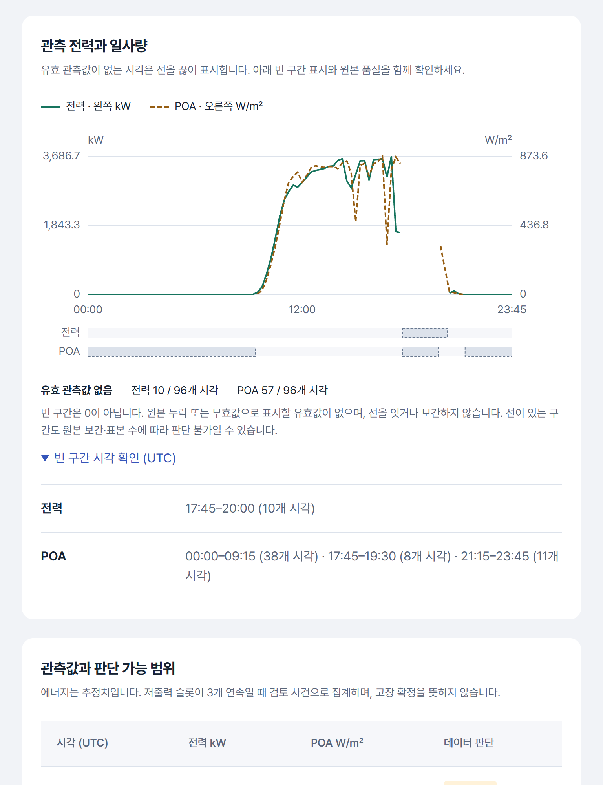

# 선택창 스크롤·관리 탭·관측 차트 검증

2026-10-23 (Asia/Seoul). 기준 코드는 `9fe010f`, 대상은 기존 로컬 공개 자료 앱 8502와 독립 관리 서버 8504입니다. API·계산·원본은 변경하지 않았습니다.

후속 사용자 피드백으로 이 문서의 ‘스크롤 시 목록 닫힘’은 [열림 유지·버튼에 다시 배치](select-anchor-20261023.md)로 교체했습니다. 아래 검사는 당시 동작의 기록이며 현재 목록의 동작 계약은 후속 문서가 기준입니다.

## 사용자 피드백과 수정

| 문제 | 확인한 원인 | 반영한 동작 |
|---|---|---|
| 목록을 열고 페이지를 스크롤하면 떠 있음 | fixed popover의 위치를 열 때만 계산. 180px 스크롤 후 trigger 하단 130.22px / 목록 상단 316.22px로 186px 이탈 | 바깥 문서 스크롤·화면 크기 변경 때 닫음. 목록 내부 스크롤은 유지. Home/End는 목록만 움직이고 배경 페이지는 유지 |
| 시스템 관리에 들어가 다시 열기 버튼을 눌러야 함 | 분석 앱에 별도 안내 페이지가 있었음 | 사이드바에서 8504로 바로 이동. 예전 `?view=system` 주소도 이동하며 월·자료 필터 보존. 서비스 제어 / 컨테이너 상태 / 운영 안내 탭으로 구분 |
| 관측 차트가 끊어져 보임 | 실제 API null 구간. 기존 차트는 빈 구간 설명이 부족하고 작은 화면에서 SVG 글씨도 축소 | null은 유지하고 빈 구간 띠·개수·정확한 UTC 시각 표시. 전력 실선 / POA 점선. SVG 좌표 폭을 실제 표시 폭과 맞춰 레이블 14px 유지 |

선택창의 Escape·포커스 복귀·native select 값/change 계약을 유지했습니다. 관측값 표에는 키보드로 가로 스크롤할 수 있는 영역 이름과 포커스를 추가했습니다. 단일 유효값은 점으로 표시하고 실제 시각 간격이 15분을 초과하면 선을 잇지 않습니다.

독립 관리 서버는 분석 앱을 꺼도 다시 시작할 수 있도록 유지합니다. 이번 변경은 화면과 탐색에 한정하며, 기존 관리자 보안·제어 범위·API는 바꾸지 않았습니다.

## 차트의 끊김은 정상인가

사용자 화면과 같은 **PS_001 · 2024-04-30 · UTC**를 API와 보존 원본 CSV로 대조했습니다. 최대 전력 3,686.68kW, 최대 POA 약 873.58W/m²입니다.

| 계열 | 표시할 유효값이 없는 시각 (양 끝 시각 포함) | 개수 |
|---|---|---|
| 전력 | 17:45–20:00 | 10 / 96 |
| POA | 00:00–09:15, 17:45–19:30, 21:15–23:45 | 38 + 8 + 11 = 57 / 96 |

17:45–20:00 원본에서 인버터 39개 × 10시각 = **390행의 전력값이 모두 비어 있었습니다**. 같은 구간 기상 10행 중 POA 8개도 비어 있습니다. 두 필드 모두 음수는 0개였습니다. 따라서 선을 끊는 것은 정상이며 0이나 임의 보간으로 채우면 안 됩니다.

이는 행 자체가 없는 경우와 다릅니다. 관측 슬롯 지표가 100%여도 값이 비어 있을 수 있습니다. 새 설명은 빈값과 무효값을 포괄해 ‘유효 관측값 없음’으로 표시하며, 원본 보간·표본 수에 따른 판단 가능 여부는 기존 관측값 표에서 별도로 확인합니다. 선이 이어진다고 실측 품질이 보장되는 것도 아닙니다.

## 실제 화면

모두 실제 Chromium 렌더링의 DPR 2 원본입니다. GitHub 본문에서는 축소 표시되므로 링크로 열어 확대할 수 있습니다. [이미지별 출처·촬영 조건](../portfolio/images/interactions-20261023/README.md).

| 영역 | 수정 전 | 수정 후 |
|---|---|---|
| 목록 스크롤 | [1440px 이탈 재현](../portfolio/images/interactions-20261023/before-detached.png) | [열림 1440px](../portfolio/images/interactions-20261023/runs-open-1440.png), [스크롤 후 닫힘](../portfolio/images/interactions-20261023/runs-scrolled-1440.png), [보고서 390px](../portfolio/images/interactions-20261023/reports-open-390.png) |
| 시스템 관리 | [중간 페이지](../portfolio/images/interactions-20261023/before-system.png) | [서비스 1440px](../portfolio/images/interactions-20261023/admin-services-1440.png), [컨테이너 768px](../portfolio/images/interactions-20261023/admin-containers-768.png), [안내 390px](../portfolio/images/interactions-20261023/admin-guide-390.png) |
| 관측 차트 | [기존 1440px](../portfolio/images/interactions-20261023/before-series.png) | [1440px](../portfolio/images/interactions-20261023/series-1440.png), [768px](../portfolio/images/interactions-20261023/series-768.png), [390px](../portfolio/images/interactions-20261023/series-390.png) |



이전·이후는 해당 기능으로 스크롤한 실제 화면이며 동일한 잘라내기 영역의 픽셀 비교가 아닙니다. 원본 캡처는 축소 편집·샤프닝하지 않았습니다.

## 실행한 검사

| 검사 | 결과 |
|---|---|
| API validation + 관리자 pytest | **31 passed**, 4.09초 |
| Agent Browser 회귀 | **303명령**, 1440/768/390 CSS px |
| axe 접근성 | **18회, 위반 0** |
| 상호작용 | 두 화면의 선택창 실제 wheel, 긴 날짜 목록 내부 스크롤·Home/End/Enter·Escape·포커스·배경 위치 |
| 관리 탐색 | 직접 링크·과거 주소 이동, 세 탭·방향키·Home/End·해시 직접 주소·필터 보존 |
| 데이터 표현 | 실제 null 구간/개수, 브라우저 안의 null/0/단일 점/불규칙 시각 fixture, 빈 상태·오류·복구 |
| 불변 확인 | 시계열·overview API 응답 전후 동일, 관리자 operation 전후 동일, JS 페이지 오류 0 |
| 배포 | 8502 HTML/JS/controls/CSS와 8504 HTML/JS가 작업 소스와 SHA-256 일치 |
| 정적·문서 검사 | Ruff 검사·70파일 형식, JS 문법, 로컬 링크493·스크립트 참조57·원본 기획 체크섬8개, diff 공백 검사 통과 |
| GitHub CI (`a416080`) | Windows/Ubuntu 각각 **127 passed, 5 skipped**, 합성 데모·복원·wheel·소스 패키징 성공. [실행39881009706](https://github.com/TaeyanG4/solarops-audit/actions/runs/39881009706) |

관리 중지 확인창은 열고 **취소**했으며 실제 시작·중지 요청은 제출하지 않았습니다. 이번 작업에서 전체 수명주기 시험을 다시 수행했다고 주장하지 않습니다. 그 검사는 [이전 범위](workspace-20261023.md)에 있습니다.

재실행에는 준비된 로컬 8502/8504와 Agent Browser가 필요합니다. 출력은 존재하지 않는 새 폴더를 지정합니다.

```text
uv run pytest -q tests/test_api_validation.py tests/test_admin.py
uv run python -u scripts/validation/interaction_browser.py --output artifacts/interactions-new
```

로컬 상세 증거(Git 제외): `artifacts/ui04-20261023/verified-v2/{summary,checks}.json`, `pytest.xml`, `series-before.json`, `source-gap-check.json`, `deployed-assets.json`. 브라우저 fixture는 브라우저에만 주입했으며 DB·보고서·공개 자료에 쓰지 않았습니다.

대시보드 이미지 `solarops-worker:0.4.1-ui04-20261023`을 빌드해 dashboard만 재생성했습니다. DB·MinIO·kind와 원본 자료는 유지했습니다. 이미지 SHA는 [버전 기록](../image-versions.json)에 있습니다.

## 스킬과 검수 범위

| 스킬 | 이번에 실제 사용한 목적 |
|---|---|
| UI UX Pro Max | dropdown/scroll/keyboard 및 missing/time series 검색. 목록 키보드 동작·계열 선 구별·수치표 대안을 적용 |
| Impeccable | harden·craft-floor·polish로 스크롤/포커스·글씨·탭 위계 검수. 정적 detector와 실제 캡처를 함께 검토 |
| Agent Browser | 실제 Chromium 상호작용·반응형·axe·전후 캡처 및 재현 가능한 회귀 스크립트 |
| Web Design Guidelines | 최신 규칙으로 href 탐색·URL/탭 상태·포커스·키보드 스크롤 확인 |

Impeccable detector는 **27건(권고 26, 경고 1)**을 보고했습니다. 경고는 정적 HTML에서 `/static/dashboard.css?v=…`를 연결하지 못해 body/h1/h2를 모두 16px로 판단한 항목입니다. 실제 서비스의 computed style은 390px에서 body16px·페이지 제목32px·최근 작업 제목15px였고 캡처도 확인했습니다(`rendered-typography.json`, Chrome156). 권고에는 정적 색상/토큰 탐지가 포함되며 detector 0건으로 기록하지 않습니다. 이번 검수는 자체 검수이고 별도 에이전트 독립 리뷰를 수행하지 않았습니다.

이번 결과는 Chromium의 화면 크기 에뮬레이션입니다. 실제 터치 기기·Safari/Firefox·스크린리더 검증이나 WCAG 인증, 전체 공개 자료 재처리·현장 설비 정상 판정을 뜻하지 않습니다.
