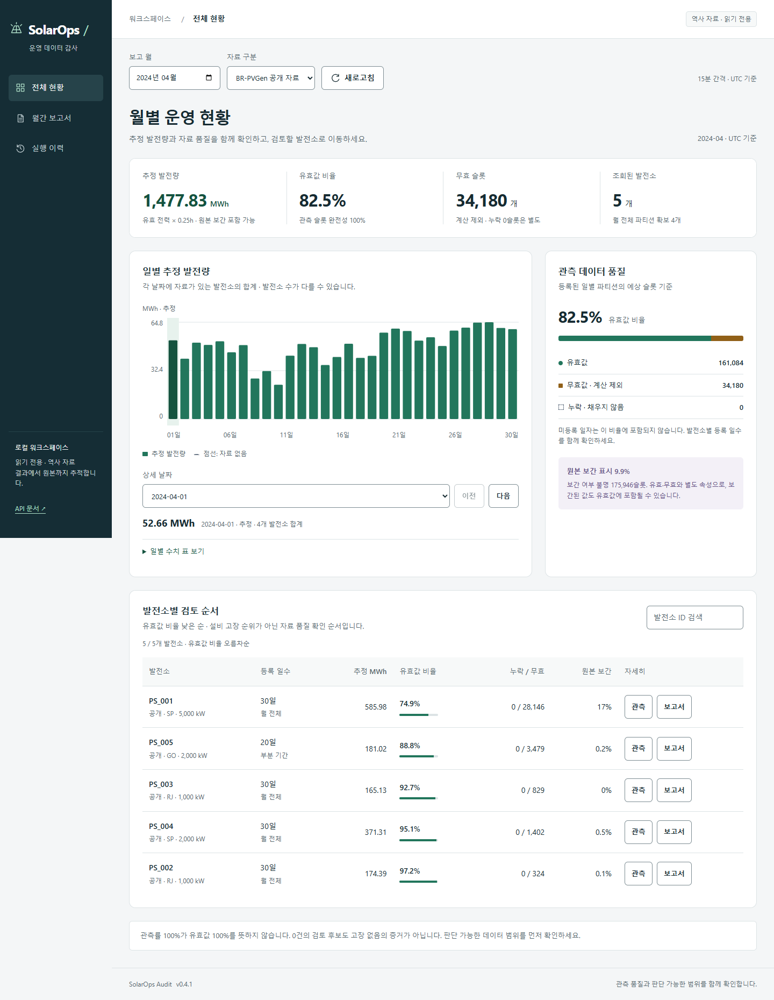

# 전체 현황 리디자인 검증 — 2026-10-23

범위: 전체 현황과 공통 화면 틀. 기존 FastAPI/API/계산은 변경하지 않았습니다. 기준 코드 `eb3501c`, 앱0.4.1 / 계산energy-interval-v2, Windows 로컬 Compose `127.0.0.1:8502`에서 공개2024-04자료를 사용했습니다.

## 전후 화면

같은 공개 자료·동일 너비, viewport 높이1000px의 전체 페이지 캡처입니다. 추가 탐색 기능과 모바일 발전소 요약 때문에 페이지 높이는 달라집니다. 기존 이미지와 원본 데이터는 보존했습니다.

| 너비 | 수정 전 | 수정 후 |
|---|---|---|
| 1440px | [전체 보기](../portfolio/images/overview-redesign/before-1440.png) | [전체 보기](../portfolio/images/overview-redesign/after-1440.png) |
| 768px | [전체 보기](../portfolio/images/overview-redesign/before-768.png) | [전체 보기](../portfolio/images/overview-redesign/after-768.png) |
| 390px | [전체 보기](../portfolio/images/overview-redesign/before-390.png) | [전체 보기](../portfolio/images/overview-redesign/after-390.png) |



## 적용과 발견 사항

[디자인 시스템](../design/overview-system.md)에 UI UX Pro Max 검색, 제품에 맞지 않은 landing 패턴의 제외, 색·크기·반응형·데이터 의미를 기록했습니다. Impeccable4.7.0의 audit/polish와 Agent Browser0.39.1을 사용했습니다. Github 인기/별점은 이번 작업에서 평가 근거로 사용하지 않았습니다.

| 우선순위 | 발견한 문제와 근거 | 수정 |
|---|---|---|
| P1 | 이전 CSS 캐시와 새 HTML/JS가 섞이면 SVG가 기본 크기·검정으로 출력. 첫 배포 `draft-*.png`에서 재현 | HTML 정적 자산 version query, 최종렌더 재확인 |
| P2 | 이전 표헤더10px/내용12px, 390px 차트축이 SVG와 함께 작아짐 (`before-390.png`) | 표13/14px, 차트축은 HTML12px로 고정 |
| P2 | title에만 의존한 날짜 수치 탐색, 좁은 화면에서 상세 버튼이 가로 스크롤 뒤에 있음 | 날짜선택·방향키·수치표, 발전소 요약배치·44px버튼 |
| P2 | 보간과 유효값의 관계, 미등록 일자와 슬롯누락의 분모 혼동 가능 | 원본보간을 별도 색/설명으로 분리, 미등록 일자 제외 명시 |
| P2 | 첫 개선안390px에서 자료구분 select 문구가 잘림 (`review-390.png`) | 월/새로고침1행, 자료구분 전체너비2행 |

Impeccable 정적 detector 최초 및 후속 CSS 보완 후 모두 `[]`, exit0. 코드 검출은 실제 사용성의 증거를 대신하지 않으므로 아래 렌더링·상호작용을 함께 검증했습니다. 별도 사용자 인터뷰나 독립 에이전트 리뷰는 수행하지 않았습니다.

## 실행 결과

| 검사 | 실제 결과 |
|---|---|
| Agent Browser / Headless Chrome155 | 79개 CLI 명령·assertions 완료, 1440/768/390px 실제 렌더링 |
| axe-core4.12.1 | 세 너비 각각45passes / 0violations / 0incomplete |
| 가로 넘침 | 전체 현황1440/768/390px 및 추가320px에서 document.scrollWidth=innerWidth |
| 키보드 | 막대 focus→ArrowRight→End, 날짜 동기화와 마지막 날짜 다음버튼 비활성 확인 |
| 수치 탐색 | 날짜 select,30일 수치표, API의 해당날 합계와 표시값 일치 |
| 발전소 | 대소문자 검색, 결과 없음, 부분기간, PS_001 관측/보고서 진입, 실행이력 화면 이동 |
| 기간·출처 | 공개→합성, 네이티브 month의 연도키 변경, 빈 기간 안내 |
| 누락·0·null | 합성 누락날짜 안내. 브라우저에서만 주입한 fixture로 실제0 / 자료없음 / 추정값없음 구분, 서버자료 비변경 |
| 오류 | 테스트 브라우저의 overview 요청만 abort→오류→route해제→다시시도 성공 |
| 터치 | Agent Browser가 연 Chrome의 CDP Input.dispatchTouchEvent로390px 다음날 버튼 동작 확인 |
| 동작 줄이기 | reduced-motion에서 버튼 transition0s 확인 |
| 페이지 오류 | page errors0, console messages0 (검증 종료 시) |
| 데이터 보존 | 공개2024-04 overview 응답 전체 JSON 전후 일치:1,477,828.846kWh, 유효161,084/무효34,180/누락0슬롯,5개발전소 |
| Python 회귀 | Windows `uv run pytest -q`:112passed,6skipped(18.68초) |
| 정적 검사 | Ruff check/format 통과, JS구문 검사 통과 |

자동 접근성0건은 전체 WCAG 인증이 아닙니다. 실제 스마트폰·Safari/Firefox·스크린리더 음성은 미검증입니다. 생성된 보고서는 저장된 원본 HTML이며 관측 상세차트의 모바일축은 이번 범위에서 재설계하지 않았습니다. 서비스데이터 재처리·Airflow/Kubernetes 재실행은 하지 않았습니다.

## Impeccable 자체 검수

| 차원 | 점수(0–4) | 판단 근거·한계 |
|---|---|---|
| 접근성 | 3 | axe0건·키보드·대체표 확인, 실제 보조기기 미검증 |
| 성능 | 3 | 외부JS/폰트/차트 의존성 추가없음, overview단일조회 유지. 새 성능 벤치마크 없음 |
| 테마 | 3 | 전체 현황 의미별 토큰 일관성, 밝은 테마만 제공 |
| 반응형 | 3 | 세 요구너비+320px·합성터치 확인, 실제기기 미검증 |
| 구현 일관성 | 4 | detector0건, 역사자료/추정/품질 의미와 표시 일치 |
| 합계 | 16/20 | Good. 자체 평가이며 독립 리뷰 아님 |

## 재현과 증거

로컬 로그는 Git제외 `artifacts/ui-overview-20261023/`에 있습니다. `verify.py`, `edge-checks.py`, `touch.mjs`와 JSON로그, 원본 전후 캡처, API전후 JSON, pytest.log, impeccable-final.json을 보존했습니다. 테스트 도구는 무시된 `.tools/ui-review/`에 고정설치했고 앱 의존성에는 추가하지 않았습니다.

```powershell
$ab = '.tools/ui-review/node_modules/agent-browser/bin/agent-browser-win32-x64.exe'
& $ab --session solarops-review open 'http://127.0.0.1:8502/?view=overview&period=2024-04&source=public'
& $ab --session solarops-review set viewport 390 1000
& $ab --session solarops-review screenshot artifacts/review-390.png --full
& $ab --session solarops-review a11y --json
& $ab --session solarops-review close
```

화면용 Compose이미지는 `solarops-worker:0.4.1-overview-20261023`; [이미지 ID](../image-versions.json)에 별도 기록합니다. 기존 worker는 기준코드로 태그를 복원하고 Airflow·kind는 중지상태를 유지합니다. 별도 Python서버 없이 app-db·MinIO·dashboard만 사용합니다.

worker0.4.1 태그는 UI개발 빌드 중 이동했으므로 `git archive eb3501c`의 별도 경로에서 다시 빌드해 기준 소스로 복원했습니다. 원래 기록 ID `478d7fbf…`는 로컬에서 조회되지 않았고, 복원 빌드 ID는 `d094ef26…`입니다. 소스 복원과 이미지 바이트 동일성은 구분하며 기존 파일·볼륨을 삭제하지 않았습니다.

문서검사169개 로컬링크/50개 스크립트참조/8개 보존checksum 통과, 진행기록 일관성 검사 통과. 기능커밋 `afd6169`의 [CI39812883684](https://github.com/TaeyanG4/solarops-audit/actions/runs/39812883684)는 Windows·Ubuntu 모두 success입니다. 각113passed/5skipped이며 합성 데모·복원·wheel·소스 패키징도 통과했습니다. Windows 로컬의 추가skip1개는 환경별 실행 조건 차이로 CI결과와 구분합니다.
