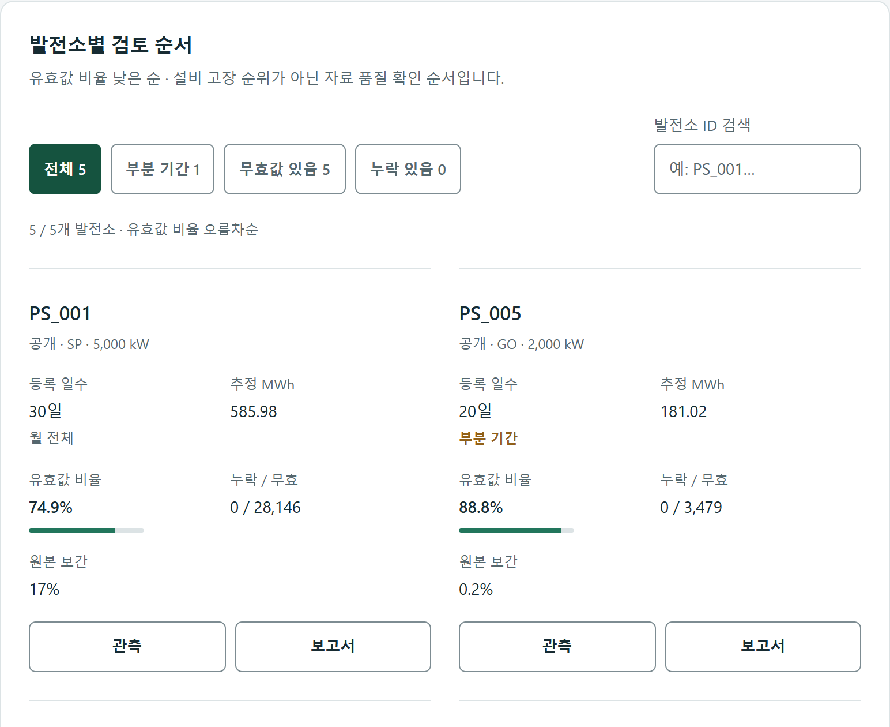

# 전체 현황 출처·검토 흐름 개선 — 2026-10-23

이 문서는 **채택되지 않은 중간안**의 기능 검증 기록입니다. 사용자가 기존과 비슷한 외형을 거절해 [Energy Desk](energy-desk-20261023.md)로 새로 만들었습니다. 아래 결과를 최종 디자인 승인으로 해석하지 않습니다.

기준 코드 `2bd379c`, 앱 0.4.1 / 계산 `energy-interval-v2`. 기존 리디자인 위에 출처와 검토 흐름을 보완했습니다. FastAPI·API·계산·원본 자료·기존 테스트 계약을 변경하지 않았습니다. 로컬 Compose 8502, 공개 BR-PVGen 2024년 4월 기준입니다.

## 전후 화면

동일 데이터·너비, 높이 1000 CSS px, DPR 2의 실제 Chrome 전체 페이지 캡처입니다. 새 영역 때문에 전체 페이지 높이는 달라집니다. 긴 이미지를 작은 표 안에 축소하지 않고 원본 링크로 제공합니다.

| 화면 너비 | 개선 전 | 개선 후 |
|---|---|---|
| 1440px | [원본](../portfolio/images/overview-v2-20261023/before-1440.png?raw=1) | [원본](../portfolio/images/overview-v2-20261023/after-1440.png?raw=1) |
| 768px | [원본](../portfolio/images/overview-v2-20261023/before-768.png?raw=1) | [원본](../portfolio/images/overview-v2-20261023/after-768.png?raw=1) |
| 390px | [원본](../portfolio/images/overview-v2-20261023/before-390.png?raw=1) | [원본](../portfolio/images/overview-v2-20261023/after-390.png?raw=1) |



[README용 출처·요약](../portfolio/images/overview-v2-20261023/overview.png?raw=1) · [일별 차트](../portfolio/images/overview-v2-20261023/chart.png?raw=1) · [품질](../portfolio/images/overview-v2-20261023/quality.png?raw=1). 820px/DPR 2로 새로 렌더링해 크롭했습니다. 원본 PNG 확대·샤프닝·수치 편집은 하지 않았습니다.

## 발견과 해결

| 우선도 | 발견된 문제 | 변경과 확인 |
|---|---|---|
| P1 | 합계·발전소의 `null / 1000`이 0으로 표시됨 | 브라우저 전용 fixture로 수정 전 `0MWh`·`0` 재현. null 검사 후 `추정값 없음`, 실제 0 유지 |
| P2 | 화면 안에서 원본 출처로 바로 갈 수 없음 | 조회 자료 종류별 설명과 Zenodo·CC BY 4.0 표시. 합성 화면에서 공개 출처 링크 제거 |
| P2 | 부분 기간·무효·누락 대상은 표를 직접 읽어 찾아야 함 | 실제 API 속성 기반 범위 버튼·건수·검색·초기화. PS_005 부분 기간과 DEMO_01 누락 확인 |
| P2 | 탐색 버튼은 새 탭·기본 뒤로 가기를 제공하지 않음 | 주 메뉴·발전소 이동을 href 링크로 전환. 검색/검토 범위 URL 저장, reload/back 복원 확인 |
| P2 | 일별 null과 미등록 날짜의 차트 표식이 같음 | 빈 원과 점선, 날짜 설명과 수치표의 명시적 문구로 구별 |
| P3 | placeholder만 보이는 검색 입력 | 클릭 가능한 label·name·autocomplete·spellcheck, 모바일 2×2 검토 버튼 |

중간 검수에서 링크 버튼의 CSS 우선순위가 기본 버튼 색을 덮는 문제를 발견해 수정했습니다. Impeccable의 detector 결과만으로 이 문제를 발견했다고 주장하지 않습니다.

## 실행 결과

Agent Browser 0.39.1, Headless Chrome 156, axe-core 4.12.1 / Windows에서 실행했습니다.

| 검사 | 결과 |
|---|---|
| 브라우저 회귀 | [재현 스크립트](../../scripts/validation/overview_browser.py), 107개 명령 통과 (세션 종료 제외) |
| 접근성·반응형 | 1440/768/390px 각각 axe 위반 0건. 320px 포함 문서 가로 넘침 0 |
| 필터·이동 | 부분 기간·무효·누락, 공백/대소문자 검색, 결과 없음, 초기화 포커스, URL reload/back, 관측·PS_001 보고서·이력 이동 |
| 값의 의미 | 합계·발전소 null, 발전소 0, 일별 0/자료 없음/추정값 없음, 별도 보간 설명 |
| 키보드·터치 | 범위 버튼 Space, 차트 ArrowRight/End·select·수치표. 390px CDP 합성 터치로 다음 날짜 선택 |
| 상태 | 공개·합성·혼합, 빈 월, 테스트 브라우저 요청 abort 후 다시 시도, reduced-motion |
| 페이지 오류 | 회귀 종료 시 errors 0 / console messages 0 |
| API 보존 | 수정 전후 공개 overview 전체 JSON 동일. 1,477,828.846 kWh, 유효 161,084 / 무효 34,180 / 누락 0, 발전소 5개 |
| Python | `uv run pytest -q`: 112 통과·6 제외, 20.12초. 서비스 의존 제외를 통과로 계산하지 않음 |
| 정적 검사 | Ruff check/format, Node 문법 검사 통과. Impeccable source detector `[]`, exit 0 |
| 서비스 | `/health`·`/ready` HTTP 200. dashboard만 새 UI 이미지로 교체, DB·MinIO 자료 유지 |

전체 WCAG 인증, 실제 스마트폰·보조기기·Safari/Firefox 검증을 뜻하지 않습니다. Airflow/Kubernetes 작업이나 전체 공개 데이터 재처리를 다시 실행하지 않았습니다.

## Impeccable 자체 검수

구현 일관성 **통과**: 밝은 운영 화면의 기존 토큰, 추정 에너지와 데이터 상태의 표현을 유지했습니다. detector는 정적 소스 검출이며 실제 렌더·조작 증거와 구분합니다.

| 차원 | 점수 / 4 | 근거와 한계 |
|---|---:|---|
| 접근성 | 3 | axe·키보드·명시적 레이블·실제 링크. 보조기기 미검증 |
| 성능 | 3 | 기존 overview 1조회, 필터는 메모리에서 수행. 새 성능 부하 시험 없음 |
| 테마 | 3 | 의미별 토큰 유지, 밝은 테마만 지원 |
| 반응형 | 3 | 세 요구 너비·320px·합성 터치, 실제 기기 미검증 |
| 구현 일관성 | 4 | null→0 회귀 수정, 출처·분류·이동 흐름의 일관성 |
| 합계 | **16 / 20** | Good. 자체 검수이며 독립 평가·사용자 조사 아님 |

Web Design Guidelines 검토는 변경 범위의 실제 링크, URL 상태, 레이블, 테마 메타, 숫자 정렬, 빈값·오류·포커스·동작 줄이기 지침에 적용했습니다. 발견 위치와 결과:

- `src/solarops/api/dashboard.html:31` — 주 메뉴 button→a, 실제 href 및 aria-current 유지.
- `src/solarops/api/static/dashboard.js:70` — 검토 범위/검색 URL 보존과 실제 발전소 링크.
- `src/solarops/api/static/dashboard.js:564` — 검색 label/name/autocomplete/spellcheck 보완.
- `src/solarops/api/dashboard.html:6` — theme-color 명시.

생성 보고서와 관측 상세 화면 전체를 새로 디자인한 것으로 표현하지 않습니다. 영어 Title Case, React hydration 등 이 한국어 정적 앱에 해당하지 않는 규칙은 적용 대상으로 삼지 않았습니다.

## 재현

공개 April 2024·합성 데모가 준비된 로컬 서비스에서 실행합니다. API에는 쓰지 않고 fixture는 테스트 브라우저의 응답에만 주입합니다. 출력 폴더는 매번 새 이름을 사용합니다.

```text
npm install -g agent-browser@0.39.1
agent-browser install
uv run python scripts/validation/overview_browser.py --output artifacts/overview-check-new
```

Windows에서는 CLI의 `.cmd`가 URL의 `&`를 셸 명령으로 해석하는 문제를 피하도록 스크립트가 native exe를 직접 사용합니다. 처음 띄운 daemon이 캡처 pipe를 보유하는 문제도 파일 출력으로 우회합니다. 테스트 도구 오류를 제품 오류로 계산하지 않습니다.

상세 로그·원본 API 응답·설치 로그·터치 증거·중간 실패는 Git 제외 `artifacts/ui-overview-v2-20261023/`에 보존합니다. [수행 기록](../worklog/2026-10-23-overview-v2.md) · [스킬과 설치 버전](../development/skills.md).
