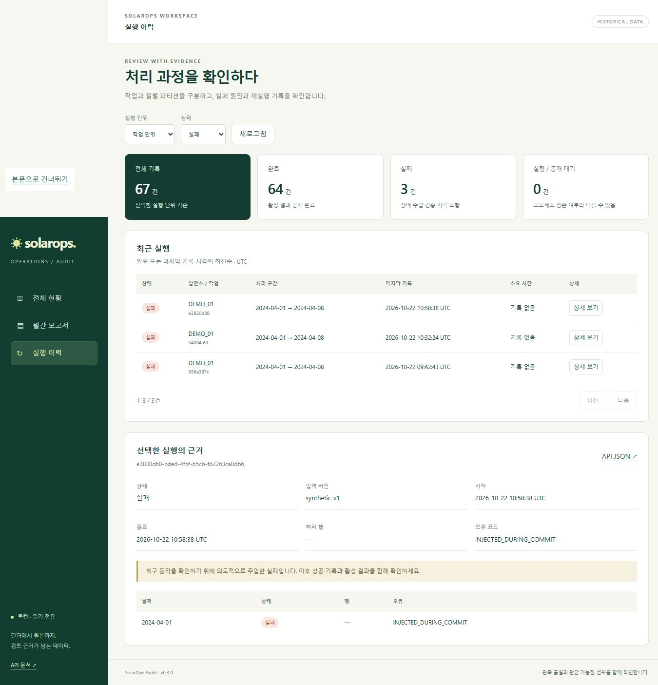

# v0.3.0 워크스페이스 개선 검증

2026-10-22, 같은 Windows/WSL/Docker 개발 환경에서 수행했습니다. 전체 데이터셋 처리 성능은 [기존 보고서](2026-10-22.md)에 별도로 기록되어 있습니다.

## 월별 조회의 HTTP 요청 감소

기존 화면은 발전소 목록 1회와 발전소별 지표 N회를 순차 호출합니다. 새 화면은 월 범위의 `/api/v1/overview`에서 필요한 지표를 한 번에 읽습니다. 같은 월과 자료 구분을 비교하기 위해 기존 방식에도 기간 필터를 넣었습니다. 실제 이전 화면은 전체 역사 범위를 조회했으므로 이 비교는 이전 방식에 유리한 조건입니다.

| 조건 | 기존 목록 + 발전소별 요청 | 새 overview |
|---|---:|---:|
| 보고 월 / 자료 구분 | 2024-04 / 전체 | 2024-04 / 전체 |
| 등록 발전소 수 | 52 (공개 51 + 합성 1) | 동일 DB |
| 자료 API HTTP 요청 수 | 53 | 1 |
| 응답 본문 합계 | 23,935 bytes | 15,245 bytes |
| 5회 중앙값 | 703.239ms | 12.576ms |
| 최소–최대 | 649.420–818.435ms | 12.081–32.202ms |

새 응답은 해당 월에 자료가 있는 발전소, 집계 지표, 30일 추이를 포함합니다. 이 달의 공개 자료는 5개 발전소에 있습니다. 기존 응답은 등록 목록과 각 발전소의 첫 지표·총 일수를 반환하므로 두 응답은 동일한 내용이 아닙니다. 버전 표시용 `/health` 최초 1회 호출과 HTML/CSS/JS 전송은 측정에서 제외했습니다.

클라이언트는 Windows Python urllib, 서버는 Compose FastAPI + PostgreSQL이며 localhost에서 순차 실행했습니다. 애플리케이션 캐시는 없지만 DB/OS 캐시를 초기화하지 않았습니다. 별도의 부하 격리나 동시 사용자 실험은 하지 않았습니다. 이 결과에는 HTTP 왕복 횟수의 차이가 포함됩니다. 전체 시스템의 일반적인 56배 성능 향상이나 DB만의 가속으로 해석하지 않습니다.

```text
uv run python scripts/validation/benchmark_dashboard.py --mode legacy --output artifacts/legacy-new.json
uv run python scripts/validation/benchmark_dashboard.py --mode overview --output artifacts/overview-new.json
```

기존 결과를 보존하기 위해 출력 파일은 새 경로여야 합니다. `--repeat`, `--period`, `--url`로 조건을 명시할 수 있습니다. 원본 증거는 `artifacts/dashboard-legacy-v030.json`, `artifacts/dashboard-overview-v030.json`입니다.

## 정확성과 호환성

- Windows 오프라인: 59 passed, 2 skipped (외부 서비스 + symlink 권한).
- WSL 오프라인: 60 passed, 1 skipped (외부 서비스).
- 실제 PostgreSQL/MinIO: 1 passed. 트랜잭션 복구와 새 overview/run-history/detail 쿼리를 함께 검사했습니다.
- Ruff와 JS 문법 검사 통과. wheel 내부에 dashboard HTML/CSS/JS가 포함되는 것을 확인했습니다.
- 독립 합성 데모: 커밋 중 실패 후 활성 결과 유지, 재실행 해시 일치, 활성 7개 파티션, 작업 상태 완료 2건/실패 1건을 실행 중 단언합니다.

회귀 검사는 슬롯 가중 비율(95% vs 잘못된 단순 평균 75%), 공개/합성 필터, 조직·시간대·계산 버전 격리, 윤년 2월, 빈 날의 null, 단일 SELECT, 이전 형식의 실행 기록 호환, 최신순·페이지·상태 필터, batch와 하위 파티션 연결을 포함합니다.

전체 51개 자료를 다시 적재한 측정이나 새 고장 탐지 성능 평가는 수행하지 않았습니다. 계산 규칙은 `energy-interval-v1`을 유지합니다.

## 화면 검증

실제 Compose 서비스에서 1365×960 데스크톱과 390×844 모바일 폭을 확인했습니다. 모바일의 문서 너비는 뷰포트를 넘지 않았고 넓은 표는 표 내부에서 가로 스크롤합니다. 월/자료 구분, 발전소 관측, 전력·POA 좌우 축, 상태 필터, 이전/새 실행의 상세, 빈 기간, 없는 발전소 보고서 안내를 확인했습니다. 브라우저 콘솔 오류는 관찰되지 않았습니다.

보고서가 없는 PS_005를 선택했을 때 다른 발전소 보고서를 대신 보여주던 동작을 검증 중 수정했습니다. 새 실행 실패 상세에는 소스 버전·시작/종료 시각·오류와 실패한 날짜가 연결됩니다. 이전 기록은 없는 연결과 소요 시간을 “기록 없음”으로 표시합니다.



화면 증거는 `docs/portfolio/images/overview.png`, `docs/portfolio/images/run-evidence.png`, 모바일은 gitignored `artifacts/mobile-v030.png`입니다.

## 원격 CI와 최종 이미지 실행

[v0.3.0 기능 커밋의 GitHub Actions](https://github.com/TaeyanG4/solarops-audit/actions/runs/39767534134)에서 Ubuntu·Windows 작업이 모두 성공했습니다. 각 OS에서 오프라인 검사, 정상 합성 데모, 실패·복구 데모, wheel 빌드, lockfile 일치와 아티팩트 업로드까지 완료했습니다. 업로드한 자료는 합성 보고서와 검증 증거이며 공개 원본이나 비밀 설정은 포함하지 않습니다.

Compose `compose-synthetic-*-1792666684`의 정상/재시도/백필/품질/보고서 5개 시나리오와 kind `k8s-public-*-1792666800`의 공개 자료 계획/처리/백필/품질/보고서 5개 시나리오가 새 이미지에서 성공했습니다. Compose의 주입 실패는 replay 태스크 try_number=2에서 성공했고, 모든 DAG는 검증 후 pause했습니다. kind 모드 DagBag의 4개 DAG와 공개/합성 템플릿도 검증했습니다.

처리 시간은 원본 등록 뒤 batch가 생성된 시점부터 기록합니다. 다운로드·원본 checksum/등록 시간은 포함하지 않습니다. batch 등록 전에 실패하는 입력 검증은 CLI 오류로 남고 이력 화면의 batch에는 포함되지 않을 수 있습니다.

증거: `artifacts/airflow-compose-v030.log`, `artifacts/k8s-public-v030.log`, `artifacts/portfolio-demo-v030.json`. 배포 이미지 ID는 `docs/image-versions.json`에 기록했습니다.
