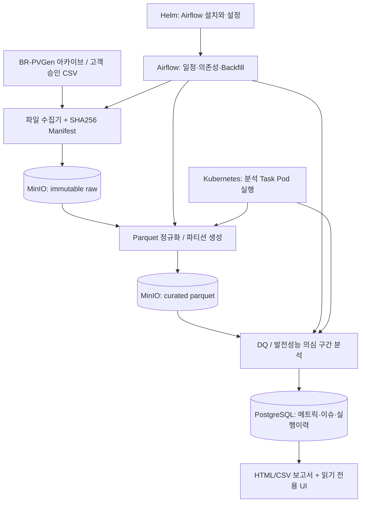

# SolarOps Audit — 사업화형 데이터 엔지니어링 프로젝트 기획서 (PRD + 기술설계)

- 문서 버전: v1.0 (2026-10-21)
- 프로젝트 상태: 기획 완료 / 구현 미착수
- 주목적: **유료 고객 검증이 가능한 태양광 O&M 데이터 감사·보고 자동화 MVP** 제작
- 부목적: Docker·Airflow DAG·Kubernetes·Helm의 실전 운영 포트폴리오 구축
- 대상 개발 환경: Windows + WSL2(Ubuntu) + Docker Desktop + VS Code
- 실행 주체: Codex(단계별 구현), 사람(고객 인터뷰·실행 환경 승인·데이터 제공 및 검수)

> 구현의 기본 원칙: 고객은 Airflow/Kubernetes가 아니라 데이터 검증과 업무시간 절감에 돈을 낸다. 두 기술은 운영 가치를 검증하는 프로젝트 요구사항으로 **반드시 구현**하지만, 초기 유료 서비스의 프로덕션 환경에서 무조건 사용할 필요는 없다.

## 1. 프로젝트 정의

### 1.1 한 문장 정의
다수 태양광 발전소를 관리하는 소규모 O&M 업체가 CSV/운영 데이터를 업로드하면, 결측·보간·중복·센서 이상과 발전 성능 의심 구간을 구분해 검증하고 재현 가능한 월간 보고서를 생성하는 **데이터 품질·운영 보고 플랫폼**.

### 1.2 문제/고객/해결책
- **1차 고객:** 발전소 여러 곳을 관리하고 여러 인버터/모니터링 솔루션에서 CSV를 추출하는 태양광 O&M 업체의 운영 담당자 및 팀장.
- **핵심 문제:** 회사마다 파일 형식이 다르고 누락/보정이 뒤섞여 있어 보고서 작성과 설비 확인 우선순위 결정에 시간이 든다.
- **제품이 해결하는 문제:** 원시 파일별 출처 확인, 데이터 정합성, 재처리 가능한 계산, 검토 우선순위 정리, 월간 보고 자동화.
- **차별화 후보:** 운영 데이터 신뢰도(수집 누락 / 소스 측 보간 / 품질 문제)와 발전 이상 징후를 **별도 분류**하고, 결과의 출처·근거·재실행 이력을 보여준다.
- **수익화 가설:** 고객은 반복 보고 업무시간 감소와 점검 누락 위험 감소에 대해 유료 파일럿 및 구독료를 지불한다. 이 가설은 미검증 상태다.

### 1.3 사용자별 주요 활동(JTBD)
1. 운영자: '지난달 A 발전소 자료가 정확한가? 누락/보간이 어디인지 알려줘.'
2. 운영자: '일사량이 충분한데 출력이 낮았던 구간을 검토 목록으로 만들어줘.'
3. 팀장: '50개 발전소의 월간 리포트를 같은 기준으로 생성하고 확인 근거를 남겨줘.'
4. 개발·운영자: '지난주 잘못 적재된 데이터를 원본 보존 상태에서 재처리하고 계산 결과를 비교해줘.'

## 2. 범위와 비범위

### 2.1 MVP 필수(P0)
- BR-PVGen 공개 자료의 출처·버전·체크섬·라이선스 확인 및 안전한 다운로드/적재.
- 51개 발전소 데이터 중 **1개 발전소 1주 구간**으로 시작, 이후 51개 전체 데이터 처리 확장.
- 스트리밍/청크 기반 처리, Parquet 파티셔닝, PostgreSQL 집계 마트.
- 데이터 품질: PK 중복, timestamp, NULL, 범위/단위, 소스 보간 플래그, 측정 샘플 수, 파일 계보 추적.
- 원본 불변 저장, 멱등 재실행, 실패 재시도, 기간별 Backfill 및 감사 로그.
- 분석: 일별 생산량 근사치, 데이터 완전성, 보간율, 검토가 필요한 저출력 구간.
- 월간 HTML/CSV 리포트 및 로컬 읽기 전용 대시보드.
- Airflow DAG 3종, Kubernetes 실행 Pod, Helm 배포, 재실행/장애 시연.
- 테스트, 보안 기본기, 설치 가이드, 성능 측정 리포트.

### 2.2 2차(P1)
- 고객사에서 제공한 단일 제조사 CSV 연결 어댑터 1종(고객의 사용 허가 전제).
- 파일 업로드/검수 워크플로와 승인된 이상 징후 상태 관리.
- 메일 발송(파일럿 동의와 발송 기록 필요), CSV 내보내기, 사용자별 권한.
- 계량 데이터·계약 단가를 **고객이 제공한 경우에만** 손실 추정치 표시.

### 2.3 초기에는 만들지 않음(P2/Out of scope)
- 발전소 제어/원격 차단, 고장 원인 자동 확정, 실제 손실액 확정, 보증성능(PR) 인증, 거래·정산 자동집행.
- 실시간 제어, Kafka/Spark/ML 학습 플랫폼, 다중 테넌트 결제 시스템, 모바일 앱, LLM 챗봇.
- 무단 크롤링 또는 외부 서비스 계정에 대한 임의 로그인.
- 실제 고객 확보 전 공개 인터넷 서비스 오픈.

## 3. 근거 데이터 및 중요한 주의사항

### 3.1 공개 데이터 — BR-PVGen
- 원문: https://zenodo.org/records/21511487
- DOI: https://doi.org/10.5281/zenodo.21511487
- 라이선스: CC BY 4.0. 재배포·상업적 활용 시 적절한 출처·변경 내용 표시, 저자가 안내한 데이터셋/연관 논문 인용 수행.
- 51개 익명 태양광 발전소(브라질), 2024-03-26~2025-06-09, 15분 간격(발전소별 범위 다름).
- 인버터 관측 약 14,400,480건, 기상 약 1,151,232건, 공개 압축 파일 총 약 351.3 MB.
- 원본 다운로드: `BR-PVGen_metadata.csv`, `BR-PVGen_inverter.zip`, `BR-PVGen_meteorological.zip`, `Readme.txt`.
- 게시된 파일의 MD5도 참조하고, 다운로드 후 자체 SHA-256을 계산해 manifest에 기록. 원본 파일을 Git에 커밋하지 않는다.

**데이터 품질에서 절대 놓치면 안 되는 사실**
1. 이는 **SCADA 원시 로그가 아니라 15분 간격으로 표준화·가중 이동평균·일부 보간된 데이터**다. `interpolated_keys_*`, `document_count_*` 컬럼을 보존하고 원시 결측률이라고 표현하지 않는다.
2. `Readme.txt`는 metadata의 `id`를 Integer로 서술하지만 **실제 CSV의 `id`는 `PS_001` 같은 문자열**이다. 실제 헤더/타입 검사 결과를 우선하고 README와 차이는 계약 문서에 기록한다.
3. README의 발전소 용량 범위 요약과 실제 `metadata.csv`의 일부 용량 값이 다를 수 있으므로 기본 범위 검증은 실제 수치·근거에 따라 정하고 값이 1 MW라고 자동 오류 처리하지 않는다.
4. 타임스탬프 예시는 `Z`(UTC)로 끝난다. UTC로 파싱/저장하고 화면 시각은 명시적 타임존 설정으로 변환한다.
5. 데이터셋에는 실제 고장 정답 라벨, 고객 정산 계약, 한국 발전소별 정밀 위치가 없다. **고장 확정/원화 손실/한국 발전소 일반화**를 주장하지 않는다.

### 3.2 수익화 비교 사례(상업적 선례, 가격 앵커가 아님)
- 국내 Solarlog O&M의 공개 기본형 가격은 100kW당 월 35,000원 수준이며 10년 약정과 하드웨어/시공 포함 조건이 명시돼 있다. 따라서 순수 SW형 SolarOps 가격과 동등 비교하면 안 된다. https://www.solarlog.kr/service/om
- 해외 에너지 데이터 분석 유료 서비스는 시장 존재 증거이지만, 해당 업체가 Airflow/Kubernetes를 사용한다는 증거로 활용하지 않는다.

### 3.3 사용자 파일 확보 전제
- 실제 고객 CSV는 비식별/계약·보안 검토 후에만 사용한다.
- 공개 데이터로 개발한 엔진의 정확도와 국내 실제 고객 가치 검증은 별개 단계로 취급한다.

## 4. 성공 지표와 검증 게이트

| 범위 | 지표 | 초기 목표/합격 조건 | 측정 방식 |
|---|---|---|---|
| 기술 | 소규모 샘플 파이프라인 | 1개 발전소 1주 데이터 end-to-end 성공 | `make demo-sample` 로그 및 DB 조회 |
| 기술 | 멱등성 | 같은 파일/구간을 3회 처리해도 결과 행수·체크섬 동일 | 자동 통합 테스트 |
| 기술 | 실패 복구 | 고의로 Pod를 종료한 뒤 재실행 시 중복·부분 공개 없음 | 사고 시뮬레이션 기록 |
| 기술 | 데이터 계보 | 모든 보고 지표에서 소스·버전·처리시각 추적 가능 | 보고서 drill-down / API |
| 기술 | 규모 확장 | 51개 발전소 전체 데이터 파이프라인 완료; 시간·RAM 측정 | 1·2·4 Pod 비교, 환경 기록 |
| 품질 | 합성 오류 검사 | 생성한 누락·중복·시간 오류를 규칙으로 검출 | golden fixture 테스트 |
| 품질 | 실제 고장 검출 | MVP에서 성능 수치 단정 금지 | 전문가 라벨 확보 후 평가 |
| 사업 | 발견 인터뷰 | O&M 담당자 10명 이상 인터뷰, 반복 문제 확인 | 기록 및 검증 동의 |
| 사업 | 파일럿 진입 | 실제 데이터 사용 허가 업체 최소 1곳 또는 명시적 피벗 | 동의/계약 기록 |
| 사업 | 첫 수익 | 유료 파일럿 1건 체결을 목표로 제안; 보장 아님 | 실제 결제 확인 |
| 사업 | 가치 | 보고서 작성 시간 30% 이상 절감 **가설** | 고객의 before/after 측정 |

## 5. 전체 시스템 설계

### 5.1 처리 흐름


### 5.2 실행 환경을 두 가지로 **분리**
1. **local-dev (필수):** WSL2 → Docker Compose → 앱 전용 PostgreSQL + MinIO + Airflow 개발 스택 + 실행 CLI + 대시보드. 작은 샘플로 검증.
2. **local-k8s (필수):** WSL2 → kind 클러스터 → Airflow Helm Chart + 앱 전용 PostgreSQL + MinIO + 전용 서비스 계정 + 컨테이너 작업. **Compose 서비스에 의존하지 않고** 클러스터 내부 서비스 DNS로 연결한다.

- 시스템 메모리가 충분하지 않으면 두 환경은 **동시에 띄우지 않는다**.
- Airflow의 **메타데이터 DB**와 제품 분석용 **앱 DB**는 논리·계정·데이터를 분리한다.
- kind는 학습·시연 환경이다. 개발용 PV/비밀 설정을 그대로 인터넷 프로덕션에 사용하지 않는다.

### 5.3 결정한 기술 스택
| 영역 | 선택 | 선택 이유 |
|---|---|---|
| 런타임 | Python 3.12 + `uv` 의존성 잠금 | 재현성·개발 편의 |
| 데이터 처리 | Polars 또는 PyArrow의 청크 처리(프로젝트 시작 시 하나 결정) | 1,440만 행 전체를 RAM에 적재하지 않기 위해 |
| SQL / 집계 | DuckDB(Parquet 집계), PostgreSQL 16(메타데이터·마트) | 원본 대량 조회와 서비스 조회 분리 |
| 저장소 | MinIO(S3 호환) + Parquet | 파일 불변성, 이력 및 파티셔닝 |
| 오케스트레이션 | Apache Airflow 3.3.x, Task SDK, KubernetesPodOperator | 실행 의존성·백필·작업 Pod 격리 |
| 컨테이너 | Docker & Compose | 재현 가능한 개발 실행 |
| 오케스트레이터 인프라 | kind + Kubernetes + Helm | 로컬 K8s 데모·리소스·배포 관리 |
| 보고서 | Jinja2 기반 HTML + CSV (MVP) | 저비용, 파일럿 피드백 즉시 반영 |
| 서비스 화면 | Streamlit 로컬 읽기 전용(선택) | 무거운 프론트 개발 피함 |
| 품질/자동화 | pytest, Ruff, GitHub Actions | 회귀 방지 및 재현성 |
| 운영 | JSON 로그 + 메트릭; 추후 Prometheus/Grafana | 오류 분석 가능한 기준 세움 |

> 시작 시 구체적인 Docker/Helm/Airflow/Provider 이미지 버전은 호환성을 확인해 잠금파일/설정에 정확히 고정한다. 떠다니는 `latest` 태그는 금지. KubernetesExecutor와 KubernetesPodOperator를 혼동하지 않는다. 이 계획은 **Helm + LocalExecutor + KubernetesPodOperator**를 1차 권장 구성으로 한다(작업별 Pod는 KPO가 실행). 적용 불가 시 근거와 ADR을 남기고 대안을 선택한다.

## 6. 데이터 계약 및 모델

### 6.1 Raw 저장과 버전
- 예시: `s3://solarops-raw/demo/br-pvgen/v1/BR-PVGen_inverter.zip` / `s3://solarops-raw/customer-approved/{org_id}/{import_id}/...`. 단일 파일 checksum이 같더라도 조직 간 권한·원본 메타데이터가 공유되면 안 된다.
- 다운로드는 명시적 실행에서만 수행하며, 설치나 테스트 단계에 351MB 다운로드를 강제하지 않는다.
- `manifest.json`: org_id, origin URL, upstream_dataset_version, original_filename, md5_expected(있다면), sha256_actual, byte_size, license, downloaded_at_utc, source_kind, source_preprocessed=true.
- 다운로드·압축 해제 시 다운로드 크기/파일 확장자/압축 경로 탈출(zip-slip)/압축 해제 용량 제한 검사.
- 고객 파일은 공개 데이터와 저장 버킷·권한을 분리. 암호/개인정보와 고객 원본 파일을 Git에 커밋하지 않는다.

### 6.2 핵심 PK/컬럼 (DB 타입은 구현 시 마이그레이션에 고정)
| 테이블 | 자연키/주요키 | 주요 컬럼 |
|---|---|---|
| `dim_plant` | `(org_id TEXT, plant_id TEXT)` | `nominal_power_kw`, `state`, `structure_type`, `source_version` |
| `source_object` | `source_object_id UUID` | `org_id`, `sha256`, `UNIQUE(org_id, sha256)`, `origin_uri`, `license`, `source_version`, `dataset_kind`, `created_at` |
| `pipeline_run` | `run_id UUID` | `org_id`, `dag_id`, `partition_id`, `source_object_id`, `status`(`running/staged/validated/committed/failed`), `started_at`, `finished_at`, `error_code` |
| `active_partition_manifest` | `(org_id, source_kind, partition_id, calculation_version)` | `active_source_version`, `object_prefix`, `logical_content_hash`, `committed_at`, `run_id` |
| `dq_issue` | `issue_id UUID` | `org_id`, `plant_id`, `event_at`, `rule_id`, `reason`, `severity`, `origin`, `evidence_json`, `run_id` |
| `daily_plant_metric` | `(org_id, plant_id, local_date, report_timezone, dataset_version, calculation_version)` | `estimated_energy_kwh`, `coverage_ratio`, `source_interpolation_ratio`, `warning_count` |
| `anomaly_event` | `event_id UUID` + `(org_id, plant_id, start_utc, rule_id, calculation_version)` 유니크 | `end_utc`, `confidence`, `review_status`, `evidence_json` |
| `report_run` | `report_run_id UUID` | `org_id`, `scope`, `period`, `generated_at`, `source_manifest_hash`, `calculation_version`, `artifact_path` |

파티션된 Parquet의 논리 스키마:
- `inverter_observation`: 키 `(org_id TEXT, plant_id TEXT, inverter_id INT, ts_utc TIMESTAMPTZ)`; `active_power_w`, `reactive_power_var`, `dc_power_w`, `internal_temperature_c`, `interpolated_*`, `document_count_*`, `source_object_id`, `ingest_run_id`.
- `station_observation`: 키 `(org_id TEXT, plant_id TEXT, ts_utc TIMESTAMPTZ)`; `poa_irradiance_wm2`, `ghi_irradiance_wm2`, 온도, 풍속, 보간/샘플 플래그, 계보 컬럼.
- 파일 경로 예: `curated/org_id=demo/source_version=v1/plant_id=PS_001/year=2024/month=03/*.parquet`. `org_id=demo`는 공개 데이터 데모 전용이며 실제 고객과 분리한다.

### 6.3 결정적 재처리 규칙

**조직 격리:** 공개 데이터에는 `org_id=demo`를 부여하고, 고객사별 `org_id`는 별도로 부여한다. 모든 DB 쿼리와 객체 경로는 org_id 범위를 명시한다. 단일 고객 로컬 배치에서 시작하지만 테넌트 간 파일·집계가 섞이지 않도록 최소한의 데이터 경계는 MVP에 포함한다.
1. 파일 체크섬이 같으면 중복 적재하지 않되, 검증 기록은 남길 수 있다.
2. 정규화 키 중복 레코드의 모든 값이 같다면 한 건만 유지; 값이 다르면 **충돌을 기록하고 조용히 덮어쓰지 않는다**.
3. 고쳐진 소스 데이터가 들어오면 `source_version`을 명시하고 이전 원본을 보존한다. `ingested_at`이 늦다는 이유만으로 기존 버전을 자동 덮어쓰지 않는다.
4. 처리 결과는 `staging/{run_id}/...` 객체/테이블에 기록하고, 검증 통과 시 DB의 `active_partition_manifest` 포인터를 **트랜잭션으로** 전환한다. 읽기 API/보고서는 활성 매니페스트만 읽는다. 작업 중단 시 기존 공개 결과 유지.
5. 같은 `org_id + source_version + partition + calculation_version` 조합을 3회 재실행한 정규화 행수·**논리 데이터 해시**가 동일해야 한다. SHA-256 논리 해시는 자연키 정렬 후 값·규칙 버전으로 계산하고, `run_id`, `ingested_at`, Parquet 파일 메타데이터처럼 실행마다 변하는 필드는 제외한다.
6. Airflow XCom에는 경로/ID/건수만 전달하고 대량 DataFrame은 전달하지 않는다.

### 6.4 데이터 품질 규칙
| 규칙 | 처리 |
|---|---|
| 타임스탬프 UTC 파싱 실패 | 격리 + 원인 코드 기록 |
| 메타데이터에 존재하지 않는 `ps_id` | 격리 + 데이터 계약 위반 |
| 동일 자연키 중복 | 동일값 중복 제거, 불일치 충돌 격리 |
| 음수·무한대·비정상 센서 값 | 경고 및 근거 기록(자동 수정 금지) |
| 15분 그리드 시간 결손 | 관측 구간 내 누락 집계, 가상 정답과 구분 |
| `interpolated_keys_*` = true | 소스 제공자의 보간 데이터로 별도 표시 |
| `document_count_*` | 가중평균 원천 샘플 수 정보로 보존 |
| 일사량 NULL/보간인데 발전 저하 | 성능 이상 확정 금지, '검토 불가' 상태 |
| 야간 저출력 | 정상, 이상 경보 생성 금지 |

`coverage_ratio`의 분모는 **실제 해당 발전소·인버터의 관측 가능 시작/종료 시각**과 데이터 계약에 근거해 구성한다. 모든 발전소가 동일 날짜에 시작했다고 가정하지 않는다.

## 7. 발전량과 이상 징후 분석

### 7.1 측정값의 해석
- 입력 `total_active_power_w`: 15분 샘플의 유효전력(W). `power_kw = W/1000`.
- 간단한 에너지 **근사**: 연속적인 **유효 15분 구간에서만** `estimated_energy_kwh += power_kw × 0.25h`. 비어 있는 구간을 선형 보간하거나 전력량을 확장하지 않는다. 이는 적산 계량값과 같음을 보장하지 않으므로 UI/보고서에 '추정'이라고 적는다.
- 동일 발전소의 여러 인버터는 `(plant_id, ts_utc)`로 합산하고, 중복/결손 인버터를 고려한 coverage를 별도로 표시한다.
- `nominal_power_mw × 1000`으로 kW 변환. 메타데이터의 설비 용량은 일반적으로 DC 설치 용량(MWp)으로 해석될 수 있고 측정 `active_power_w`는 AC 인버터 출력이므로 엄밀한 1:1 비교가 아니다. 데이터셋의 용량 정의를 재확인하고 저출력 비율은 **비검증 탐색용 휴리스틱**이라고 표시한다.

### 7.2 MVP 규칙 기반 이상 징후
- **DQ-MISSING:** 기대 수집 구간에 레코드가 없을 때(관측 가능 구간 한정).
- **DQ-INTERPOLATED:** 소스 보간율/샘플 카운트가 이상한 구간(고장 라벨 아님).
- **PERF-LOW-OUTPUT(검토 필요):** 예를 들어 `POA ≥ 400 W/m²`이고, 신뢰 가능한 일사량·인버터 데이터가 있으며, 3개 연속 15분 구간 동안 `plant_power_kw / nominal_power_kw < 0.10`인 경우. 이 임계값은 **검증 전 초기 가설**이며 고객 설비 특성에 맞춰 조정해야 한다.
- 판단에 필수값이 보간/누락됐으면 `INSUFFICIENT_DATA`로 두고 '고장'으로 판단하지 않는다.
- 이력 저장 시 규칙 버전, 임계값, 증거 구간을 남긴다.

### 7.3 정확도 표현
- 공개 데이터에 고장 정답 라벨이 없으므로 정밀도/재현율을 '실제 고장 탐지 성능'이라고 주장하지 않는다.
- 테스트에서는 **의도적으로 주입한 합성 이상**에 대한 검출률만 산출하고, 합성 라벨임을 명시한다.
- 손실액은 실제 계량 데이터·정산 단가·검증된 기대발전량 모델이 확보되기 전까지 출력하지 않는다.

## 8. Airflow DAG 상세 설계

| DAG ID | 기본 실행 / 입력 | 핵심 Task 순서 | 중복·장애 정책 |
|---|---|---|---|
| `solarops_ingest_daily` | 매일 02:00 UTC; 명시적 데이터 구간 | discover_sources → stage_raw → validate_manifest → normalize_partitions → commit_curated | source+partition checkpoint, retry(backoff), 실패 격리 |
| `solarops_quality_daily` | ingest 성공 후 또는 수동 | select_partitions → profile_dq → compute_daily_metrics → detect_review_candidates → publish_mart | 품질 실패 시 publish 금지, 결과 버전 |
| `solarops_report_monthly` | 매월 2일 03:00 UTC(대상 월 명시) | await_validated_data → generate_html_csv → check_lineage → publish_report | 데이터 미완료 시 미완료 보고서 표시/발행 차단 |
| `solarops_backfill_manual` | 수동 파라미터: from/to, plant_ids, source_version, dry_run | plan → approve / execute → compare_checksums → commit_version | 최대 범위 제한, 실패 파티션만 복구 |

**공개 BR-PVGen 자료는 과거 정적 데이터:** '매일 새로운 발전소 측정값 수집'처럼 위장하면 안 된다. 실제 MVP에서는 *과거 파티션의 날짜별 재생(replay) 모드* 또는 신규 CSV가 놓이는 *파일 도착 확인 모드*로 DAG를 실행한다. 실제 고객 API 연동 시 스케줄을 라이브 수집에 연결한다.

- Airflow 3 공식 Task SDK/호환 Provider를 사용한다. DAG 정의/Task 구현을 분리한다.
- Kubernetes 작업은 `KubernetesPodOperator`로 **동일한 업무용 Python CLI 이미지**를 실행한다. `LocalExecutor`(Airflow 스케줄링)와 KPO(작업별 Pod)가 다른 층임을 문서화한다.
- 정적 데이터 전체를 매일 전량 중복 처리하지 않는다. 날짜·발전소 파티션별 checkpoint와 `source_version` 확인 후 변경분만 처리한다.
- DAG 타임존은 UTC. 공개 브라질 데이터는 정밀 위치가 없으므로 데모 보고서 기본 타임존도 UTC로 두고, 고객이 제공한 발전소의 타임존이 명확한 경우에만 현지 날짜로 계산한다. 보고서에는 항상 표시 타임존을 기록한다.
- Backfill에 최대 31일 및 최대 10발전소 등 안전 한도를 기본 설정하고 운영 승인 시 확대한다. 목표 범위와 실제 지원 범위는 설정에서 관리.

## 9. Kubernetes/Helm 설계

- `kind` 단일 노드로 시작; 하드웨어 여유 시 worker node 추가. 데이터 처리는 Pod 1·2·4개 비교.
- Airflow는 공식 Helm Chart로 설치하고 chart/app/provider 버전을 기록한다.
- 앱/작업 컨테이너는 non-root, read-only root filesystem(가능 시), 리소스 requests/limits, 시간 제한, liveness/readiness(서비스형만) 설정.
- `airflow-task-runner` 서비스 어카운트와 필요한 Namespace 권한만 부여. KPO Pod create/get/list/watch/delete/logs에 필요한 최소 권한 명시.
- MinIO/앱 PostgreSQL은 K8s 네임스페이스 내로 배포해 서비스 DNS로 접근; Helm chart의 Airflow 메타DB와 분리.
- 이미지 배포는 `solarops-worker:<git-sha>` 등 고정 태그, kind load docker-image 또는 레지스트리. `latest` 금지.
- Secret은 `.env.example`만 커밋; 실제 값은 `.env`/K8s Secret으로 별도 공급. dev default/password를 외부로 노출하지 않는다.
- Prometheus/Grafana는 P1. P0에서는 JSON 로그, 단계별 시간, 작업 성공률/실패 사유/재처리 횟수 지표의 저장·조회부터 구현.
- 메모리 16GB에서도 Airflow+DB+MinIO+kind 동시 구동이 부담될 수 있다. 기본은 Compose와 kind를 번갈아 실행하며, 8GB PC는 Compose 샘플을 먼저 완성한 후 K8s 실습에 별도 충분한 환경을 사용한다.

## 10. API/화면/보고서 요구사항

### 10.1 P0 화면/출력
1. 발전소 목록: 최신 관측 구간, 수집 성공 여부, 데이터 완전성.
2. 발전소 상세: 일별 추정 발전량 그래프, POA와 전력 시계열, 소스 보간율, 검토 사건 목록.
3. 보고서: 선택 기간의 발전소별 지표, 주의 구간, 데이터 출처·보간/결측 한계, 작업/규칙 버전.
4. 백필 결과: 재처리 기간, 성공/실패, 이전/이후 결과 해시.
5. 다운로드: HTML/CSV. 생성 날짜·대상 타임존·스키마 버전·데이터 버전을 명기.

### 10.2 권장 최소 API 계약(선택적 FastAPI)
- `GET /health` → 서비스 프로세스 살아있음.
- `GET /ready` → 앱 DB/저장소 연결 확인(민감정보 노출 금지).
- `GET /api/v1/plants` → 페이지네이션 및 기간 필터.
- `GET /api/v1/plants/{plant_id}/metrics?from=...&to=...`.
- `GET /api/v1/plants/{plant_id}/issues?status=...`.
- `GET /api/v1/reports/{report_id}` → 파일 경로나 인증된 다운로드를 통해 접근(초기에는 로컬 전용).
- API 응답의 모든 시간은 ISO 8601 타임존 포함; 페이지네이션과 오류 코드 명시.

**보안:** MVP 서비스는 로컬/내부 테스트 전용. 실제 고객 사용 시 HTTPS, 인증, 조직별 데이터 접근 통제, 동의/계약, 데이터 보존·삭제 정책과 백업이 갖춰지기 전 인터넷 공개 금지.

## 11. 테스트와 품질 승인 기준

### 11.1 자동 테스트 종류
- 단위: 파싱, W→kW, 15분 kWh 추정, UTC 변환, 경계 조건, 플래그 처리.
- 계약: metadata의 `id=PS_001` 문자열 파싱, 실제 헤더 검증, 알 수 없는 칼럼 추가 시 안전한 대응.
- 합성 fixture: 파일 중복, 한 슬롯 누락, 기록 순서 뒤섞임, 수치 범위 이상, 보간 flag, 누락/재도착, 두 source_version 충돌.
- 통합: 샘플 파이프라인 3회 실행 후 같은 결과 해시, PostgreSQL 트랜잭션 롤백, MinIO lineage.
- K8s: Pod 강제 종료 → Airflow 재시도 → 결과 이중 집계/반쯤 발행된 리포트 0건.
- 성능: 동일 데이터·하드웨어에서 Pod 1/2/4개 실행시간·최대 메모리·실패율 측정(개선 안 되어도 정확히 기록).

### 11.2 완료 정의(Definition of Done)
- `make doctor`, `make test`, `make lint`, `make demo-sample`, `make dag-validate`가 문서대로 성공.
- kind + Helm 설치 후 `make k8s-smoke`에서 적어도 한 파티션을 Pod로 처리하고 결과가 DB/MinIO에 저장됨.
- 코드 변경 시 CI(린트·단위·샘플 통합)가 자동 통과.
- 공개 데이터 출처/라이선스/한계가 README와 보고서에 표시됨.
- 처음 보는 개발자가 Ubuntu/WSL2에서 문서만 보고 재현 가능(실제 기기 사양이 충분하다는 가정).
- 아래 4개 시나리오의 실행 로그/스크린샷을 남김: 정상 → 중복 재실행 → 오류 주입 → Pod 장애 복구.
- 데이터 또는 비밀 값이 Git에 커밋되지 않음.

## 12. 단계별 일정 및 인수 기준 (12주 / 90일)

| 주차 | 개발 산출물 | 사업 검증 활동 | 통과 게이트 |
|---|---|---|---|
| 1 | 코드베이스/WSL2 설치 지침, dataset 계약 검증, 샘플 fixture | O&M 인터뷰 대상 10곳 선정 | README 기반 데이터 파서 통과 |
| 2 | 원본 다운로드(옵트인), SHA256 manifest, 안전한 압축 해제 | 3곳 인터뷰 | 샘플 저장/출처 추적 |
| 3 | Parquet 정규화, DQ, PostgreSQL 마트 | 인터뷰 5곳 추가 | 소규모 E2E + 멱등성 |
| 4 | HTML/CSV 고객용 첫 보고서 | 10곳 인터뷰 정리/문제 좁히기 | 실제 보고서 피드백 3곳 |
| 5 | Docker Compose 환경 재현, CLI 분리 | 데이터 제공 가능한 1곳 탐색 | `make demo-sample` 성공 |
| 6 | Airflow DAG 1/2, TaskFlow, 재시도 | 파일럿 범위 협의 | DAG/리플레이 성공 |
| 7 | Airflow 월간 보고 + Backfill | 파일럿 데이터 사용 승인 여부 결정 | 재실행 체크섬 동일 |
| 8 | kind + Helm, 최소 권한 KPO | 유료 제안서 작성 | Pod 작업 1개 완주 |
| 9 | 발전소별 동적 작업 / 자원 제한 | 파일럿 피드백 | 1/2/4 Pod 비교 |
| 10 | 장애 주입, 감사 로그, 성능 프로파일 | 가격·지불 의사 검증 | 중복/부분공개 0 |
| 11 | 리포트·UI 완성, 고객용 샘플 제공 | 유료 파일럿 계약 시도 | 고객 워크플로 확인 |
| 12 | CI/CD·운영 런북·데모 영상·인수 테스트 | 유료/비유료 결과를 기록하고 피벗 판단 | DoD 충족, 미충족 공개 |

시간이 부족하면 화면/고급 분석을 줄이되 **데이터 계약·멱등성·장애 복구·Airflow/K8s 시연**은 삭제하지 않는다.

## 13. 첫 매출 실험 및 가격 가설

- 고객 선택: 여러 제조사 CSV를 합쳐 매월 수작업 보고를 하는 중소 O&M 업체 10곳 대상으로 문제 탐색.
- 인터뷰에서 확인: 발전소 수, 파일 추출 형태와 권한, 월간 작성시간, 누락 사례, 기존 툴, 책임자, 비용 지불자, 도입 장벽.
- 유료 파일럿 **가격 가설:** 4주 / 최대 10개 발전소 / 수동 CSV 연동 / 보고 1회 + 개선 1회 / 20만 원. 시장 가격 아님.
- 구독 **가격 가설:** 조직당 월 15~30만 원, 데이터 연동 범위와 지원 비용에 따라 변경. 검증 전 고정 가격으로 발표하지 않는다.
- 비교군: 기존 업체가 보고서에 소모한 시간, 제출 오류율, 원천 검수 재작업 횟수. 생산량 증대/손실액 절감은 측정 근거 없으면 주장 금지.
- 10곳 인터뷰 중 반복 통증이 없거나 고객 원천 접근이 불가능하다면 **기술 구현과 별개로 사업 가설을 재검토**한다.
- 성공은 '의향 있음'이 아니라 실제 돈을 지급했는지로 판단하며, 비용/지원시간을 기록해 매출과 이익을 구분한다.

## 14. 비기능·보안·운영 요구사항

- 가용성: 무료 로컬 시연은 SLO 없음. 유료 파일럿 시 합의된 보고 일정과 실패 시 수동 대체 절차를 계약에 명시.
- 관측성: 작업별 source/plant/partition/run_id/elapsed_ms/rows/errors를 JSON 구조화 로깅(PII/비밀 제외).
- 비용: K8s 유휴 자원 낭비를 피하고 Compose 기준 운영 단가와 비교. CPU/RAM 요구사항 실측.
- 백업: 고객 데이터가 있으면 별도 암호화 백업과 복구 테스트 후 도입. kind 개발 PV는 영구 보관 수단으로 간주하지 않는다.
- 라이선스: 공개 데이터 인용/개정 명시; Docker Desktop 상업 이용 약관은 회사 규모에 따라 별도 확인.
- 보안: 최소권한, 환경변수/Secret, 이미지 취약점 검사, 리포트 URL 접근 제한, 로그에 고객 식별정보 최소화.
- 개인/기업 데이터: 보존 기간, 고객 승인, 삭제 요청 대응을 계약에 포함. 정보보호/세무/사업자 요건은 실제 판매 단계에서 확인.

## 15. 프로젝트 구조(목표 상태)

```text
solarops-audit/
├── README.md                 # 5분/30분 실행 가이드
├── AGENTS.md                 # Codex 작업 수칙
├── pyproject.toml / uv.lock
├── .env.example / .gitignore / Makefile
├── src/solarops/
│   ├── cli.py               # 모든 데이터 작업의 공통 진입점
│   ├── acquisition/         # 다운로드, manifest, 승인 CSV
│   ├── contracts/           # 스키마·검증 규칙
│   ├── normalize/           # Parquet 파티션 처리
│   ├── analytics/           # DQ, 집계, 의심 구간
│   ├── storage/             # MinIO, PostgreSQL
│   ├── reports/             # HTML/CSV 템플릿
│   └── api/                 # 읽기 전용 API/화면(선택)
├── dags/                    # Airflow DAG 정의만
├── migrations/              # DB 스키마 마이그레이션
├── infra/
│   ├── compose/             # 로컬 서비스
│   ├── docker/              # 버전 고정 이미지
│   ├── kind/                # 클러스터 설정
│   ├── helm/                # Airflow values / 배포 스크립트
│   └── k8s/                 # 앱 DB, MinIO, RBAC, secrets 샘플
├── tests/{unit,contract,integration,k8s}/
├── fixtures/                # 작고 합성/공개 사용 가능한 샘플
├── docs/{adr,runbooks,benchmarks,market}/
└── .github/workflows/       # CI
```

## 16. 구체적인 위험과 중단 조건

| 위험 | 징후 | 대응/중단 조건 |
|---|---|---|
| 도메인 문제 불일치 | 고객에게 이미 충분한 리포팅 도구 존재 | 인터뷰에서 불편이 반복되지 않으면 타깃 변경 |
| 원시 데이터 부재 | 고객이 파일 제공 불가 | 공개 데이터 데모만 유지, 상용 매출 예측 중단 |
| 전처리 자료의 착시 | interpolation을 실제 센서 누락으로 오해 | 별도 컬럼/용어/QA 룰 고정 |
| 잘못된 에너지 계산 | 단위/전력 적분 실수 | W→kW→kWh 자동 단위 테스트 |
| K8s 비용/복잡도 | 16GB PC OOM, 구현 지연 | Compose 먼저 완료, K8s 별도 시연 단계 |
| false alarm | 야간 0출력을 고장으로 경고 | irradiance + 신뢰도 gating, human review |
| 고객 데이터 유출 | 공개 저장소·로그에 비밀 포함 | gitignore/비밀 스캔/인증 전 공개 금지 |
| 수익화 착시 | 인터뷰 칭찬만 있고 실제 결제 없음 | 유료 제안/결제 증빙 전 PMF 주장 금지 |

## 17. 구현 시작 전 확정할 선택 사항

1. 사용자 PC 메모리(8/16/32GB)와 여유 저장공간. 미확인 시 샘플 우선 + k8s 단독 실행 기준.
2. PodOperator+LocalExecutor가 해당 시점 Airflow chart/provider와 호환되는지 실제 `helm template`, DAG import로 검증.
3. 소규모 샘플 파일 생성 방법: 공개 자료 `metadata.csv`를 사용하고 합성 telemetry fixture로 테스트; 대용량 압축 파일은 별도 명시 명령으로만 다운로드.
4. 상품 우선 가치: 보고서 시간 단축 vs 데이터 품질 경고. 인터뷰 결과 전에는 둘 다 가설.
5. 고객 파일럿 이전 공개 배포는 금지하고 모든 사용자 데이터는 개발 환경 밖으로 복제하지 않음.

## 18. 근거 문헌 및 공식 가이드

- BR-PVGen 공식 Zenodo: https://zenodo.org/records/21511487
- 데이터 README(컬럼, 보간, 라이선스): https://zenodo.org/records/21511487/files/Readme.txt?download=1
- 원본 메타데이터 CSV: https://zenodo.org/records/21511487/files/BR-PVGen_metadata.csv?download=1
- Solarlog 공개 O&M 가격: https://www.solarlog.kr/service/om
- Airflow 3 Task SDK: https://airflow.apache.org/docs/task-sdk/stable/api.html
- Airflow DAG 개념: https://airflow.apache.org/docs/apache-airflow/stable/concepts/dags.html
- Airflow KubernetesPodOperator: https://airflow.apache.org/docs/apache-airflow-providers-cncf-kubernetes/stable/operators.html
- Airflow kind+Helm Quick Start: https://airflow.apache.org/docs/helm-chart/stable/quick-start.html
- kind Quick Start: https://kind.sigs.k8s.io/docs/user/quick-start/
- Docker Desktop + WSL2: https://docs.docker.com/desktop/features/wsl/

---
**인수 방식:** 이 파일과 `02_CODEX_EXECUTION.md`를 Codex에 전달하되 한 번에 전 기능 구현을 요청하지 않는다. 단계별 PR/커밋으로 진행하고, 매 단계 인수 조건을 통과해야 다음 단계로 넘어간다.
