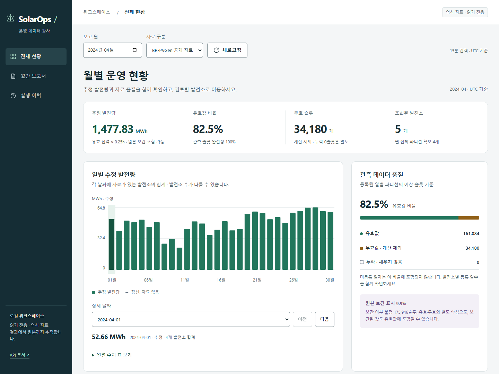
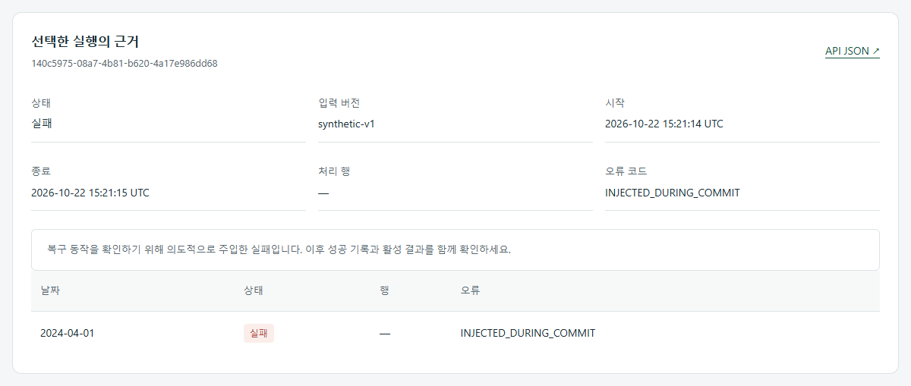

# SolarOps Audit — 결과를 재현하고 실패를 설명하는 데이터 파이프라인

태양광 발전량 차트에서 출발해 **입력의 품질, 재처리의 일관성, 결과의 출처**까지 설명하는 데이터 엔지니어링 프로젝트입니다. 공개 BR-PVGen과 합성 자료를 사용하며 고객 운영 실적이나 고장 탐지 정확도를 주장하지 않습니다.

공개 자료의 제작자·범위·다운로드는 [데이터 출처](../data-sources.md), 도구와 적용 범위는 [스킬 기록](../development/skills.md), 화면 출처는 [이미지 정보](images/readme-20261023/README.md)에 정리했습니다.

## 해결하려는 문제

자료가 존재한다고 모두 유효한 값인 것은 아닙니다. NULL, 누락, 원본에서 이미 보간된 값, 표본 수가 불명인 값을 구분하지 않으면 완전해 보이는 보고서가 잘못된 확신을 줄 수 있습니다. 재처리 중 일부가 실패했을 때 결과가 섞이거나, 보고서 숫자의 원본을 찾지 못하는 것도 운영상 문제입니다.

SolarOps는 이 문제를 입력 계약, 원자적인 일별 공개, 논리 해시, 보고서 스냅샷으로 다룹니다. 사용자에게는 월별 전체 현황 → 발전소 관측 자료 → 보고서·출처 → 실행 이력의 흐름으로 보여줍니다.

## 구현과 확인 가능한 증거

| 설명할 역량 | 구현 | 증거 |
|---|---|---|
| 데이터 계약과 품질 | 실제 공개 CSV 스키마, UTC, NULL·보간·표본 수, 중복 충돌 | [계약](../data-contract.md), [계약 검사](../../tests/test_contracts.py) |
| 재현성과 복구 | 원본 checksum, 명시 버전, 일별 트랜잭션, 실패 시 이전 활성 결과 유지 | [실행형 데모](../../scripts/demo/portfolio_demo.py), [회귀 검사](../../tests/test_pipeline.py) |
| 저장소와 배치 처리 | DuckDB·Arrow로 일별 정규화, PostgreSQL·MinIO | [51개 전체 처리 검증](../benchmarks/2026-10-22.md) |
| 오케스트레이션 | 같은 CLI를 Airflow LocalExecutor와 KPO에서 실행 | [DAG 운영](../runbooks/dags.md), [공개 자료 시나리오](../../scripts/validation/airflow_checks.py) |
| API 설계와 성능 | 월 범위의 단일 SELECT, 필요한 지표만 조회, API 팬아웃 제거 | [조회 모델](../../src/solarops/api/readmodels.py), [쿼리 수 회귀 검사](../../tests/test_workspace.py) |
| 운영 가시성 | 최신순·상태별 작업 이력, batch→partition 연결, 실패 원인 | [API](../../src/solarops/api/app.py), 실행 화면 |
| 전달과 재현 | OS별 CI, 실제 합성 보고서·검사 결과·wheel 아티팩트 | [GitHub Actions](https://github.com/TaeyanG4/solarops-audit/actions) |

## 숫자를 설명할 때 지킬 범위

- 공개 전체 처리: **51개 발전소, 인버터 14,400,480행, 12,572개 일별 파티션**. v0.1.0에서 실행한 측정이며 새 버전마다 전체 부하 검사를 반복한 것은 아닙니다.
- native와 PostgreSQL/MinIO 전체 결과의 논리 해시·지표가 일치했습니다. v0.2.0에서는 PS_001 하루를 native/Compose/kind에서 다시 비교했습니다.
- v0.3.0 월별 조회: 기존 요청 패턴 **53 HTTP 요청 → 1 HTTP 요청**. 같은 로컬 서비스·2024년 4월·전체 자료 종류로 각 5회 측정한 중앙값은 **703.239ms → 12.576ms**입니다. 새 API는 해당 월에 자료가 있는 발전소만 반환합니다. 응답 내용이 같지 않고 네트워크 요청 방식의 차이가 포함되므로 DB만의 속도 향상이나 일반 환경 성능 보장으로 표현하지 않습니다.
- 2024년 4월 화면의 공개 발전소는 **5개**입니다. 51개는 데이터셋 전체 범위이고 해당 월의 조회 대상 수와 다릅니다.
- 동시 Pod 1/2/4 성능은 766행의 작은 합성 작업으로 측정했습니다. 대규모 선형 확장성의 증거로 사용하지 않습니다.

[측정 상세와 재현 방법](../benchmarks/workspace-v0.3.0.md)

전체 버전·대안·선택 이유는 [기술 스택](../architecture/technology-stack.md), 파일별 책임과 커밋 경계는 [구조 안내](../architecture/system.md)를 참고합니다.

## 설명할 수 있어야 하는 설계 선택

**왜 일별 파티션을 공개 단위로 정했는가?** 월 전체보다 재시도 비용이 작고, 부분 실패의 경계가 명확합니다. 대신 여러 날짜를 처리하다 실패하면 앞서 완료한 날짜는 남을 수 있습니다. 전체 batch가 하나의 트랜잭션이라는 보장은 하지 않습니다.

**왜 파일 checksum과 논리 해시가 모두 필요한가?** 전자는 입력 파일이 같은지 확인합니다. 후자는 실행 ID·시각이 달라도 정규화된 자료와 지표·규칙이 같은지 확인합니다. 같은 소스 버전 이름으로 다른 내용을 넣으면 충돌로 중단합니다.

**왜 SQLite와 PostgreSQL을 함께 쓰는가?** SQLite는 별도 서버 없이 재현 가능한 합성 데모를 제공합니다. 운영 시나리오는 PostgreSQL의 트랜잭션과 잠금, MinIO의 객체 저장으로 별도 검증합니다. 두 환경의 결과 일치 검사도 수행했습니다.

**왜 Airflow와 Kubernetes를 분리했는가?** Airflow는 의존성·재시도·실행 기록을, KPO 작업 Pod는 CLI 실행의 자원 격리를 담당합니다. 핵심 변환 로직을 DAG에 복제하지 않았습니다. 이 규모에서 Kubernetes가 반드시 더 경제적이라고 주장하지 않습니다.

**왜 월별 품질을 단순 평균하지 않는가?** 10슬롯 중 5개 유효한 날과 90슬롯 모두 유효한 날의 비율은 `(5+90)/(10+90)=95%`입니다. 두 일별 비율을 평균한 75%와 다릅니다. 분모가 없을 때는 0%로 바꾸지 않습니다.

**왜 별도 프런트엔드 빌드 체인을 넣지 않았는가?** 읽기 중심의 작은 UI라 FastAPI가 HTML/CSS/JS를 함께 제공하도록 했습니다. 정적 자산은 wheel에 포함되며 Node는 JS 문법 검사에 사용합니다. 화면 규모와 팀 협업이 커지면 타입·컴포넌트 체계 도입을 다시 판단할 수 있습니다.

## 현재 한계와 다음 우선순위

*위 화면은 DEMO_01 합성 자료에 의도적으로 커밋 실패를 주입한 복구 검사입니다.*

1. 실제 현장 고장 라벨을 확보해 검토 후보 규칙의 유효성을 검증해야 합니다. 현재 0건은 “고장 없음”이 아닙니다.
2. 고객 스키마 어댑터, 인증, 보존·백업 정책은 실제 고객 도입 전에 별도 설계해야 합니다.
3. 대규모 운영 이력에서 JSON 필터가 병목이면 정규 컬럼과 인덱스를 추가합니다. 이번 월별 조회 측정만으로 모든 API 성능을 보장하지 않습니다.
4. 프로세스 강제 종료 직후 남은 running 상태의 자동 조정과 외부 경보는 아직 없습니다. 현재 UI는 저장된 상태를 표시합니다.

구현에는 AI 코딩 도구를 활용했습니다. 포트폴리오에서는 코드 양이나 도구 목록보다, 위 선택의 이유와 실제 실행 증거를 설명하는 데 집중합니다.

## 경계 실패로 설명하는 v0.4.1 개선

원본을 저장한 뒤 입력 파일을 바꾸는 테스트, 같은 버전의 다른 입력을 동시에 등록하는 테스트, 오래된 보고서가 늦게 끝나는 테스트를 먼저 실패시켰습니다. 보존 raw 처리·원자적 버전 claim·조건부 active 보고서 전환으로 고쳤고 SQLite뿐 아니라 PostgreSQL/MinIO에서도 확인했습니다. 조회가 DB나 버킷을 생성하던 부작용도 제거했습니다.

[실패 전후 증거](../benchmarks/integrity-v0.4.1.md)와 [설계 결정](../adr/0008-storage-integrity.md)은 정상 화면보다 강한 설명 자료입니다. 보고서 SHA 검증과 계산 논리 해시의 목적, 업로드와 DB 커밋의 경계, 늦은 완료를 처리하는 정책을 구체적인 코드와 연결할 수 있습니다.
