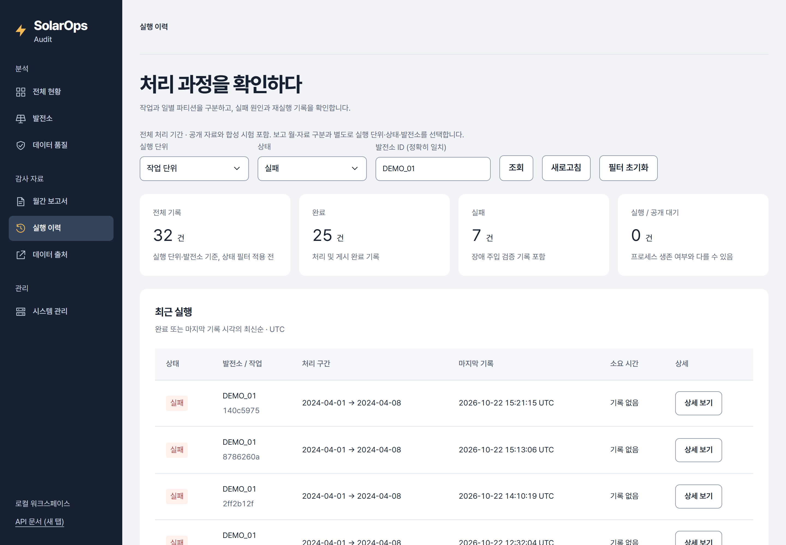

# 실행 이력 탐색 — 실제 화면

2026-10-23, Agent Browser로 로컬 Compose dashboard를 캡처했습니다. `view=runs&run_plant=DEMO_01&status=failed`, 전체 기간의 **합성 장애 주입 시험 이력**입니다. 32건 중 완료25·실패7은 과거 시험 기록이며 공개 발전소 장애·현재 서비스 장애가 아닙니다.

- [데스크톱 원본](runs-1440.png): CSS viewport1440×1000, DPR2, PNG2880×2000.
- [모바일 원본](runs-390.png): CSS viewport390×1000, DPR2, PNG780×2000.
- 생성형 이미지·재표본화·선명화·크롭 없이 원본 PNG를 보존했습니다. 원본 링크에서 확대할 수 있습니다. 뷰포트 캡처로 아래 표 전체는 포함하지 않습니다.
- [변경·검사·한계](../../../worklog/2026-10-23-run-navigation.md). 실제 모바일 기기가 아닌 Chrome의 뷰포트 확인입니다.

